# Domain model

Foundation document 2. Date: 2026-10-31. Status: for owner review. Governed by ADR-0005 (own fleets), ADR-0006 (allowlist), ADR-0007 (cash custody), ADR-0008 (offline outbox), ADR-0009 (SSE), ADR-0010 (VROOM), ADR-0011 (stock ledger), ADR-0012 (tracking mode and locations), ADR-0013 (channel publish), ADR-0014 (pack-time shipments), ADR-0018 (sites), ADR-0024 (outbox), ADR-0025 (tenancy), and the proposed ADR-0026 (bounded contexts), ADR-0027 (event envelope) and ADR-0028 (location pings); informs the contracts document (3) and the data architecture (5).

Seed: foundation plan section 4. Identity, roles, tokens and tenancy mechanics are in `identity-and-tenancy.md` (document 4); containers, CI and observability are in `platform.md` (document 6). Neither is repeated here.

Reading conventions. Invariants are numbered `K-` (shared kernel), `D-` (Delivery) and `W-` (WMS); a reviewer checks a PR against them by number. Table names below are logical; the physical name carries the context prefix (`core_`, `del_`, `wms_`), so ADR-0011's `stock_movements` is `wms_stock_movements`. Every aggregate has a UUIDv7 `id`, `account_id` (except where marked platform), `created_at` and `updated_at`; tables list only what is specific.

## 1. Bounded contexts

Three contexts in one PostgreSQL database (ADR-0019), one NestJS application (ADR-0003), separated by module folder and table prefix (ADR-0026).

| | Shared kernel | Delivery | WMS |
|---|---|---|---|
| Module folder | `apps/api/src/modules/kernel/` | `apps/api/src/modules/delivery/` | `apps/api/src/modules/wms/` |
| Table prefix | `core_` | `del_` | `wms_` |
| Owns | accounts, users, memberships, roles, API keys, sites, feature flags and rollout modes, limits and usage counters, sequences, audit log, idempotency keys, outbox and consumer receipts, channel connections and inbound webhooks | orders and their events, zones and coverage, drivers, vehicles, devices, shifts, locations telemetry, assignments, offers, capacity, slots, attempts, proofs, COD and cash custody, liability, deposits, cash reports, tracking tokens | locations and totes, products, lots, serials, suppliers, purchase orders, receipts, stock ledger and projections, reservations, fulfilment orders, pick tasks, packages, returns, adjustments, counts, consumables, channel publications |
| Publishes | `core.*` events (section 6) | `delivery.*` events | `wms.*` events |
| Reads from others | nothing; the kernel depends on no context | kernel ports only | kernel ports; Delivery `CoverageQueryPort` |
| Writes into others | never | never | only through `OwnFleetOrderPort` (below) |

Boundary rules (ADR-0026):

- A context's code imports another context only from that context's `public/` folder (ports, event payload types, DTOs). Drizzle table objects are private, so a cross-context join cannot be written without an import the architecture test rejects.
- Business code never joins across prefixes. Reporting views that span contexts live in the data architecture (document 5) and are read-only.
- Foreign keys from `del_` and `wms_` to `core_` (account, site) are allowed. No foreign key runs between `del_` and `wms_`; references are opaque UUIDs (`del_orders.source_ref`, `wms_packages.delivery_order_id`).
- Cross-context state changes happen by consuming domain events delivered through the outbox (ADR-0024, ADR-0027). The one exception is a synchronous command port, listed below, used where the user needs the result in the same request and both sides live in the same database.

### 1.1 Ports between contexts

| Port | Direction | Kind | Why this kind |
|---|---|---|---|
| `AccountContext` | kernel → all | sync read | request account, membership, sites from `AsyncLocalStorage` (document 4 §5) |
| `SitesQuery` | kernel → all | sync read | site kind, address, point, opening hours |
| `FeatureGate` | kernel → all | sync read | rollout mode and per-account flag (ADR-0006) |
| `SequenceAllocator` | kernel → all | sync, in caller's transaction | human numbers must be gap-free and roll back with the business write |
| `AuditWriter`, `OutboxWriter`, `IdempotencyStore` | kernel → all | sync, in caller's transaction | they must commit or roll back with the business write (ADR-0024) |
| `CoverageQuery` | WMS → Delivery | sync read | the pack bench shows the own-fleet card only when the address is covered from this site (ADR-0015) |
| `OwnFleetOrderPort.createFromPackage` | WMS → Delivery | sync command, same transaction, plus events | the packer needs the order number and label at the bench; both rows live in one database, so one transaction gives atomicity without a saga; the command emits `delivery.order.created` like any other intake (ADR-0014) |
| `RouteOptimizer`, `DistanceMatrix` | Delivery → VROOM, Hudhud | sync adapters, read-only computations | no side effect, so not an outbox case (ADR-0010) |
| `PaymentPort` | Delivery → provider | named, no adapter | ADR-0017 |
| Order lifecycle | Delivery → WMS | async events | the driver write path must never wait on or fail because of WMS; WMS reacts to `delivery.order.picked_up`, `.delivered`, `.returned` |
| Channel orders | kernel → WMS or Delivery | async event `core.channel_order.received` | the kernel cannot depend on contexts; the consumer is chosen by the account's flags (WMS fulfilment if enabled, else a Delivery order) |
| Carrier status | kernel → WMS | async event `core.carrier_update.received` | inbound Eeasy shipping webhooks are verified and stored by the kernel, then consumed by WMS |

### 1.2 Context diagram

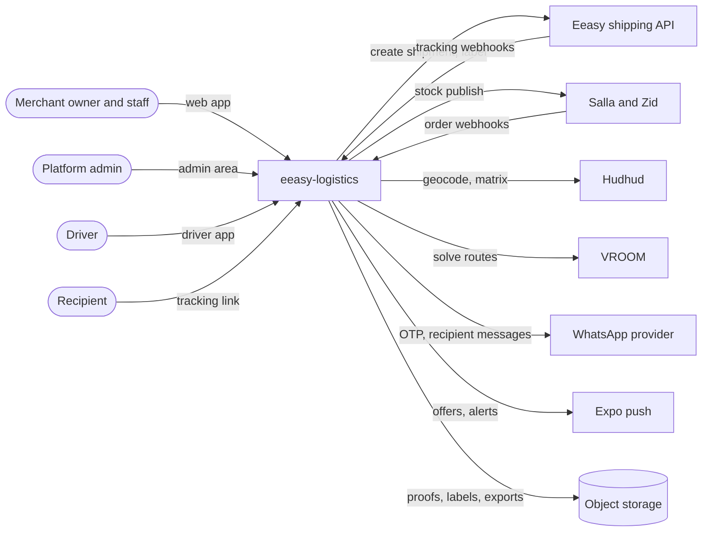

### 1.3 Container diagram

Consistent with `platform.md` §2.

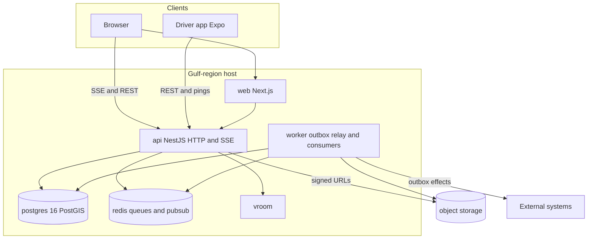

## 2. Shared kernel aggregates

### 2.1 Account

| | |
|---|---|
| Identity | `id`; platform table, no `account_id` |
| Attributes | name, country `SA`, default locale `ar` or `en`, timezone `Asia/Riyadh`, status, limits (orders per month, drivers, sites, API keys) and usage counters, `provisioned_by` |
| Lifecycle | `provisioned → active ⇄ suspended → closed` |

- K-1: an account exists only because a platform admin provisioned it; nothing is created on first use (ADR-0006).
- K-2: suspension pauses the account's outbox effects, rejects its API keys and ends its drivers' shifts; data is kept (document 4 §6).

### 2.2 User and Membership

Summary only; the authority is document 4 §1 to §4. A **user** is a person (platform table). A **membership** binds a user to one account with roles and `site_ids`. Drivers are users with a driver membership and a `del_drivers` row. API keys belong to the account.

- K-3: the account of every request comes from the token or key, never from a parameter or body (ADR-0025).

### 2.3 Site (ADR-0018)

| | |
|---|---|
| Attributes | `kind ∈ {branch, warehouse, both}`, name `ar`/`en`, address text, National Address short code, `point` geometry(Point, 4326), opening hours, staff assignments via membership `site_ids` |
| Lifecycle | `active ⇄ inactive`; never deleted once referenced |

- K-4: Delivery dispatch, coverage and cash custody reference sites with kind `branch` or `both`; WMS locations reference sites with kind `warehouse` or `both`.
- K-5: a site cannot become inactive while it has orders not in a terminal state, unsettled cash, or stock on hand.

### 2.4 FeatureFlag and RolloutMode (ADR-0006)

| | |
|---|---|
| RolloutMode | platform row per feature key: `off`, `allowlist` or `all`, default `allowlist`, written only by a platform super admin |
| FeatureFlag | per account and feature key: `enabled`, `provisioned_by` (platform user), `enabled_at` |

- K-6: a feature is visible to an account iff its mode is `all`, or its mode is `allowlist` and the account flag is enabled with `provisioned_by` set. Every change writes an audit row.

### 2.5 AuditLog

Append-only `core_audit_log` (document 4 §7): actor, acting account, target type and id, action, before and after (redacted), request id, IP, user agent.

- K-7: update and delete are rejected by trigger. Admin and ledger-adjacent actions write the row in the same transaction as the change.

### 2.6 IdempotencyKey

| | |
|---|---|
| Key | `(account_id, principal_id, key)` unique; principal is the user, device or API key |
| Attributes | route, request hash (SHA-256 of method, path, body), response status and body, `expires_at = created_at + 24 h` |

- K-8: a replay with the same key and hash returns the stored response; same key and different hash returns `422 idempotency_key_reused`; a key is reserved before the business write, in the same transaction.
- K-9: after 24 hours the row is purged; driver writes stay deduplicated beyond that window by the permanent unique key on `del_order_events` (D-15).

### 2.7 Outbox and consumer receipts (ADR-0024, ADR-0027)

| | |
|---|---|
| `core_outbox` | the event envelope (section 6) plus delivery state: `kind` (internal event, webhook, message, push, channel publish, carrier call, `storage_lifecycle` (ADR-0036)), `status ∈ {pending, enqueued, done, dead, superseded}`, attempts, `next_attempt_at`, last error, `supersede_key` (amended 2026-10-31, roadmap A-10) |
| `core_consumer_receipts` | `(consumer, event_id)` unique; written in the consumer's transaction so a redelivered event is a no-op |

- K-10: an outbox row is written in the same transaction as the business change; envelope columns are immutable (trigger); only delivery-state columns change.
- K-11: one dead row never blocks others; it blocks only later rows for the same aggregate when the consumer requires order (section 6.2).

## 3. Delivery context aggregates

### 3.1 Order

| Attribute | Notes |
|---|---|
| `number` | per-account sequence from `SequenceAllocator` inside the transaction, shown as e.g. `D-000123` |
| `kind` | `∈ {delivery, return_pickup, exchange, pickup_request}` |
| `status` | state machine 3.13 |
| `site_id` | the dispatching site (kind `branch` or `both`) |
| `source`, `source_ref` | `∈ {manual, csv, api, channel, wms_package}`; opaque external or package id |
| recipient | name, phone (E.164), alternate phone, preferred language |
| address | text, city, district, `national_address_short_code`, `point` geometry(Point, 4326), `pin_source ∈ {geocoded, recipient_pin, driver_pin, manual}`, geocode confidence |
| `pending_reason` | why a `pending` order waits: `outside_coverage` (D-3), `needs_location` (no reliable point, integrations §6.2; DEL-2), `awaiting_review`; null once it leaves `pending` |
| `zone_id`, `slot_id` | resolved at acceptance; slot optional |
| `cod_amount` | integer halalas, `currency` `SAR`; zero when no COD |
| `executor_account_id` | nullable, reserved, nothing built on it (ADR-0005, D-1) |
| `current_assignment_id`, `attempt_count`, `max_attempts` | denormalised for dispatch boards |
| `version` | optimistic concurrency (section 8) |

Kinds: `delivery` carries goods to the recipient; `return_pickup` collects from the recipient and ends at the site; `exchange` does both in one stop, with items marked `direction ∈ {out, in}`; `pickup_request` collects from a third party (a supplier or a merchant's other address) to the site. All kinds share one state machine; "delivered" means handed over at the kind's destination.

### 3.2 OrderItem

Order line: name `ar`/`en`, SKU, quantity, `direction` (`out` default, `in` for return and exchange), optional `wms_product_id` (opaque), declared value in halalas. Immutable after `picked_up`.

### 3.3 OrderEvent (ADR-0008)

Append-only `del_order_events`: `order_id`, `type` (transition or note), `from_status`, `to_status`, actor (user, driver, system), `device_id`, `client_ts`, `server_ts`, `idempotency_key`, `point`, payload (reason code, proof ids, collection ids). The order's `status` column is the fold of its events, written in the same transaction.

### 3.4 Zone and coverage

| | |
|---|---|
| Zone | name `ar`/`en`, `boundary` geometry(MultiPolygon, 4326) with a GiST index, source (official boundary or drawn), active |
| Coverage | `(site_id, zone_id)` rows created with the account by the provisioning door (ADR-0015) |

### 3.5 Driver, Vehicle, DriverDevice

| Aggregate | Attributes |
|---|---|
| Driver | `user_id`, the account's own name for the driver (`del_drivers.name`, not the person's: a person may drive for several accounts, DEL-4 adversary H-3), home `site_id`, status `∈ {active, suspended, archived}`, `cash_blocked_at` and `cash_blocked_reason` (D-11), capacity limit |
| Vehicle | plate, kind (car, van, motorbike), capacity in parcels, active |
| DriverDevice | device id, platform, app version, Expo push token, `revoked_at`; at most two active per driver (document 4 §3.2) |

### 3.6 DriverShift

`driver_id`, `site_id`, `vehicle_id`, `planned_start`, `planned_end`, `started_at`, `ended_at`, status (state machine 3.17). Going on shift starts position reporting; going off stops it (ADR-0009).

### 3.7 DriverLocation (ADR-0009, ADR-0028)

Telemetry, not an aggregate with invariants beyond retention: see section 7.

### 3.8 Assignment, Offer, CapacityCounter

| Aggregate | Attributes |
|---|---|
| Assignment | `order_id`, `driver_id`, `vehicle_id`, `shift_id`, `assigned_by`, `started_at`, `ended_at`, `end_reason ∈ {completed, reassigned, unassigned, returned}`, `version` |
| Offer | `order_id`, `driver_id`, `status` (state machine 3.14), `sent_at`, `expires_at`, `responded_at`, `wave` (auto-dispatch round) |
| CapacityCounter | `(driver_id)` with `active_orders`, `limit`; one row per driver |

### 3.9 Slot and SlotDay

SlotDay: `(site_id, zone_id, date)` with open or closed. Slot: window `starts_at`, `ends_at`, `capacity`, `booked`. An order books a slot at acceptance or reschedule.

### 3.10 Attempt and Proof

| Aggregate | Attributes |
|---|---|
| Attempt | `order_id`, `assignment_id`, number, `status` (state machine 3.15), reason code from the account's list, note, `point`, `client_ts` |
| Proof | `order_id`, `attempt_id`, `kind ∈ {photo, signature, recipient_otp, id_check}`, storage key, `upload_status ∈ {pending_upload, stored, failed}`, sha256; read only through expiring signed URLs (ADR-0015) |

### 3.11 Cash: CodCollection, CashHandover, DriverLiabilityEntry, CashDeposit, CashReport (ADR-0007)

| Aggregate | Attributes | Writes |
|---|---|---|
| CodCollection | `order_id`, `driver_id`, amount halalas, `method ∈ {cash, card, mada, wallet}`, external reference for non-cash | insert-only |
| Custody entry | `collection_id`, `from_custody`, `to_custody ∈ {collected, with_cashier, with_bank, not_held}`, holder (driver, cashier at site, bank account), `handover_id` or `deposit_id`, `recorded_by` | append-only ledger; current custody is the latest entry |
| CashHandover | `driver_id`, `site_id`, `cashier_id`, expected amount (sum of collected cash), counted amount, `status ∈ {requested, confirmed, rejected}`, driver PIN check time | mutable status until confirmed |
| DriverLiabilityEntry | `driver_id`, signed amount (positive deficit, negative surplus or clearance), reason, `handover_id`, `recorded_by` | append-only |
| CashDeposit | `site_id`, amount, bank reference, slip storage key, `deposited_at`, `recorded_by`, collection ids | insert-only; corrections are reversing deposits |
| CashReport | `site_id`, business date, totals by method, deficits, `status ∈ {open, closed}`, `closed_by` | immutable once closed |

### 3.12 TrackingToken

`order_id`, `purpose ∈ {track, reschedule, address_pin}`, `expires_at`, `revoked_at`. The link carries an HMAC token (document 4 §3.5); the row exists for revocation and audit.

### 3.13 Order state machine

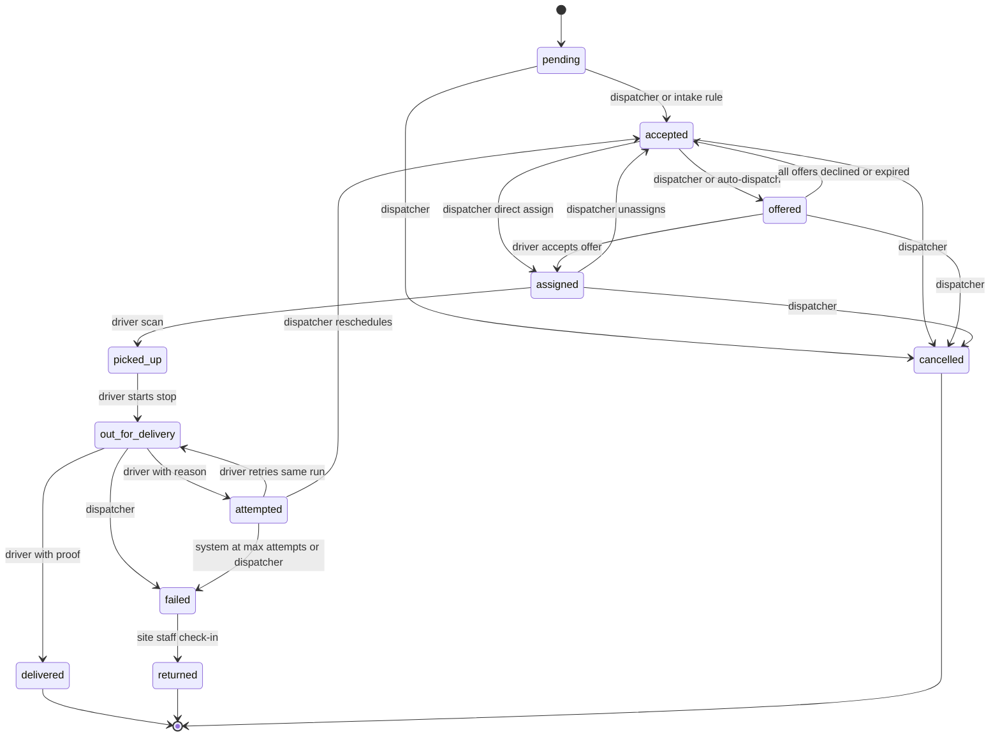

| Actor | Transitions |
|---|---|
| Driver (current assignee only) | offered→assigned, assigned→picked_up, picked_up→out_for_delivery, out_for_delivery→delivered, out_for_delivery→attempted, attempted→out_for_delivery |
| Dispatcher | pending→accepted, accepted→offered, accepted→assigned, assigned→accepted, attempted→accepted, attempted→failed, out_for_delivery→failed, any pre-pickup state→cancelled |
| Site staff | failed→returned |
| System | pending→accepted (auto-accept rule), accepted→offered (auto-dispatch), offered→accepted (expiry), attempted→failed (max attempts) |

Terminal: `delivered`, `returned`, `cancelled`. Reassignment between drivers while `assigned` or `picked_up` is an Assignment change (transfer), not a status change. Cancelling after pickup goes through `failed` → `returned`, because the parcel is physically with a driver.

### 3.14 Offer state machine

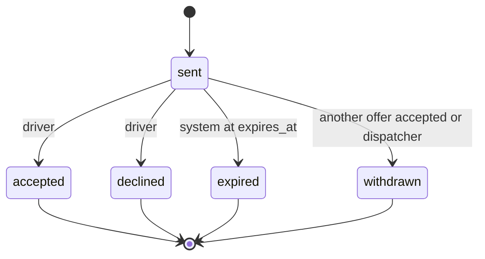

### 3.15 Attempt state machine

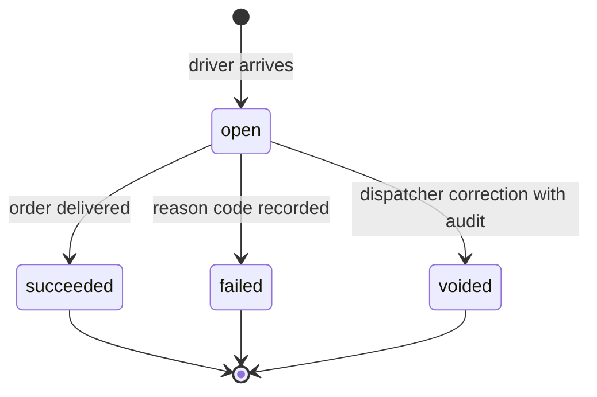

### 3.16 COD custody state machine

Derived from the append-only custody entries; each arrow is one entry.

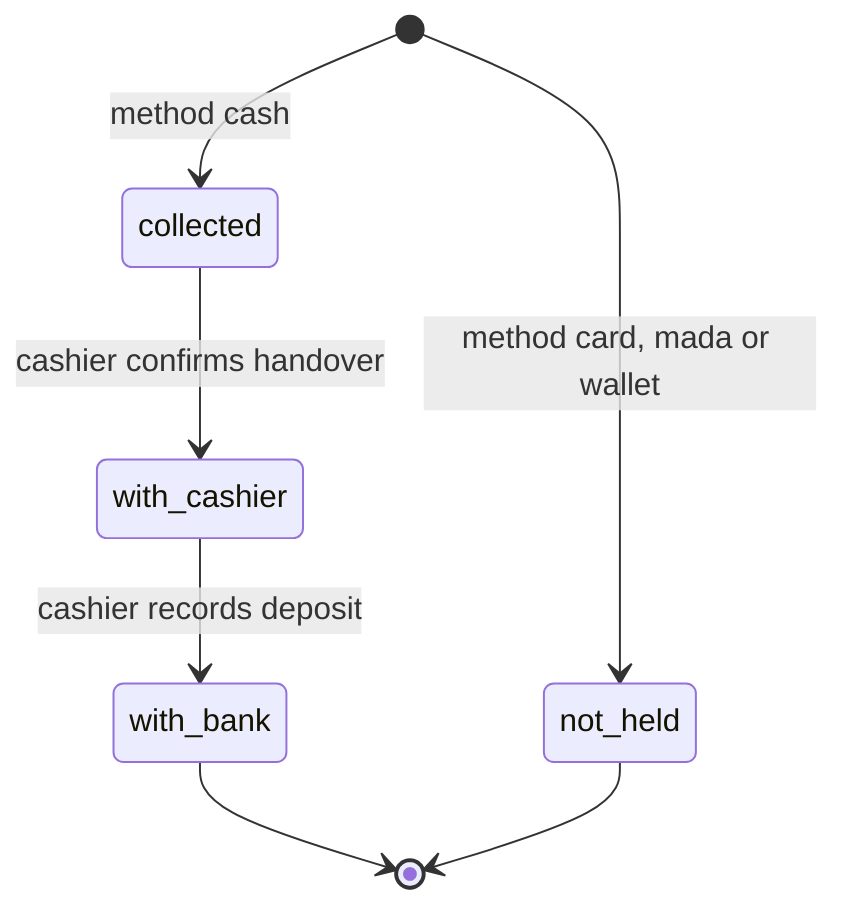

### 3.17 DriverShift state machine

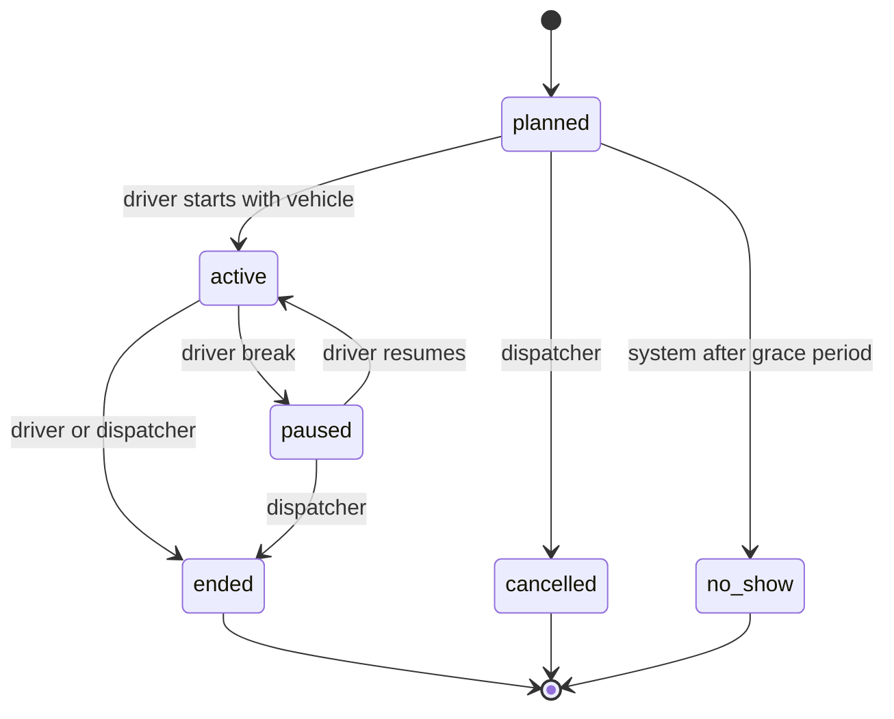

### 3.18 Delivery invariants

- D-1: `del_orders.executor_account_id` is always NULL, enforced by a CHECK constraint until an ADR supersedes ADR-0005; no code reads or writes it.
- D-2: `number` is unique per account, monotonic and gap-free, allocated by `SequenceAllocator` in the creating transaction.
- D-3: an order leaves `pending` only if its address point lies inside a zone covered by its site; otherwise it stays `pending` with the typed reason `outside_coverage` (ADR-0015). Intake rules "receive as pending" and "auto-accept" are account settings evaluated at creation.
- D-4: `cod_amount` is a non-negative integer in halalas; it is non-zero only for kinds `delivery` and `exchange`.
- D-5: only the transitions in 3.13, by the listed actor, are legal; any other request returns `409` with the current status and version (ADR-0008).
- D-6: driver transitions are accepted only from the driver of the order's active assignment, identified by the token, during an `active` or `paused` shift, except as D-23 allows for work completed before a reassignment.
- D-7: an order is delivered only from `out_for_delivery` and only by its current assignee, with the proofs the account's proof policy requires recorded (upload may lag, D-17) and, when `cod_amount > 0`, CodCollections whose amounts sum exactly to `cod_amount`, in the same transaction.
- D-8: `delivered`, `returned` and `cancelled` are terminal; corrections after a terminal state are audited notes and liability or custody entries, never a status change.
- D-9: an order has at most one assignment with `ended_at IS NULL` (partial unique index).
- D-10: a driver's `CapacityCounter.active_orders` equals the count of that driver's open assignments; it changes in the same transaction as the assignment; on reassignment the old holder is decremented and the new one incremented; it never goes below zero or above `limit`.
- D-11: a driver holding cash with custody `collected` from a previous business day (Asia/Riyadh) is `cash_blocked`: no offer may be sent to them and no assignment created until a supervisor clears it, with an audit row (ADR-0007).
- D-12: offers and assignments go only to drivers who are `active`, not cash-blocked, on an `active` shift with a vehicle, and whose site covers the order's zone.
- D-13: an order has at most one `sent` offer per driver; the first acceptance wins under a row lock on the order, and every other `sent` offer for that order becomes `withdrawn` in the same transaction.
- D-14: every `attempted` transition creates a `failed` Attempt with a reason code; when `attempt_count` reaches `max_attempts` (account setting, default 3) the system moves the order to `failed`.
- D-15: `del_order_events` is append-only (trigger) and `(account_id, idempotency_key)` is unique forever; a replayed driver write returns the original result (ADR-0008).
- D-16: driver events for one order are applied in the order the app replays them; if a dispatcher change happened in between, the driver event is rejected with `409` unless D-23 applies, and the app shows it on the sync screen.
- D-17: a proof row is written with the status change (`pending_upload`); the file follows; a proof still `pending_upload` 24 hours after delivery raises an alert, never reverses the delivery.
- D-18: a CodCollection with method `cash` starts with custody `collected` held by the driver; methods `card`, `mada` and `wallet` start and stay `not_held` and never enter cash totals, handovers or liability (ADR-0007, ADR-0017).
- D-19: custody moves only forward (3.16); each move is a new custody entry recorded by the receiver (the cashier for a handover, the cashier for a deposit), never by the driver; custody entries are never updated or deleted (trigger).
- D-20: confirming a handover writes custody entries for every included collection and, if counted differs from expected, one DriverLiabilityEntry for the difference, in the same transaction; a driver's liability balance is the sum of their entries.
- D-21: a CashReport for a site and business date closes only when every cash collection of that date is `with_cashier` or `with_bank` and every difference has a liability entry; a closed report is immutable.
- D-22: dispatcher writes to Order and Assignment send the `version` they read (`If-Match`); a mismatch returns `409` (section 8).
- D-23: field facts win for completed work: a `delivered` or `attempted` event from a driver who was the assignee at its `client_ts` is accepted even if a dispatcher reassigned or unassigned the order after that `client_ts`; the dispatcher change is superseded and the dispatcher is alerted (open question 1).
- D-24: a tracking token reveals only the order's public view (status, ETA, driver first name, last position while `out_for_delivery`) and expires per document 4 §3.5.

## 4. WMS context aggregates

### 4.1 Location tree and totes (ADR-0012)

| | |
|---|---|
| Attributes | `site_id`, `parent_id`, `type ∈ {site_root, zone, aisle, rack, shelf, bin, tote, dock, transit, returns, quarantine, system}`, code, generated `path`, optional coordinates, `pickable`, `active` |
| System locations | per account, `type = system`, codes `SUPPLIER`, `CUSTOMER`, `ADJUSTMENT` (ADR-0011); no site, no parent |

A tote is a movable location whose `parent_id` changes when it moves. `dock` (packed goods awaiting pickup), `transit` (goods with a driver or carrier) and `returns` are ordinary per-site locations created with the site (see open question 2).

### 4.2 Product, Lot, Serial

| Aggregate | Attributes |
|---|---|
| Product | SKU, barcodes, name `ar`/`en`, `tracking_mode ∈ {none, lot, serial}`, unit, weight and dimensions, `is_consumable`, active |
| Lot | `product_id`, lot code, expiry date, received at |
| Serial | `product_id`, serial number unique per product |

### 4.3 Supplier, PurchaseOrder, InboundReceipt

| Aggregate | Attributes |
|---|---|
| Supplier | name, contact, VAT number |
| PurchaseOrder | `number` (per-account sequence), `supplier_id`, `site_id`, lines (product, quantity, unit cost halalas), `status ∈ {draft, sent, partially_received, received, closed, cancelled}` |
| InboundReceipt | `number` (per-account sequence), `site_id`, optional `purchase_order_id`, lines (product, lot or serial, expected, received, damaged), receiving location, `status` (state machine 4.11) |

### 4.4 StockMovement (ADR-0011)

Append-only `wms_stock_movements`: `batch_id` (one business operation), `product_id`, `lot_id`, `serial_id`, `quantity > 0`, `from_location_id`, `to_location_id`, `reason ∈ {receipt, putaway, pick, pack, handover, delivery, return, adjustment, count, consumption, transfer}`, `ref_type` and `ref_id` (receipt, pick task, package, count session), `ledger_seq` (bigint identity, the projection cursor), `recorded_by`.

### 4.5 StockLevel, StockSummary, Reservation

| Projection | Grain | Maintained |
|---|---|---|
| StockLevel | `(location, product, lot, serial)`: `on_hand` | in the movement's transaction by the ledger service, under a row lock |
| StockSummary | `(product)`: `on_hand`, `reserved`, `available`, `version` | asynchronously by a cursor over `ledger_seq`, reading only rows below the oldest in-flight transaction so a late commit is never skipped |
| Reservation | `(fulfilment_order_line, product, lot)`: quantity | mutable, not a ledger; created by allocation, released by pick or cancel |

A nightly assertion recomputes both projections from the ledger and alerts on any difference (ADR-0011, `platform.md` §7). Maintaining StockLevel inside the movement's transaction refines ADR-0011 rather than departing from it: the ledger stays the only source of truth, StockLevel is a cache the ledger service keeps current so W-6 can be checked under a lock, and both projections can be dropped and rebuilt from `ledger_seq` zero at any time.

### 4.6 FulfilmentOrder and PickTask

| Aggregate | Attributes |
|---|---|
| FulfilmentOrder | `number`, `site_id`, `source ∈ {channel, manual, api}`, `source_ref`, recipient and address snapshot, COD amount halalas, lines (product, quantity, picked, packed), `status` (4.12), `version` |
| PickTask | `fulfilment_order_id` (or a wave of them), picker, lines (location, product, lot or serial, quantity, picked), target tote, `status` (4.13) |

### 4.7 Package (ADR-0014)

| Attribute | Notes |
|---|---|
| `fulfilment_order_id`, contents | lines packed into this package |
| `weight_g`, `length_mm`, `width_mm`, `height_mm` | measured at the bench; required before a method is chosen |
| `fulfilment_method` | `∈ {own_fleet, carrier}` |
| `delivery_order_id` | own fleet: opaque id returned by `OwnFleetOrderPort` |
| `carrier_code`, `awb`, `label_storage_key`, `eeasy_shipment_id` | carrier: stored when the Eeasy shipping call succeeds |
| `status` | state machine 4.14 |

### 4.8 Return, Adjustment, CountSession, Consumable

| Aggregate | Attributes |
|---|---|
| Return | `site_id`, source (delivery order returned, carrier return, walk-in), lines (product, lot or serial, quantity, condition), disposition per line `∈ {restock, quarantine, scrap}`, `status ∈ {expected, received, dispositioned}` |
| Adjustment | lines, reason code, `requested_by`, `approved_by`; posts ADJUSTMENT movements |
| CountSession | `site_id`, scope (locations or products), blind or not, lines (system quantity at start, counted, variance), `counted_by`, `approved_by`, `status` (4.15) |
| Consumable | a Product with `is_consumable`; packing records consumption as a movement to ADJUSTMENT with reason `consumption` |

### 4.9 ChannelPublication (ADR-0013)

`wms_channel_publications`: `connection_id` (kernel channel connection), `product_id`, `quantity`, `status ∈ {pending, sent, failed, dead, superseded}`, attempts, `next_attempt_at`, `superseded_by`, channel response. A dedicated outbox, executed by the worker like `core_outbox` (ADR-0024).

### 4.10 Allocation note

Available quantity is `on_hand − reserved` over pickable locations of the site. Allocation reserves; picking moves stock and releases the reservation in the same transaction.

### 4.11 InboundReceipt state machine

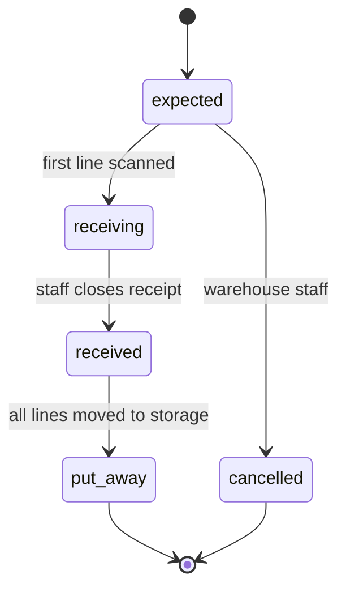

### 4.12 FulfilmentOrder state machine

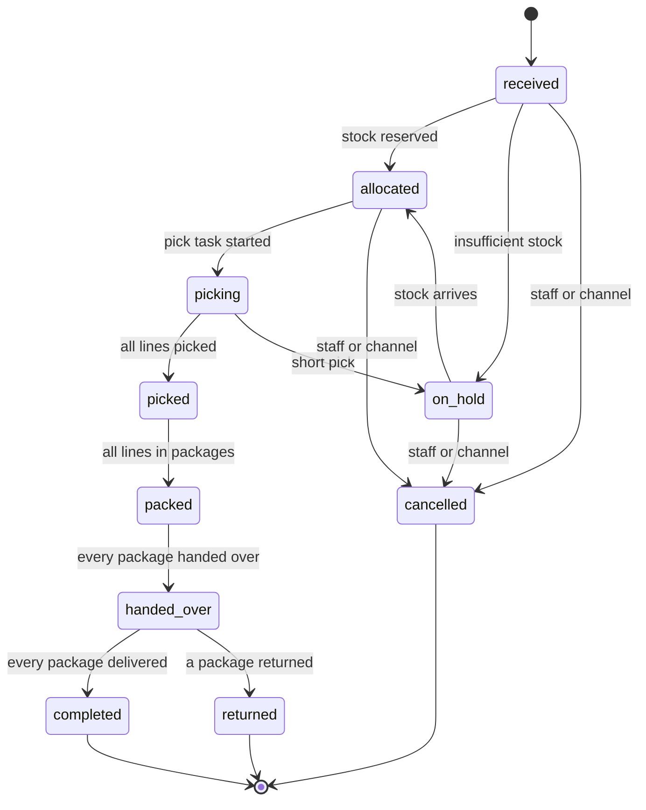

### 4.13 PickTask state machine

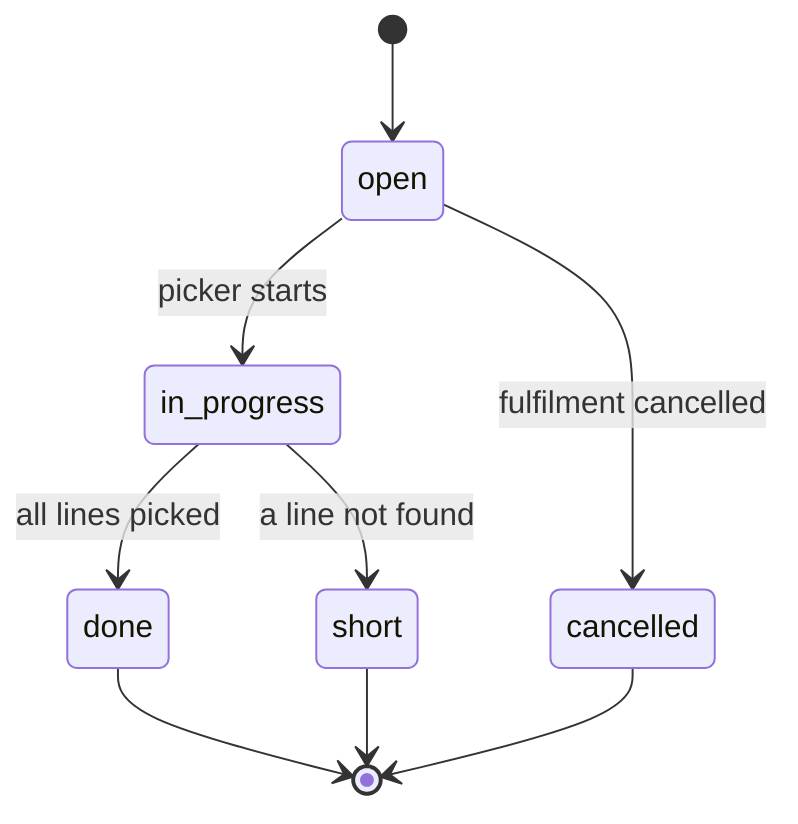

### 4.14 Package state machine

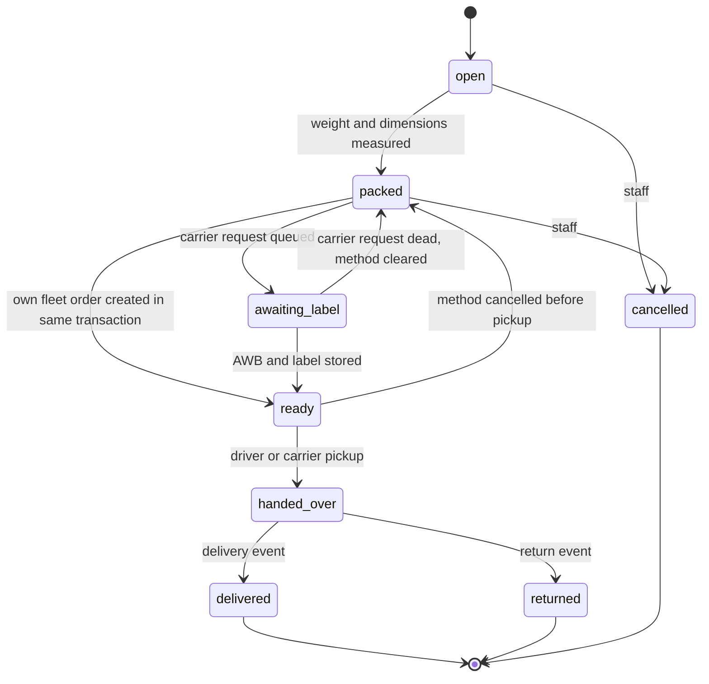

### 4.15 CountSession state machine

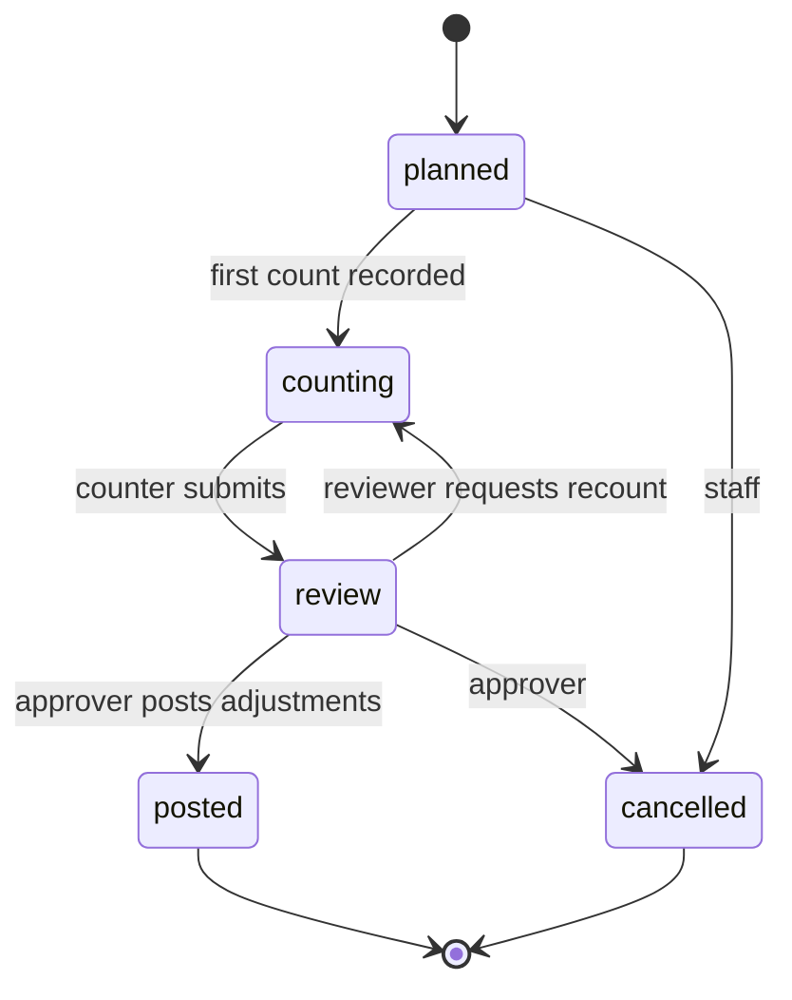

### 4.16 WMS invariants

- W-1: every location belongs to the account; non-system locations belong to a site of kind `warehouse` or `both`; a parent is on the same site; the tree has no cycles.
- W-2: a tote's parent changes only through a transfer movement batch; a tote never contains a tote.
- W-3: `tracking_mode` cannot change once the product has any movement.
- W-4: a movement carries `lot_id` iff the product mode is `lot`, and `serial_id` iff it is `serial`; a serial movement has quantity 1; a serial is on hand in exactly one location.
- W-5: `wms_stock_movements` is append-only (trigger); `quantity > 0`; `from ≠ to`; at most one side is a system location; rows are written only by the ledger service (ADR-0011, ADR-0020).
- W-6: `on_hand` in a non-system location never goes negative; the ledger service checks under the StockLevel row lock and a CHECK constraint backs it.
- W-7: StockLevel changes in the movement's transaction; StockSummary trails by at most the cursor lag; the nightly assertion is green or an alert is open.
- W-8: allocation reserves at most `available`; a reservation is released exactly once, by pick or cancel.
- W-9: a pick moves stock from the pick location to the task's tote and releases the reservation in one transaction; a short pick puts the fulfilment order `on_hold`.
- W-10: a package gets a fulfilment method only when `packed` with weight and all three dimensions greater than zero (ADR-0014).
- W-11: choosing `own_fleet` calls `OwnFleetOrderPort.createFromPackage` in the same transaction and stores the returned `delivery_order_id`; it is refused with a typed reason when `CoverageQuery` says the address is not covered.
- W-12: choosing `carrier` writes an outbox row for the Eeasy shipping API (ADR-0024); this product never computes carrier prices or AWBs (ADR-0001, ADR-0014).
- W-13: a package has one active method; switching requires cancelling the Delivery order or voiding the AWB first, and is forbidden after `handed_over`.
- W-14: stock leaves the warehouse in steps: tote → `dock` at pack, `dock` → `transit` at handover, `transit` → CUSTOMER on `delivery.order.delivered` or a carrier delivered update, each idempotent per package (consumer receipt).
- W-15: a receipt moves SUPPLIER → receiving location; receiving above the PO line plus the account tolerance needs an approver.
- W-16: a count posts variances as ADJUSTMENT movements; above the account threshold the approver is not the counter (document 4 §2).
- W-17: a return moves CUSTOMER → `returns`; disposition is a further movement (`restock` to a storage location, `quarantine`, `scrap` to ADJUSTMENT).
- W-18: at most one `pending` publication exists per (connection, product); a newer one supersedes it; quantities read from a channel never write the ledger (ADR-0013).

## 5. Cross-context flows

Notation: solid arrows `->>` are synchronous calls (HTTP requests or in-process port calls); dashed arrows `-->>` are their synchronous replies; a shaded box is one database transaction; dashed open arrows `--)` are outbox events or effects relayed by the worker after commit.

### 5.1 Channel order to delivered parcel

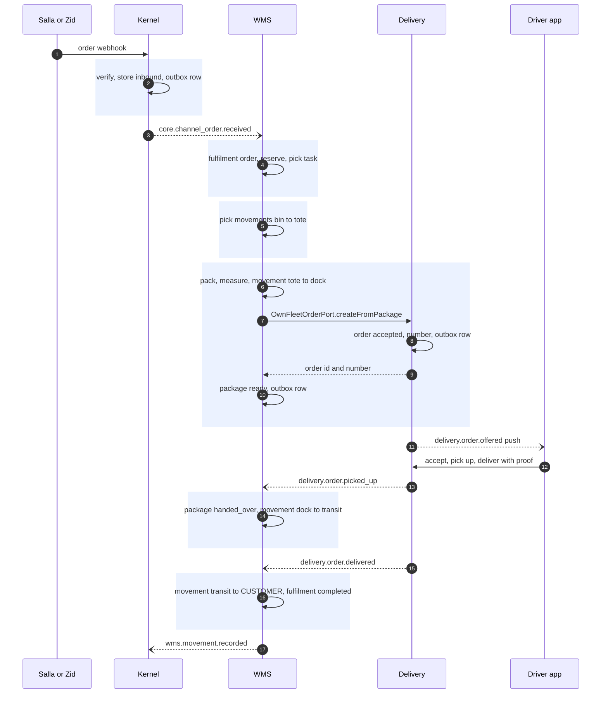

### 5.2 COD collected offline to bank

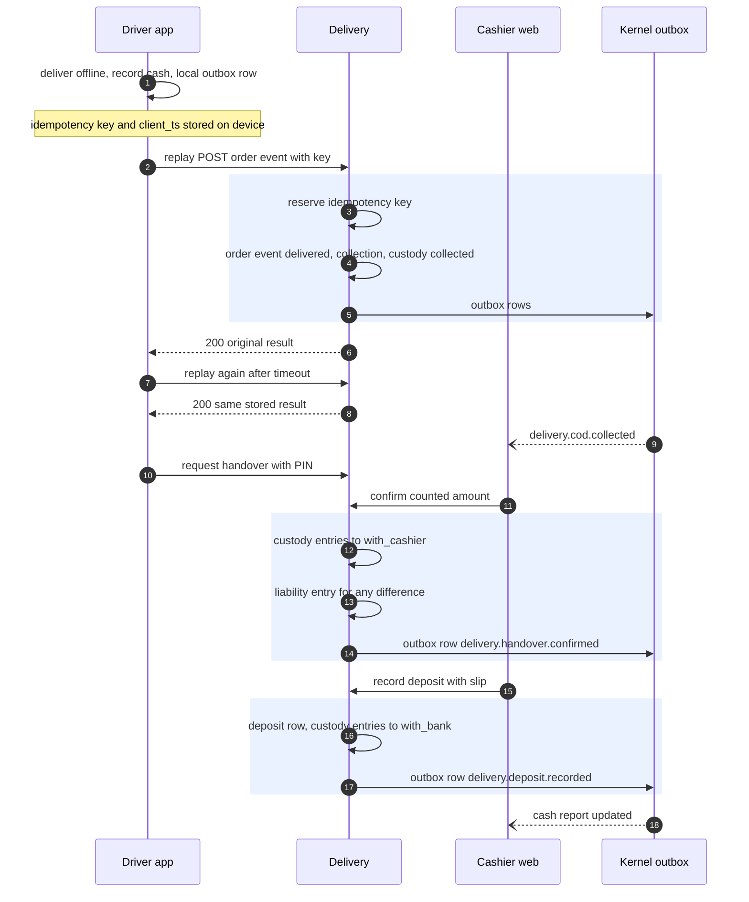

### 5.3 Stock movement to channel publication

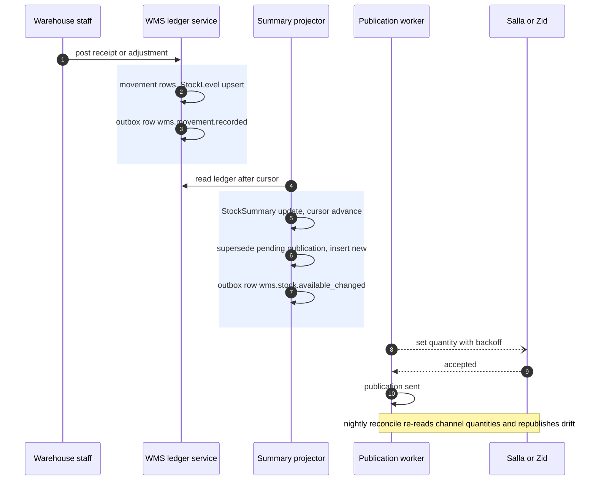

## 6. Domain event catalogue

### 6.1 Envelope (ADR-0027)

| Field | Type | Rule |
|---|---|---|
| `id` | UUIDv7 | unique; consumers deduplicate on it |
| `type` | string | `<context>.<aggregate>.<past_tense_verb>`, snake_case parts |
| `version` | integer | payload schema version; additive changes keep it; a breaking change bumps it and the old version is emitted in parallel for one wave |
| `occurred_at` | timestamptz | server time of the business change |
| `account_id` | UUID | tenancy; never null for operational events |
| `aggregate_type`, `aggregate_id` | string, UUID | the ordering scope |
| `sequence` | integer | per aggregate, from the aggregate's `version` after the change |
| `causation_id` | UUID | the event or request id that caused this one |
| `correlation_id` | UUID | the originating request or channel order, carried through the chain |
| `payload` | JSON | snake_case, money as halalas plus currency |

### 6.2 Delivery guarantees

At least once. Ordered per `aggregate_id`: the relay enqueues with the aggregate id as the group key, and a consumer that receives `sequence` n+2 before n+1 parks it until n+1 is processed. Internal consumers record `(consumer, event_id)` in `core_consumer_receipts`. Merchant webhooks carry the envelope and are signed (document 4 §8); receivers order by `sequence`.

### 6.3 Catalogue

Idempotency key is the envelope `id` unless stated. "Webhook" means exposed to merchants in document 3.

| Event | Producer | Consumers | Payload summary | Webhook |
|---|---|---|---|---|
| `core.account.provisioned` | kernel | kernel (defaults, coverage step) | account, limits, modules | no |
| `core.account.suspended` | kernel | Delivery (end shifts), kernel relay (pause) | reason | no |
| `core.account.reactivated` | kernel | Delivery (shifts may start again); the relay resumes from the status alone (A-26, PLAT-13) | reason | no |
| `core.account.closed` | kernel | none in wave 0; the wave 1 export and deletion tool (A-26, PLAT-13) | reason | no |
| `core.feature_flag.changed` | kernel | all (cache bust) | feature key, mode or enabled | no |
| `core.site.updated` | kernel | Delivery, WMS (cache bust) | site, kind, point | no |
| `core.channel_order.received` | kernel | WMS or Delivery by account flags | connection, channel order ref, recipient, address, lines, COD | no |
| `core.carrier_update.received` | kernel | WMS | Eeasy shipment id, AWB, status, time | no |
| `delivery.order.created` | Delivery | WMS (if `source = wms_package`) | number, kind, source, recipient, address, COD | yes |
| `delivery.order.updated` | Delivery | Delivery dispatch (DEL-6 board) | order, number, changed keys (COD or address edited after acceptance; DEL-2) | no |
| `delivery.order.accepted` | Delivery | Delivery dispatch | zone, slot | yes |
| `delivery.order.offered` | Delivery | push effect | driver ids, expiry | no |
| `delivery.order.assigned` | Delivery | push effect, recipient message | driver, vehicle | yes |
| `delivery.order.picked_up` | Delivery | WMS (handover) | driver, time | yes |
| `delivery.order.out_for_delivery` | Delivery | recipient message with tracking link | ETA | yes |
| `delivery.order.attempted` | Delivery | recipient message | attempt number, reason code | yes |
| `delivery.order.delivered` | Delivery | WMS (CUSTOMER movement), recipient message | time, point, proof ids, COD summary | yes |
| `delivery.order.failed` | Delivery | dispatcher alert | reason | yes |
| `delivery.order.returned` | Delivery | WMS (return expected) | site, items | yes |
| `delivery.order.cancelled` | Delivery | WMS (package back to packed) | reason, actor | yes |
| `delivery.order.rescheduled` | Delivery | recipient message | new slot | yes |
| `delivery.offer.expired` | Delivery | auto-dispatch next wave | order, driver | no |
| `delivery.proof.stored` | Delivery | none (webhook) | kind, signed URL on request | yes |
| `delivery.cod.collected` | Delivery | cash report | amount, method, custody | yes |
| `delivery.handover.confirmed` | Delivery | cash report | driver, site, expected, counted | no |
| `delivery.liability.recorded` | Delivery | driver block check | driver, signed amount, reason | no |
| `delivery.deposit.recorded` | Delivery | cash report | site, amount, bank reference | no |
| `delivery.driver.cash_blocked` | Delivery | dispatcher alert | driver, held amount, since | no |
| `delivery.shift.started` / `.ended` | Delivery | telemetry gate | driver, vehicle, site | no |
| `wms.inbound_receipt.received` | WMS | none (webhook) | lines, discrepancies | yes |
| `wms.movement.recorded` | WMS | audit export, analytics | batch id, lines, reason, ref | no |
| `wms.stock.available_changed` | WMS | channel publication | product, available, on hand | yes |
| `wms.fulfilment_order.created` | WMS | none (webhook) | number, source ref | yes |
| `wms.fulfilment_order.on_hold` | WMS | staff alert | short lines | yes |
| `wms.package.packed` | WMS | none (webhook) | weight, dimensions, method | yes |
| `wms.package.shipment_created` | WMS | none (webhook) | carrier, AWB, label link | yes |
| `wms.package.handed_over` | WMS | none (webhook) | method, time | yes |
| `wms.fulfilment_order.completed` | WMS | none (webhook) | packages | yes |
| `wms.return.received` | WMS | none (webhook) | lines, condition | yes |
| `wms.count_session.posted` | WMS | none | variances | no |
| `wms.channel_publication.dead` | WMS | staff alert | connection, product, last error | no |

Order status events (DEL-2): every arrow of 3.13 goes through Delivery's one write path, which writes `delivery.order.<to_status>` (`internal_event`) with order, number, from and to status, reason code, actor type, site and zone; recipient data stays on the row (data §10). `delivery.order.created` carries the same kind of summary (no recipient), so the "recipient, address" of its row above is for the webhook render, which reads the order. An edit (`updateOrder`) is a `note` row in `del_order_events`; when it changes COD or the address of an order already accepted it also writes `delivery.order.updated` (order, number, changed keys, no recipient data; DEL-2 adversary round 1).

Ordering scope is the aggregate in the event name (order, package, fulfilment order, product summary for `wms.stock.available_changed`, movement batch for `wms.movement.recorded`).

## 7. Telemetry: driver location pings (ADR-0009, ADR-0028)

| Step | Behaviour |
|---|---|
| Ingest | `POST /driver/locations` with a batch of up to 20 points (`client_ts`, lat, lng, accuracy, speed, heading, battery); accepted with `202`; only for the token's driver during an `active` or `paused` shift; no idempotency key (a duplicate point is harmless) |
| Ring | `del_driver_locations`: a fixed ring of the last 240 points per driver (one hour at 15 s), written by upsert into slot `seq mod 240`; table size is bounded by drivers × 240 |
| Latest | the newest point per driver is also written to Redis with a 10-minute TTL for dispatcher maps |
| Daily trail | a worker every 5 minutes appends the ring's new points to `del_driver_trails` (one row per driver per business day, a simplified LineString); trails are retained 90 days, then deleted by a scheduled job |
| Fan-out | the API publishes each accepted point on a Redis pub/sub channel per account; SSE streams for dispatcher maps and per-order recipient pages subscribe (recipient pages receive only their driver while the order is `out_for_delivery`); polling at the same interval reads Redis |
| Outbox | none: pings are lossy telemetry with no external effect and no business decision depends on one; losing a point costs a gap on a map (ADR-0028) |

Telemetry signals feed OpenTelemetry as defined in `platform.md` §7. Domain-specific additions: pings accepted and rejected per minute, ping lag (`server_ts − client_ts`), active shifts, offer acceptance latency, orders per status, outbox consumer lag per consumer, cash-blocked drivers, and the ledger assertion drift count. Domain events are spans linked by `correlation_id`.

## 8. Deterministic data patterns

| Pattern | Rule |
|---|---|
| Primary keys | UUIDv7 for every table, generated by the API (time-ordered, index-friendly, safe to create offline in the driver app) |
| Human numbers | per-account counters in `core_sequences (account_id, name)` incremented under a row lock inside the business transaction: order number, receipt number, PO number, fulfilment number; monotonic and gap-free |
| Money | integer halalas plus a `currency` column (`SAR`); no floats, no decimals in transit |
| Time | every timestamp is `timestamptz`; business dates (cash day, slot day) are `date` in Asia/Riyadh |
| Tenancy | `account_id` on every operational row, indexed, set from the request context (ADR-0025, document 4 §5); platform tables listed as exemptions in the schema test |
| Append-only | enforced by `BEFORE UPDATE OR DELETE` triggers on `core_audit_log`, `del_order_events`, `del_cod_collections`, `del_cash_custody_entries`, `del_driver_liability_entries`, `del_cash_deposits`, `wms_stock_movements`; `core_outbox` envelope columns are immutable by trigger, delivery-state columns are not |
| Idempotency | `Idempotency-Key` on every retryable write, stored in `core_idempotency_keys` for 24 hours (K-8); permanent uniqueness on `del_order_events` covers driver replays beyond that |
| Optimistic concurrency | Order and Assignment carry `version`, incremented on every change; dispatcher writes send it (`If-Match`), mismatch returns `409`; driver writes are checked by the state machine and D-16, D-23 |
| Event sequence | an aggregate that publishes events increments `version` on each change; the envelope `sequence` is that value |
| Geometry | PostGIS `geometry(…, 4326)` with GiST indexes for zone boundaries, site and address points, trails |

## 9. Open questions for the owner

1. **Offline conflict rule (D-23).** When a driver delivered offline and a dispatcher reassigned the order before the event reached the server, the proposal is that the field fact wins and the dispatcher is alerted. Accept, or should the dispatcher's change win and the delivery go to review?
2. **When stock leaves the books (W-14).** Proposed: goods move to a per-site `transit` location at pickup and to CUSTOMER only when delivered. The alternative is CUSTOMER at handover, which is simpler but shows parcels still on the road as gone.
3. **Maximum attempts (D-14).** Default three attempts before `failed`, as an account setting. Is three right for the pilot, and may a dispatcher override it per order?
4. **Exchange orders.** Proposed: one order of kind `exchange` with `out` and `in` items in one stop. The alternative is two linked orders, which makes partial outcomes (delivered but return refused) easier to report.
5. **Location retention (section 7).** Ring of one hour per driver and daily trails kept 90 days. Is 90 days enough for disputes and driver pay checks, or should trails follow the two-year proof retention?
6. **Cancellation after pickup.** Proposed: a merchant cancel after pickup becomes `failed` then `returned`, so the parcel's journey back is recorded. Should a recipient refusal at the door also count as an attempt, or go straight to `failed`?
