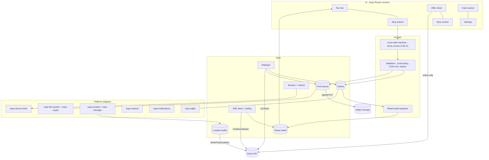

# Driver app architecture

Foundation document 8. Date: 2026-10-31. Status: for owner review. Governed by ADR-0004 (new driver app), ADR-0007 (cash custody), ADR-0008 (offline outbox), ADR-0009 (polling and SSE), ADR-0010 (route rungs), ADR-0016 (Arabic and English), ADR-0017 (digital COD gated), ADR-0021 (driver app in the monorepo), the proposed ADR-0028 (location pings) and ADR-0029 (SSE event names), and the proposed ADR-0034 (offline cash PIN verifier) and ADR-0035 (Maestro end-to-end flows); derives from the contracts (document 3) and the domain model (document 2); informs wave 1 and the roadmap (document 12). Order: ARCH-1, decision 2.7.

Vocabulary is document 2: states, arrows and invariants (D-n) are cited, not redefined. Operations are named by their `operationId` in `docs/contracts/openapi/driver.yaml`; their schemas, error lists and rate limits are in document 3 and are not repeated. Tokens, OTP budgets and the PIN policy are document 4 §3.2 and §4.

## 1. Scope

`apps/driver` is one Expo app with Expo Router for iOS and Android, built and updated through EAS Build and EAS Update, sharing `packages/contracts` (generated types and client) and `packages/i18n` with the rest of the monorepo (ADR-0021, foundation plan §3).

Field loop in one sentence: the driver signs in by WhatsApp OTP on a bound device, goes on shift with a vehicle, accepts offers, picks up by scan, works the run stop by stop, delivers with proof and COD or records an attempt with a reason, and hands the day's cash to a cashier, with every field write recorded on the phone first and replayed when the network allows (ADR-0008).

What the app never does:

- **No web app roles.** It holds only the driver permissions `delivery.driver.work`, `delivery.driver.cash` and `delivery.driver.locations` (document 3 §11); no dispatcher, cashier or admin screen exists in it, and the driver token is refused on `/v1/staff` (document 3 §1).
- **No account switching.** One session is one driver in one account (the token's `acc`); a person who drives for two accounts signs out and in again. There is no account picker.
- **No direct external calls.** The app talks to `/v1/driver` and to the signed storage URLs the API hands it (ADR-0015); it never calls Hudhud, WhatsApp, a payment provider or any merchant system. Opening the phone dialler or a maps app by URL is an OS hand-off, not an integration.
- **No local authority over money or state.** The phone proposes transitions and collections; the API decides (D-5, D-7, D-16, D-23) and the cash figure of record is the server ledger (ADR-0007).

## 2. Architecture layers

| Layer | Holds | Depends on |
|---|---|---|
| UI | Expo Router screens (section 9), components from a driver-specific kit built mirrored for RTL (ADR-0016) | domain read model, commands |
| Domain | the local order state machine (driver arrows of document 2 §3.13 only), command validators (proof policy, COD sum, reason code), the read-model projector | sync stores, no I/O of its own |
| Sync | outbox (section 3), proof upload queue (section 4), location buffer (section 6), SSE client and polling (section 8), auth session and token refresh (section 7) | platform adapters, generated contract client |
| Platform adapters | `expo-sqlite` (stores), `expo-secure-store` (tokens, PIN material), `expo-location` with `expo-task-manager` (background positions), `expo-camera` (scan, photos), `expo-notifications` (push), `expo-file-system` and `expo-crypto` (proof files, sha256), `expo-network` (connectivity), `expo-updates` | the OS |

The local state machine knows exactly five arrows, the driver's own field arrows of §3.13: assigned → picked_up, picked_up → out_for_delivery, out_for_delivery → delivered, out_for_delivery → attempted, attempted → out_for_delivery. The sixth driver arrow, offered → assigned, is the online-only offer acceptance (`driverAcceptOffer`) and is never projected locally. Every other arrow (unassign, reschedule, cancel, failed, returned) arrives from the server and is only displayed. A screen offers an action only when the projected status allows its arrow; the server stays the judge (D-5).



## 3. Offline-first outbox (ADR-0008)

### 3.1 What goes through it

| Write | Through the outbox | Why |
|---|---|---|
| `driverPostOrderEvent` (all four `to_status` values) | yes | the field loop must work in a basement (ADR-0008) |
| `driverPauseShift`, `driverResumeShift`, `driverEndShift` | yes, lane `shift` | a break or the end of a day must not wait for signal |
| `driverPinAddress` (wave 2) | yes, in the order's lane | captured at the door |
| `driverUpdatePushToken` | yes, lane `device`, latest wins | token rotation can happen offline |
| `driverStartShift`, `driverAcceptOffer`, `driverDeclineOffer`, `driverSetCashPin`, `driverRequestHandover` | no, online only | eligibility, offer races (D-13) and PIN checks need the server's answer now (driver.yaml `info.description`) |
| `driverPostLocations` | no, location buffer (section 6) | telemetry, not a business write (ADR-0028) |

### 3.2 Schema

`expo-sqlite`, one database file per install, WAL mode, migrations numbered and forward-only (section 12.4). The file is encrypted with SQLCipher (`useSQLCipher` in the `expo-sqlite` config plugin; owner ruling 2026-11-01, ADR-0039): a random 256-bit key is generated on first launch and kept in `expo-secure-store`, set with `PRAGMA key` right after open, and the app refuses to start when `PRAGMA cipher_version` returns no row, because a build without SQLCipher would otherwise store the data unencrypted without any error.

```sql
CREATE TABLE outbox_items (
  id              TEXT PRIMARY KEY,   -- UUIDv7 minted when the action is recorded; sent as Idempotency-Key, never re-minted
  driver_id       TEXT NOT NULL,      -- owner; replayed only under this driver's token (section 7.4)
  lane            TEXT NOT NULL,      -- 'order:<order_id>' | 'shift' | 'device'
  order_id        TEXT,               -- null outside order lanes
  kind            TEXT NOT NULL,      -- 'order_event' | 'address_pin' | 'shift_pause' | 'shift_resume' | 'shift_end' | 'push_token'
  event_type      TEXT,               -- to_status for order events
  payload         TEXT NOT NULL,      -- JSON request body exactly as it will be sent, without cash_pin (section 5.3)
  client_ts       TEXT NOT NULL,      -- ISO 8601 with offset, corrected by the server clock offset (3.6)
  seq             INTEGER NOT NULL,   -- local monotonic sequence; replay order inside a lane
  status          TEXT NOT NULL CHECK (status IN ('pending','sending','acked','rejected')),
  attempts        INTEGER NOT NULL DEFAULT 0,
  next_attempt_at TEXT,               -- backoff schedule
  last_error      TEXT,               -- JSON { http, code, message, details, request_id }
  response        TEXT,               -- JSON body of the acknowledged result
  created_at      TEXT NOT NULL,
  acked_at        TEXT
);
CREATE UNIQUE INDEX outbox_lane_seq ON outbox_items (lane, seq);
CREATE INDEX outbox_open ON outbox_items (status, next_attempt_at) WHERE status IN ('pending','sending','rejected');
```

`event_id` in a `DriverOrderEvent` body equals the item `id`, and proof and collection ids inside the payload are UUIDv7s minted in the same local transaction (document 2 §8), so the order, its proofs and its collections can be referenced before the server has seen any of them. The item, its proof rows (section 4) and the read-model overlay are written in one SQLite transaction; a crash leaves either all of them or none.

### 3.3 Replay rules

- **Strict per-order order (D-16).** Inside a lane only the lowest `seq` with status `pending` or `sending` may be in flight. A lane whose head is `rejected` is halted: later items in that lane stay `pending` and are shown as "waiting on" the rejected one.
- **Lanes in parallel.** Different order lanes replay concurrently, at most three requests in flight in total, which stays well inside the 300 per minute device budget (document 3 §7).
- **Shift barrier.** A `shift_end` item is sent only after every order-lane item with an earlier `client_ts` is `acked` or `rejected`; otherwise those events would arrive after the shift ended and fail `shift_not_active` (D-6). `shift_pause` and `shift_resume` follow the same rule.
- **Single, not batched.** The driver API has no batch endpoint for business writes: each item is one request with its own `Idempotency-Key`, so each gets its own result and its own error. Batching applies only to positions (section 6) and is deliberately outside the outbox.
- **Triggers.** Replay runs on connectivity regained, app foreground, a successful SSE connect, every 15 s while items are open and the app is in front, and opportunistically from the background location task and an `expo-background-task` job (section 4.4).
- **Crash recovery.** On start, every `sending` item returns to `pending`. Re-sending is safe because the key is unchanged and the server returns the stored result (D-15).
- **Backoff.** Network errors, timeouts (20 s), `5xx` and `429` keep the item `pending` with exponential backoff and full jitter, 2 s doubling to a 5-minute cap; `429` honours `Retry-After`. Attempts are counted, never capped: an item is never dropped for being old.

### 3.4 Results and what the app does

| Response | Item becomes | App behaviour |
|---|---|---|
| `200` (including `replayed: true`) | `acked` | write the returned `order` (and `attempt`) into the read model as server truth (3.5); release the proof uploads the event declared (section 4); if `superseded_dispatcher_change` is true, show an informational row on the sync screen (D-23) |
| `401 token_expired` | stays `sending` | refresh once (section 7.2) and resend with the same key |
| `401 token_invalid`, `device_revoked` | stays `pending` | replay stops; revocation path (section 7.4) |
| `409 stale_driver_event` | `rejected` | the dispatcher changed the order in between and D-23 does not apply (D-16); refetch the order with `driverGetOrder`, show both versions on the sync screen with "call dispatcher"; never dropped |
| `409 invalid_transition` | `rejected` | the arrow is not legal from `details.current_status` (D-5); same treatment; if the order left the run, the stop shows "removed by dispatch" with the rejected item attached |
| `409 shift_not_active` | `rejected` | the shift ended under the driver (dispatcher end, D-6); prompt to start a shift, then offer "retry" which re-queues the same item with the same key |
| `403 driver_not_assignee` | `rejected` | the order was reassigned and D-23 does not apply; shown like `stale_driver_event` |
| `422 proof_required`, `cod_amount_mismatch` | `rejected` | local validation (section 5.1) should make these impossible; if one arrives (a proof policy changed after the last `driverGetMe`), the stop reopens a "fix and resend" form; the fix is a new item with a new key, the rejected one stays in history |
| `422 cod_not_allowed`, `idempotency_key_reused`, `400 validation_failed` | `rejected` | a client defect: shown, reported to Sentry with the request id, never retried automatically |
| `403 account_suspended`, `feature_not_enabled` | stays `pending` | all replay pauses behind a banner; nothing is discarded |

"Never drop" is literal: a `rejected` item stays in `outbox_items` until a server-side resolution reaches the read model (the order is terminal or reassigned and the driver has opened the item) and is exported in the support bundle (section 11) until then. A rejected `delivered` with a cash collection is the worst case, because cash is physically in hand but not on the ledger; the sync screen pins it at the top and the cash screen shows it as "unrecorded cash" (section 5.4). Open question 3 asks whether the server should also keep a copy for dispatchers.

### 3.5 Local read model and server truth

| Table | Source | Refreshed by |
|---|---|---|
| `run_stops` | `RunStop` from `driverListRun` and `driverGetOrder`, keyed by order id, with the server `version` | SSE event, poll with `updated_from`, every ack |
| `offers` | `driverListOffers` | SSE `delivery.order.offered`, poll, push |
| `me` | `driverGetMe`: driver, device, current shift, cash summary, `cash_pin_set`, `proof_policy` | sign-in, foreground, SSE `delivery.driver.cash_blocked`, every shift action ack |
| `reference` | `driverListReasonCodes`, `driverListVehicles` | sign-in and once a day; used offline |

What a screen shows is a projection: the server snapshot with every `pending`, `sending` or `rejected`-but-unresolved item of that order folded on top through the local state machine. Each fold that produced a status the server has not confirmed carries a "not synced" mark. On every ack, and on every server snapshot newer than the stored `version`, the snapshot is replaced and the projection recomputed; when the server status contradicts a pending item (the order was cancelled before pickup), the item is not folded and is shown as at risk until its replay result arrives. Server truth always wins in the read model; the outbox keeps the driver's record of what they did.

### 3.6 Time

`client_ts` is the device clock corrected by the offset between the server `Date` header and the device clock, measured on every response and stored with the time it was measured. D-23 compares `client_ts` with dispatcher changes, so a phone set five minutes wrong must not decide a conflict. An offset above two minutes is logged and shown in settings. Business dates on screen (cash day) are Asia/Riyadh (document 2 §8).

## 4. Proof upload queue

### 4.1 Flow

1. At the door the driver captures the proofs the proof policy needs (`proof_policy.delivery`, plus `proof_policy.cod` when `cod_amount > 0`, from `driverGetMe`). Each file is processed (4.2), written to `documentDirectory/proofs/<proof_id>.<ext>`, hashed, and a `proof_uploads` row is written in the same transaction as the outbox item that declares it (`proofs[]` with `id`, `kind`, `sha256`).
2. The server writes the proof row as `pending_upload` with the status change (D-7, D-17). The app does not upload before the declaring event is `acked`: until then the server has no proof row to attach the file to.
3. After the ack: `driverCreateProofUpload` returns an `UploadTicket`; the app `PUT`s the file to `upload_url` with the ticket's headers; then `driverConfirmProof` moves the proof to `stored` after the server's sha256 check (document 3 §3, uploads).
4. On `stored` the local file is deleted and the row kept 7 days for the sync screen.

```sql
CREATE TABLE proof_uploads (
  proof_id        TEXT PRIMARY KEY,   -- UUIDv7 declared in the event
  outbox_item_id  TEXT NOT NULL REFERENCES outbox_items(id),
  order_id        TEXT NOT NULL,
  kind            TEXT NOT NULL,      -- photo | signature
  file_uri        TEXT NOT NULL,
  content_type    TEXT NOT NULL,      -- image/jpeg | image/png
  sha256          TEXT NOT NULL,
  bytes           INTEGER NOT NULL,
  status          TEXT NOT NULL CHECK (status IN ('waiting_event','pending','ticketed','uploaded','stored','failed')),
  ticket_key      TEXT,               -- Idempotency-Key of the current ticket request
  ticket          TEXT,               -- JSON UploadTicket
  attempts        INTEGER NOT NULL DEFAULT 0,
  next_attempt_at TEXT,
  last_error      TEXT,
  created_at      TEXT NOT NULL,
  stored_at       TEXT
);
```

### 4.2 File rules

| Kind | Capture | Processing | Limits |
|---|---|---|---|
| photo | `expo-camera`, in-app only (no gallery pick, so a proof is taken at the door) | `expo-image-manipulator`: longest edge 1600 px, JPEG quality 0.7, EXIF stripped (the event already carries `point`) | target under 400 KB; above 1.5 MB re-encoded at quality 0.5; at most 3 photos per event |
| signature | a Skia canvas on a white background, recipient name typed under it | PNG, 1200 × 480 px, strokes only | under 100 KB |

The sha256 is computed with `expo-crypto` over the final file bytes, after processing, and is the value declared in the event and the upload request. `recipient_otp` and `id_check` (document 2 §3.10) need capture rules of their own; the app supports them only when a wave order defines them, and a proof policy that names them before then blocks delivery with a clear message rather than a fake proof.

### 4.3 Retry and failure

- Tickets expire. A `PUT` attempted after `expires_at`, or answered `403` by storage, requests a new ticket with a **new** `ticket_key`: reusing the old key inside 24 h would return the stored, expired ticket (K-8).
- `422 upload_mismatch` on confirm means the stored object is missing or different: the app re-hashes the local file; if it still matches the declared sha256 it requests a new ticket and uploads again; if it does not, the file is corrupt, the row becomes `failed`, the sync screen says so and Sentry gets the proof id. A `failed` proof stays `pending_upload` on the server and raises the 24-hour alert there.
- Network errors and `5xx` back off like the outbox (3.3). Uploads run one at a time, on any network; a setting lets an account restrict uploads to Wi-Fi later if data costs bite.

### 4.4 Background and the 24-hour alert

Uploads drain in the foreground, from the location task's wake-ups while on shift, and from an `expo-background-task` job (Android WorkManager, iOS BGTaskScheduler) that iOS runs at its own discretion. Nothing guarantees an iOS upload while the app is closed, so the sync screen and a local notification nudge the driver to open the app. The alert for a proof still `pending_upload` 24 hours after delivery is server-side (D-17) and never reverses the delivery; the app mirrors it so the driver sees it first: amber after 1 hour, red after 20 hours with "the dispatcher will be alerted at 24 hours".

### 4.5 The sync screen

One list, newest problem first, three groups:

1. **Needs attention:** `rejected` items (code, localised message, the server's `current_status`, the request id, "call dispatcher" and, where allowed, "fix and resend"), `failed` proofs, and unrecorded cash.
2. **Waiting:** `pending` and `sending` items and uploads, with attempts, next retry time, age and bytes left; a "sync now" button.
3. **Done:** items acknowledged in the last 7 days, with `replayed` and superseded marks.

The header shows connectivity, the last successful contact, the clock offset and the outbox depth. The screen also exports the support bundle (section 11). The run list shows a badge with the "needs attention" count, and the app never hides it.

## 5. COD and cash

### 5.1 Recording collections (D-7, D-18)

On `delivered` for an order with `cod_amount > 0` (kinds `delivery` and `exchange` only, D-4), the driver records one or more collections, each with a method from `cash`, `card`, `mada`, `wallet` and, for non-cash methods, the external reference the terminal or wallet shows. Local validation before the item is written: amounts are integer halalas, the sum equals `cod_amount` exactly (D-7), every non-cash line has a reference, and the proofs of `proof_policy.cod` are present. Card, mada and wallet are recorded as collected elsewhere (ADR-0017): the app never takes a card payment itself, and those lines never enter the cash figures below (D-18). A split (part cash, part mada) is two lines. The cash PIN is asked when at least one line is `cash` (driver.yaml `cash_pin`).

### 5.2 PIN rules

Document 4 §3.2 sets the policy: four to six digits, Argon2id on the server, required for a cash collection and for a handover request, five failures lock cash actions until a dispatcher resets. In the app: setup happens right after the first sign-in when `cash_pin_set` is false (`driverSetCashPin` with a fresh OTP); a change uses the current PIN; the keypad uses Western digits, shows no digits, disables screenshots on the PIN screen, and never stores a PIN in SQLite, logs or analytics. `cash_pin_locked` on `driverGetMe` shows a locked cash screen with "ask your dispatcher to reset"; deliveries without cash stay possible.

### 5.3 Offline PIN: the answer to contracts §12 open point 2

The contract sends `cash_pin` inside the replayed `delivered` event and verifies it at replay; a wrong PIN still records the delivery (D-23) and flags the collection for review. Two designs:

| | (a) PIN verified only at replay | (b) device-held verifier, server still verifies at replay |
|---|---|---|
| How | the app accepts any well-formed PIN offline and sends it with the event | the app checks the PIN against an Argon2id verifier in secure storage; the event still carries the PIN and the server verifies again |
| Feedback to the driver | none until replay, possibly hours later; a typo becomes a supervisor review | immediate, at the door |
| Someone else holding an unlocked phone | can record a cash collection under any PIN; caught only as a flag after replay | five local failures lock cash recording on the device until a server check succeeds |
| What sits on the device | the raw PIN of each pending cash event | the same, plus a verifier |
| Offline brute force if the device is extracted | nothing to attack beyond the pending PINs | the verifier can be attacked offline; four digits fall quickly to a determined attacker with a rooted copy of the keystore |
| Server and contract change | none | one online operation to (re)arm the verifier (`driverVerifyCashPin`, proposed) |

**Recommendation: (b), recorded as the proposed ADR-0034.** The PIN's job at a collection is to attest that the driver, not whoever holds the phone, recorded the cash; only (b) does that at the moment it matters, and it turns most review flags into instant corrections. The trade-off is a verifier on the device that a rooted-device attacker can brute-force offline. It is accepted because that attacker already holds the device-bound refresh token, which is worth more than the PIN, and because the server re-verifies every PIN at replay and keeps the five-failure lock: the verifier gates the app, never the ledger. Rules in ADR-0034:

- The verifier is computed on the device (Argon2id, 19 MiB, 2 iterations, random 16-byte salt, through a native Argon2 module) whenever the driver enters a PIN the server has just accepted: `driverSetCashPin`, `driverRequestHandover`, an online `delivered` with cash, or the proposed `driverVerifyCashPin` at sign-in when `cash_pin_set` is true and no verifier exists. The server's own hash never leaves the server.
- Stored in `expo-secure-store` with `AFTER_FIRST_UNLOCK_THIS_DEVICE_ONLY` (iOS) and the Android Keystore; not backed up, not synced.
- Five consecutive local failures lock cash recording on the device; the lock clears only after an online PIN check succeeds and `driverGetMe` shows `cash_pin_locked` false. A server lock (`423 cash_pin_locked`) wipes the verifier.
- The PIN for a pending cash event is kept in secure storage under the outbox item id, injected into the request body at send time, and deleted on ack or on rejection review. It is never in the SQLite payload.
- When the server flags a mismatch at replay (the PIN was changed on the second device while this one was offline), the collection goes to review as document 3 §12.2 says; the app replaces its verifier at the next online check.
- The verifier is deleted on sign-out, device revocation and PIN change on another device (seen as a `driverGetMe` change).

### 5.4 Cash in hand

The figure of record is the server ledger (ADR-0007): `cash_in_hand` and `oldest_collected_business_date` from `DriverCashSummary` (via `driverGetMe` in wave 1, `driverGetCash` in wave 2). While items are open the cash screen shows two lines, never one sum: "confirmed SAR X" from the server and "waiting to sync SAR Y", the cash lines of pending `delivered` items. Rejected cash items show a third line, "unrecorded cash SAR Z, call your dispatcher". Non-cash collections are listed separately, labelled "collected elsewhere", from `driverListCollections` with `custody=not_held`.

### 5.5 Cash-blocked state (D-11)

`cash_blocked` in the cash summary, or the SSE event `delivery.driver.cash_blocked`, puts a fixed banner on the run list: "You hold cash from {date}. Hand it over at {site} before new orders." The current run continues (D-11 blocks new offers and assignments, not open work); the offer sheet cannot appear because the server sends no offers (D-12), and a stale offer that is accepted returns `422 driver_cash_blocked`, shown with the same text. Offline, the app predicts the block: if a cash collection of a previous Asia/Riyadh business day is still pending sync, it shows the banner marked "expected".

### 5.6 Handover (wave 2, D-19, D-20)

Online only. The driver opens the cash screen at the site, checks the listed cash collections (all `collected` cash by default), enters the PIN and sends `driverRequestHandover` with the site of the current shift (or the home site). The driver never confirms custody: the request shows "waiting for the cashier", the cashier counts and confirms on the web, and the result arrives through `driverListHandovers` and the refreshed ledger. A difference becomes a liability entry the driver sees in `driverListLiability`. The button is disabled while any cash item is still pending sync, so the expected amount the server computes matches what the driver holds.

## 6. Shifts and location (ADR-0009, ADR-0028, ADR-0039)

### 6.1 Shift actions

Shift start is online: `driverListShifts` (planned shifts), `driverListVehicles`, then `driverStartShift` with the chosen vehicle and the planned shift or none for an ad hoc shift (§3.17). `422 driver_not_eligible` is shown with its reason. Pause, resume and end go through the outbox (3.1) with the shift barrier (3.3). The app blocks ending a shift while a stop is `out_for_delivery` locally, and warns when outbox items are pending ("they will still sync").

### 6.2 Background position task

| Rule | Value |
|---|---|
| Runs | only while the shift in `me` is `active` or `paused`; started on the `driverStartShift` ack, stopped on the `shift_end` ack, on a server shift that is no longer active, on `409 shift_not_active` from `driverPostLocations`, on sign-out and on revocation; reconciled with `me` on every app start |
| API | `Location.startLocationUpdatesAsync` with a task defined by `TaskManager.defineTask` at module scope |
| Profiles (ADR-0039) | `moving`: `Accuracy.High`, `timeInterval` 10 s, `distanceInterval` 20 m, `deferredUpdatesInterval` 15 s, a point every 10 to 15 s (ADR-0009). `parked`: `Accuracy.Balanced`, about 60 s / 50 m. `Balanced` also applies while the shift is `paused` and while battery is under 20 % and not charging. A profile change restarts the task with the new options (device test owed: Expo does not document option changes on a running task) |
| Entering `parked` | the driver's own arrival at a stop (local field event), or every fix within 30 m for 3 minutes |
| Leaving `parked` | the driver departs or starts the next stop, or the exit of the parked geofence: one region of about 150 m around the parked spot, registered with `startGeofencingAsync` on entry and removed on exit. On iOS the exit also restarts an app the driver swiped away; Android does not restart a terminated app |
| Speed bands | in `moving`, the distance interval widens in a few speed bands (base 20 m, scaled by speed rounded to 5 m/s), with hysteresis and at most one change a minute |
| Points dropped | accuracy worse than 100 m; older than the last point sent; identical to the previous point; or a jump implying an impossible speed, dropped only when the fix's own reported speed also disagrees. Each drop is counted by reason in the local log ring (§11) |
| Batching | points go to the SQLite `location_buffer`; a batch of up to 20 is sent with `driverPostLocations` when 2 or more points are waiting and 15 s (`moving`) or 2 to 3 minutes (`parked`) have passed since the last send; every profile change flushes at once |
| Watchdog | on every wake (task, outbox drain, push, foreground) the app compares the last fix age with the profile's interval; a stale task is restarted, or, where Android 14+ forbids starting a location foreground service from the background, a local notification asks the driver to open the app. The API raises its own stale-tracking alert after 5 minutes without a point on an active shift (DEL-5) |
| Battery budget | at most 4 % per hour during an active shift on the reference Android device (owner ruling 2026-11-01); points per hour, gaps over 2 minutes and battery per hour are recorded per shift on one reference Android and one reference iPhone before wave 1 exit |
| Offline | the buffer keeps the newest 240 points (one hour, the same depth as the server ring, document 2 §7) and drops the oldest; on reconnect it drains oldest first within the 12 requests per minute budget (document 3 §7) |
| Not in the outbox | a lost point is a gap on a map, not a lost fact (ADR-0028) |

Each point carries `client_ts` (offset-corrected, 3.6), `lat`, `lng`, `accuracy_m`, `speed_mps`, `heading_deg` `battery_pct`, `is_charging` and `power_saver` (`DriverLocationPoint`; battery state from `expo-battery`; the last two fields are added to `driver.yaml` by DEL-5, roadmap A-18). The location task's wake-up also triggers a light outbox and upload drain (3.3, 4.4) when the network is up.

### 6.3 Permissions and platform differences

Permissions are asked on the setup screen, never on a cold start, each after an in-app explanation in the driver's language: why ("the dispatcher and the recipient see where the parcel is, only while you are on shift"), when it stops ("off shift, nothing is sent"), what is sent.

| | iOS | Android |
|---|---|---|
| Order of prompts | "While Using" first, then "Always" on shift start | fine location first, then background location from system settings (Android 11+ allows no in-dialog "all the time") |
| Purpose strings | `NSLocationWhenInUseUsageDescription`, `NSLocationAlwaysAndWhenInUseUsageDescription`, `NSCameraUsageDescription` in `ar` and `en` through `expo-localization` app locales | the foreground-service notification text and channel name in both languages |
| Background mechanism | `UIBackgroundModes: location`, `showsBackgroundLocationIndicator: true`, `pausesUpdatesAutomatically: false`, activity type `OtherNavigation` (`AutomotiveNavigation` snaps tracks to roads and misplaces the walk to the door, ADR-0039) | a foreground service of type `location` with a persistent notification ("On shift: location shared"); `FOREGROUND_SERVICE_LOCATION` and `POST_NOTIFICATIONS` |
| Killers | updates stop if the driver swipes the app away; the shift banner asks drivers not to; a parked-geofence exit restarts the app, and the task restarts on the next launch while the shift is active | OEM battery managers stop services; the setup screen gives per-maker instructions (dontkillmyapp.com) and opens the battery-optimisation settings screen; the app does not request `REQUEST_IGNORE_BATTERY_OPTIMIZATIONS` |
| Store review | App Store background-location justification | Play prominent disclosure and background-location declaration form |

Without "Always" (or background) permission the shift can still start, positions are sent only while the app is in front, and the run list shows a warning; open question 4 asks whether that should block the shift instead.

## 7. Authentication and devices

### 7.1 Sign-in and device binding (document 4 §3.2)

1. `driverRequestOtp` with the phone; the app shows a 60 s resend timer and the generic "if this number is registered, a code was sent". The phone is normalised to E.164 by the server; the app only strips spaces and offers the `+966` prefix.
2. `driverVerifyOtp` with the code and `DeviceInfo`: `device_id`, platform, app version and the Expo push token if notification permission is already granted. `device_id` is a random UUID generated on first launch and kept in secure storage; no hardware identifier is read.
3. `409 device_limit_reached` (two active devices) shows "ask your dispatcher to remove an old phone" and stays on the sign-in screen.
4. On success: tokens to secure storage (7.2), `driver.id` recorded as the outbox owner, PIN setup or verifier arming (5.2, 5.3), permissions, then shift start.

The push token is sent later with `driverUpdatePushToken` when permission is granted or Expo rotates it.

### 7.2 Tokens

- The refresh token (opaque, 90 days, device-bound) lives in `expo-secure-store` with `AFTER_FIRST_UNLOCK_THIS_DEVICE_ONLY`, so the background location task can refresh while the phone is locked after the first unlock. The access token (15 minutes) lives in memory and is re-derived by a refresh after a cold start.
- Refresh is single-flight: one in-memory promise per JS context and a SQLite lock row with a 30 s lease shared by the foreground app and the background task. Two concurrent refreshes would present one token twice and revoke the whole family (document 4 §4); the lock prevents it.
- The app refreshes (`driverRefresh` with the refresh token and `device_id`) when a request returns `401 token_expired` and proactively 60 s before `expires_in` runs out while in front.
- A refresh whose response is lost on the network leaves the app holding a used token; the next refresh then revokes the family and the driver signs in again with an OTP. The outbox survives that (7.4), but it costs a driver an OTP in a basement; open question 2 asks for a short reuse grace on the server.

### 7.3 Forced sign-out

A refresh answered `401 device_revoked` (a dispatcher removed the device), `401 token_invalid` (family revoked or token unknown), or `403 account_suspended` on refresh, ends the session. The first two sign out; suspension keeps the session read-only behind a banner, since a suspended account rejects writes anyway (K-2) and the driver still needs to see the cash they hold.

### 7.4 What is cleared and what is kept

| Data | Voluntary sign-out | Revocation or family revoked |
|---|---|---|
| access and refresh tokens, SSE connection, location task, push token registration | cleared, stopped | cleared, stopped |
| read model (`run_stops`, `offers`, `me`, `reference`) | cleared | cleared |
| PIN verifier | deleted | deleted |
| outbox items that are not `acked`, their proof files and their per-item PINs | kept | kept |
| acked items, stored proofs, local log ring | kept for their normal retention | kept for their normal retention |

Voluntary sign-out with open items asks for confirmation and says the items stay on the phone. Kept items are bound to `driver_id`: they replay only when the same driver signs in again on this device, and never under another driver's token. If a different driver signs in, the previous driver's open items are shown read-only on the sync screen and included in the support bundle; support decides with the dispatcher. Uninstalling the app destroys the outbox, so the uninstall path is warned against on the sync screen while items are open.

## 8. Live updates

### 8.1 Driver stream (document 3 §6, ADR-0029)

React Native has no `EventSource`, so the client is `fetch` from `expo/fetch` with a streamed body and a small SSE parser, which allows the `Authorization` header (the driver stream never uses a query-string token). It runs only while the app is in the foreground.

- Connect with `Last-Event-ID` set to the last envelope id applied to the read model; honour `retry: 5000` with jitter; treat 45 s without bytes (two missed keep-alives) as a dead connection.
- Events: `delivery.order.offered` adds an offer; `delivery.order.assigned` and `delivery.order.accepted` (the order was taken back, document 3 §12.3) and `delivery.order.cancelled` refetch the run with `driverListRun` and `updated_from`; `delivery.driver.cash_blocked` refetches `me`.
- `stream.resync`, or reconnecting after more than 15 minutes in the background, refetches `driverGetMe`, `driverListRun` and `driverListOffers` in full.
- `401 token_expired` refreshes and reconnects; revocation follows 7.3.
- Polling fallback (ADR-0009): after three failed connects in a row, the app polls `driverListOffers` and `driverListRun` with `updated_from` every 15 s while in front and retries the stream every 2 minutes.

### 8.2 Push notifications

`expo-notifications` through the Expo push service; the server sends them (the app never sends push). Android channels: `offers` (high importance, sound, heads-up), `run` (default) and `cash` (high). Payloads carry ids only plus a localised title and body rendered by the server in the driver's locale; no recipient name, phone or address appears in a notification. Deep links through Expo Router: `eeasydriver://offers/{offer_id}`, `eeasydriver://orders/{order_id}`, `eeasydriver://cash`, `eeasydriver://sync`.

| App state | Offer arrives | Run changes |
|---|---|---|
| Foreground | from SSE: the offer sheet opens over the current screen, with a sound and a haptic; a push for the same offer is suppressed by id | SSE; banner when the current stop is affected |
| Background or killed | push; tapping opens the offer sheet after a fresh `driverListOffers` | push for assignment or cancellation; the run refetches on open |
| Offline | nothing arrives; offers simply expire (§3.14) | applied on reconnect |

The app also raises local notifications for its own problems: a newly rejected outbox item, a proof older than 20 hours, and the cash-blocked prediction.

### 8.3 Offer acceptance race (D-13)

The offer sheet shows the stop, distance, COD amount and a countdown to `expires_at` (offset-corrected). "Accept" is enabled only when online; it sends `driverAcceptOffer` once, disables both buttons and shows progress. Outcomes: `200` inserts the assignment into the run; `409 offer_withdrawn` says "another driver took this order" and removes the sheet; `409 offer_expired` says "this offer expired"; `409 shift_not_active`, `422 capacity_exceeded`, `422 driver_cash_blocked` and `403 driver_not_assignee` each have their own sentence. A network failure during accept retries with the same key, so a lost response cannot double-accept. "Decline" (`driverDeclineOffer`) asks for an optional reason.

## 9. Screens per wave

Routes are Expo Router files under `apps/driver/app/`; groups gate access: `(auth)` without a session, `(setup)` until PIN and permissions are done, `(app)` with a session.

| Screen | Route | Contract operations | Offline | Wave |
|---|---|---|---|---|
| Sign-in | `(auth)/sign-in` | `driverRequestOtp` | no | 1 |
| OTP | `(auth)/verify` | `driverVerifyOtp` | no | 1 |
| PIN setup or arming | `(setup)/pin` | `driverSetCashPin`, `driverVerifyCashPin` (proposed, ADR-0034) | no | 1 |
| Permissions | `(setup)/permissions` | none | yes | 1 |
| Shift start | `(app)/shift/start` | `driverListShifts`, `driverListVehicles`, `driverStartShift` | no | 1 |
| Run list | `(app)/(tabs)/index` | `driverListRun`, `driverGetMe`, `driverStream` | read from the local model | 1 |
| Offer sheet | `(app)/offers/[offerId]` (form sheet) | `driverListOffers`, `driverAcceptOffer`, `driverDeclineOffer` | no | 1 |
| Order detail | `(app)/orders/[orderId]/index` | `driverGetOrder` | read from the local model | 1 |
| Pick up by scan | `(app)/orders/[orderId]/pickup` | `driverPostOrderEvent` (`picked_up`, `scan_code`) | yes | 1 |
| Start stop | action on order detail | `driverPostOrderEvent` (`out_for_delivery`) | yes | 1 |
| Deliver | `(app)/orders/[orderId]/deliver` | `driverPostOrderEvent` (`delivered`), `driverCreateProofUpload`, `driverConfirmProof` | yes | 1 |
| Attempt | `(app)/orders/[orderId]/attempt` | `driverListReasonCodes` (cached), `driverPostOrderEvent` (`attempted`) | yes | 1 |
| Pin address at the door | `(app)/orders/[orderId]/pin` | `driverPinAddress` | yes | 2 |
| Sync | `(app)/(tabs)/sync` | none of its own; shows outbox and uploads | yes | 1 |
| Cash | `(app)/(tabs)/cash` | wave 1: `driverGetMe`, `driverListCollections`; wave 2: `driverGetCash`, `driverListHandovers`, `driverListLiability` | last known plus provisional | 1, 2 |
| Handover request | `(app)/cash/handover` | `driverRequestHandover` | no | 2 |
| Settings | `(app)/settings` | `driverPauseShift`, `driverResumeShift`, `driverEndShift`, `driverUpdatePushToken`, `driverLogout`, `driverSetCashPin` | shift actions yes, others no | 1 |

Screen notes:

- **Run list.** In wave 1 stops are ordered by slot window, then by assignment time; the driver may reorder locally (a view preference, not sent). In wave 2, rung 1 of ADR-0010 supplies the stop sequence from the server and the list follows it; document 3 §12.4 leaves that attribute to the wave 2 order. Each row shows status, slot, COD amount and a "not synced" mark when its projection runs ahead of the server.
- **Order detail.** Recipient, address with the National Address short code, items, COD, attempts so far against `max_attempts`, kind-specific labels (a `return_pickup` is "collect", an `exchange` shows out and in items). "Call" opens `tel:`; "Navigate" opens Google Maps, Apple Maps or Waze by URL with the order `point`, the driver's choice kept in settings.
- **Pick up.** `expo-camera` barcode scanning; the scanned code must match the order's label (number or source reference) locally before the event is written; a mismatch is refused with a haptic error, and a manual entry path exists for damaged labels.
- **Attempt.** Reason codes come from the cached account list (D-14); "last attempt" is shown when the next one reaches `max_attempts`, because the server will then fail the order.

## 10. Internationalisation

- `ar` is the default on first launch whatever the phone's language; `en` is a setting. Strings come from `packages/i18n` (`driver` namespace), both locales in the PR that adds a key; CI fails on a missing key (ADR-0016, handbook 04).
- RTL through `I18nManager.forceRTL`; switching language persists the choice and reloads with `expo-updates` `reloadAsync`, since React Native applies direction only at start. Icons that imply direction (back, next, navigate) are mirrored; maps and the signature pad are not.
- Numbers, money and dates use `Intl` with explicit extensions: `ar-SA-u-nu-latn` for Western digits and `ar-SA-u-ca-gregory-nu-latn` for dates, because plain `ar-SA` defaults to Arabic-Indic digits and the Islamic calendar. Money renders from halalas as SAR with two decimals; time zone Asia/Riyadh. Phone numbers, codes and amounts are wrapped in Unicode isolates so they stay left-to-right inside Arabic text.
- `Accept-Language` follows the app language, so server `message` texts and reason-code labels match the screen.
- Field use: tap targets at least 56 dp, high-contrast theme readable in sunlight, primary actions within thumb reach at the bottom. `expo-haptics` confirms a scan, an accepted offer and a recorded event, and signals an error distinctly. `expo-speech` reads a new offer aloud ("new order, 4 kilometres") when the setting is on and the app is in front, so a driving driver need not read. No action requires reading small text while moving.

## 11. Observability

- **Sentry** (`@sentry/react-native`) for crashes and handled errors, release `<app version>+<EAS update id>`, source maps uploaded by EAS Build and EAS Update (platform document §7). `beforeSend` strips recipient names, phones, addresses, PINs, tokens and request bodies; request ids and order, item and proof ids stay.
- **PostHog** (`posthog-react-native`) with ids only: driver, account and device ids, never a name or phone (platform document §7). Events: sign-in, shift started and ended, offer shown, accepted, declined and lost, event recorded with an online or offline flag, item acknowledged with replay latency, item rejected with code, proof stored with upload latency, PIN locked locally.
- **Local log ring.** A SQLite table of structured log lines (level, time, component, message, ids), capped at 5,000 lines or 7 days. No PIN, token, phone or recipient data is ever written to it.
- **Support bundle.** The sync screen exports one JSON file through the share sheet: app and update version, device and OS, clock offset, the open and rejected outbox items with their errors and request ids (payloads included, PINs never), the upload rows without files, the last 2,000 log lines. The driver sends it to support over WhatsApp; nothing uploads silently.
- **Outbox metrics**, sent to PostHog every 15 minutes while open items exist and on each foreground: outbox depth by status, age of the oldest open item, proof backlog count and bytes, rejections by code, replay latency (`acked_at − client_ts`), location buffer depth and points dropped. Server-side, ping lag and accepted pings are measured by the API (document 2 §7).

## 12. Testing

### 12.1 Static and unit (CI lane `driver-test`, handbook 03)

- `tsc --noEmit` against the generated `packages/contracts` types; lint with the workspace config.
- Unit tests with the workspace runner (Jest with the `jest-expo` preset unless the scaffold picks otherwise), next to the code:
  - **Local state machine:** table-driven over all states of §3.13 and the five driver arrows, asserting that every other arrow is refused and that the projection over a snapshot plus pending items is correct.
  - **Validators:** proof policy combinations, the exact COD sum (D-7), cash PIN required only with a cash line, reason code on attempts (D-14).
  - **Outbox replay:** deterministic, with an injected clock, an injected UUIDv7 source and a fake transport that plays **recorded server responses**. The recordings are captured from the API in Compose by the contract tests (`packages/contracts/test/`) and stored as fixtures, so a contract change that alters a response breaks the app test too. Cases: per-lane order under parallel lanes, the shift barrier, crash in `sending`, every row of the table in 3.4, a lane halted behind a rejection, permanent keys across restarts, `replayed: true` handling, `superseded_dispatcher_change`.
  - **Interleaving property test:** random sequences of offline periods, timeouts, lost responses and restarts must end with the same server-visible effects as a perfect network and no item lost.
  - **Proof queue:** ticket expiry needs a new key, `upload_mismatch` handling, sha256 over processed bytes.
  - **Token refresh:** single-flight under concurrent foreground and background callers.
  - **PIN verifier:** local lockout at five failures, wipe on server lock, PIN never in SQLite.
- The stores sit behind a small interface; unit tests run the same SQL and migrations on `better-sqlite3` (the same SQLite engine, not a mock), and the Maestro flows (12.2) exercise `expo-sqlite` itself. Handbook 03's ban on SQLite stand-ins concerns the API's PostgreSQL and does not apply to a store that is SQLite in production.

### 12.2 End-to-end: Maestro (proposed ADR-0035)

Maestro over Detox. Maestro drives the installed app as a black box with YAML flows, runs the same flow on the iOS simulator and the Android emulator, needs no test harness compiled into the app and no change to the native project, and survives Expo SDK upgrades without test-side work. Detox is faster per step and synchronises with the JS thread, but needs a native build configuration per platform and a Jest harness that tracks React Native internals, which is the maintenance an Expo-managed app tries to avoid. Playwright, named by AGENTS.md for the census, cannot drive a native app; Maestro takes that role for `apps/driver`.

- Flows: sign-in with a test OTP, PIN setup, shift start, accept an offer, scan pickup, deliver with photo, signature and split COD, attempt with reason, the sync screen after an offline delivery, cash screen, language switch. Each runs in `ar` and `en` (locale set through a launch argument read by the app), with screenshots kept as artifacts, Arabic first.
- Offline is produced by a toxic proxy (Toxiproxy) between the app and the isolated stack's API, so "no network", "slow network" and "lost response" are the same on both platforms.
- Against the isolated stack of handbook 03 (clone database, own ports, API base URL baked into a `preview`-profile build).
- Runs: Android flows on pull requests that touch `apps/driver` or `docs/contracts/openapi/driver.yaml`; iOS flows nightly and before every store submission.

### 12.3 EAS build channels

| Profile and channel | Build | API | Distribution |
|---|---|---|---|
| `development` | development client | local Compose or staging | internal, developers |
| `preview` | release build, test flags | staging | internal distribution to UAT and pilot drivers |
| `production` | store build | production | App Store and Play, manual submission (ADR-0021) |

### 12.4 OTA update policy

- `runtimeVersion` uses the `fingerprint` policy, so an update reaches only builds with the same native fingerprint.
- JS, assets and strings ship by EAS Update to the matching channel, staged: 10 % of production for 24 hours, then 100 %, with Sentry crash-free sessions watched between steps; rollback is republishing the previous update.
- Updates download in the background and apply on the next cold start; the app never reloads itself while a stop is `out_for_delivery` or the deliver screen is open.
- **A native build is required** for: an Expo SDK upgrade; adding or upgrading a native module (Argon2, Skia, camera, background task); permission or purpose strings, `UIBackgroundModes`, Android service types or any `app.json` plugin configuration; the app icon, scheme or bundle ids.
- SQLite migrations are forward-only and additive, because a rolled-back update may run older JS against a newer schema: old code must ignore new columns and tables. An outbox payload shape is never changed in place; a new shape is a new `kind`.
- The API serves every live app version on `/v1` (document 3 §2). Retiring an old build needs a minimum-version signal the contract does not have yet (open question 5).

## 13. Open questions for the owner

1. **Offline cash PIN (ADR-0034).** Accept the device-held verifier with server re-verification at replay, and the new `driverVerifyCashPin` operation it needs? With a verifier on the device, should the PIN become six digits only (document 4 §3.2 allows four to six)?
2. **Refresh reuse grace.** A refresh response lost on a mobile network makes the next refresh look like token theft and revokes the family (document 4 §4), forcing a new OTP. Allow a 30-second grace in which the same old token returns the same new pair?
3. **Rejected field events with cash.** When a `delivered` with cash is rejected (`stale_driver_event`, `driver_not_assignee`), the cash is in hand but not on the ledger, and only the phone knows. Should the API keep rejected driver events and show them to dispatchers and cashiers, rather than relying on the driver to call?
4. **Background location refused.** Let a driver start a shift with foreground-only location and a visible warning to dispatch (the proposal), or block shift start until background permission is granted?
5. **Minimum app version.** Add `min_app_version` to `driverGetMe` (or a `426` on the driver surface) so old builds can be told to update before an API or policy change?
