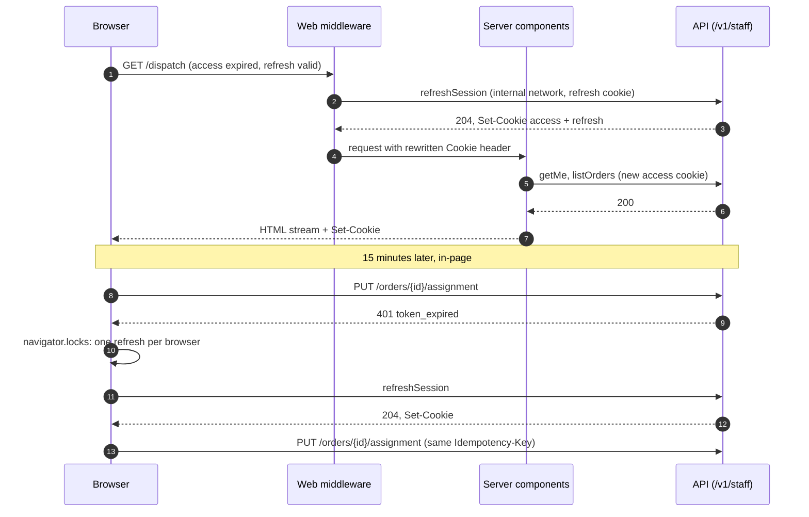

# Web app architecture

Foundation document 7. Date: 2026-10-31. Status: for owner review. Governed by ADR-0003 (monorepo, Next.js App Router), ADR-0006 (allowlist rollout), ADR-0009 (polling and SSE), ADR-0015 (signed uploads), ADR-0016 (Arabic and English), ADR-0021 (packages shared with the driver app), ADR-0022 (containers), ADR-0023 (own identity), ADR-0025 (tenancy), the proposed ADR-0029 (cursor pagination and SSE event names), and the proposed ADR-0032 (browser reaches the API on the web origin; sessions refreshed in middleware) and ADR-0033 (design system base and map provider); derives from the contracts (3) and the domain model (2); informs wave 0 and the roadmap (12). Order: ARCH-1, decision 2.6.

Inputs, not repeated here: actors, roles, tokens and cookies are document 4 (`identity-and-tenancy.md`); containers, CI and edge are document 6 (`platform.md`); operations, permissions, streams and error codes are document 3 (`docs/contracts/`); aggregates, states and invariants are document 2 (`domain-model.md`). This document says how `apps/web` uses them.

## 1. Scope and surfaces

Two Next.js applications (ADR-0038, owner ruling 2026-11-01). `apps/web`, built once as a standalone image (document 6 §2), serves the merchant and recipient audiences through three App Router route groups; `apps/admin`, its own standalone image on its own hostname, serves the platform console through two groups. Everything in this document applies to both applications unless a section says `apps/web` or `apps/admin`.

| Route group | Audience (document 4 §1) | URL space | API surface (document 3 §1) | Credential |
|---|---|---|---|---|
| `(auth)` in `apps/web` | merchant staff before sign-in | `/sign-in`, `/sign-in/second-factor`, `/invitations/[token]`, `/password-reset`, `/password-reset/[token]` | `/v1/staff/auth/*` | none yet |
| `(merchant)` | owner, admin, dispatcher, site staff, warehouse staff, cashier, viewer | `/`, `/orders`, `/dispatch`, `/cash`, `/wms/*`, `/settings/*`, … | `/v1/staff` (`staff.yaml`, `staff-delivery.yaml`, `staff-wms.yaml`) | `el_staff_at` cookie |
| `(auth)` in `apps/admin` | platform staff before sign-in | `/sign-in`, `/sign-in/totp` on the admin hostname | `/v1/platform/auth/*` | none yet |
| `(platform)` in `apps/admin` | platform super admin, admin, support | `/*` on the admin hostname (paths below are written `/platform/*` for continuity; the segment is dropped in `apps/admin`) | `/v1/platform` | `el_platform_at` cookie, host-only on the admin hostname |
| `(recipient)` | recipient, no account | `/track/[token]`, `/reschedule/[token]`, `/pin/[token]`, `/embed/track/[token]` | `/v1/recipient` | `X-Recipient-Token` header |

There is no locale segment in any URL; the locale comes from a preference cookie (section 5). Drivers never use the web app (document 4 §2).

### 1.1 Layout of `apps/web` and `apps/admin`

```text
apps/web/
  src/
    app/
      (auth)/          layout.tsx  sign-in/  invitations/[token]/  password-reset/
      (merchant)/      layout.tsx  page.tsx  orders/  dispatch/  zones/  drivers/  vehicles/  shifts/
                       slots/  cash/  wms/  channels/  settings/
      (recipient)/     layout.tsx  track/[token]/  reschedule/[token]/  pin/[token]/  embed/track/[token]/
      healthz/route.ts  csp-report/route.ts  monitoring/route.ts  ingest/[...path]/route.ts
    api/               server.ts (server client factory)  browser.ts (client fetch wrapper, refresh)
    auth/              session.ts  requirePermission.ts  Can.tsx
    live/              useEventStream.ts  merge.ts  positions.ts
    routes.ts          route manifest: path, permission, feature key, navigation entry
    analytics.ts       typed PostHog event catalogue
  middleware.ts        session refresh, host and group routing, CSP nonce, locale (proxy.ts on Next.js 16+)
  tests/               census-*.spec.ts, census.config.ts

apps/admin/
  src/
    app/
      (auth)/          layout.tsx  sign-in/  sign-in/totp/
      (platform)/      layout.tsx  page.tsx  accounts/  rollout/  outbox/  staff/  audit/  channel-publications/
      healthz/route.ts  csp-report/route.ts
    api/  auth/  routes.ts  analytics.ts   (same shape as apps/web; the platform client only)
  middleware.ts        platform session refresh, CSP nonce, locale (proxy.ts on Next.js 16+)
  tests/               census-*.spec.ts
```

Shared code lives in packages, not in the apps: `packages/contracts` (generated clients, hooks, schemas, mocks, one entry point per surface), `packages/ui` (components, tokens, map), `packages/i18n` (catalogues and formatting), `packages/config` (validated runtime configuration, document 6 §3), and the session and refresh helpers both apps use (WEB-2). `apps/web` imports only the `staff` and `recipient` surfaces, `apps/admin` only `platform`; each app's architecture test fails on any other surface (ADR-0038).

### 1.2 Isolation between the groups

Isolation is structural, not a convention:

- **Separate root layouts.** Each group has its own root `layout.tsx` with its own `<html>`; no shared root layout can leak a provider, a navigation tree or a session read into another group. `(merchant)` and `(platform)` mount the query client, the session provider and the navigation; `(recipient)` mounts only the i18n provider and, lazily, the map; `(auth)` mounts only forms.
- **Separate cookies.** The staff and platform sessions are separate cookie pairs set by their own API surfaces (`staffCookie` and `platformCookie` in `components.yaml`); a group's server API client forwards only its own cookie, and the `(recipient)` client forwards no cookie at all. A person who is both platform staff and a merchant member holds two independent sessions.
- **Separate middleware branches.** The request middleware (section 3.2) branches on the path: `/platform/*` requires the platform session; merchant paths require the staff session; `/track`, `/reschedule`, `/pin` and `/embed` require neither and never refresh anything.
- **Separate CSP.** Every response carries the document 6 §8 headers with a per-request script nonce (section 3.6). `frame-ancestors 'none'` everywhere, with one exception: `/embed/track/[token]` sets `frame-ancestors` to the merchant's embedding allowlist (section 9).
- **Import boundaries.** A lint rule forbids imports between the groups' folders; `(recipient)` may import only `packages/ui`, `packages/i18n`, the recipient client of `packages/contracts` and `src/live`.
- **Separate application and hostname for the platform console (ADR-0038).** `apps/admin` is a different build, image and hostname; the edge routes `/v1/platform/*` only there and answers `404` for it on the merchant hostnames, so the merchant deployment carries no platform route, client or namespace.

## 2. Rendering model

### 2.1 Server first

App Router, React Server Components by default. A file becomes a client component (`"use client"`) only when it needs one of: a map (MapLibre), a board or a table with selection and drag, a form with live validation, an SSE consumer, or a browser API (clipboard, file input, geolocation on the pin page). Client components are leaves; pages, layouts and data loading stay on the server.

### 2.2 How the web app talks to the API

One rule: **the web app reaches the API only through the generated clients in `packages/contracts`, and never touches a database, Redis or the object store directly.** No Drizzle import, connection string or storage key exists in `apps/web`; an architecture test (dependency-cruiser over `apps/web`) fails CI on any import of `apps/api`, `drizzle-orm`, `pg`, `ioredis` or an S3 SDK.

| Path | Used for | Mechanism |
|---|---|---|
| Server component → API | first render of every page; layouts' session and permission reads | generated fetch client with base URL `API_INTERNAL_URL` (from `packages/config`; the internal network address of document 6 §2), forwarding the group's own cookie, `Accept-Language` and `X-Request-Id`; `cache: 'no-store'` |
| Client component → API | mutations, refetches, infinite lists, streams | the same generated client and TanStack Query hooks with a same-origin base URL (ADR-0032); cookies go automatically |
| Route handler | `/healthz`, the CSP report sink, the Sentry tunnel and the PostHog proxy (section 10.4) | plain route handlers; none calls a business endpoint |
| Server action | not used | lint rule bans `"use server"` in waves 0 to 4 |

Server actions are excluded because every write in the contracts needs an `Idempotency-Key`, the dispatcher writes need `If-Match`, and conflict and validation errors are shown in the component that sent the write (section 7.4). A server action would add a hop that must re-implement all three, and a second write path to secure. Client mutations go straight to the API on the same origin.

Code generation, in `packages/contracts`, from the bundled per-surface files (document 3 §9): **Orval** produces, per surface, a fetch client, TanStack Query hooks, Zod schemas for request bodies, and MSW handlers for tests, from one configuration. The `x-permission` values are emitted as a TypeScript union (`Permission`), the SSE event names as another (`StreamEventName`), and the error codes of `errors.md` as a third (`ErrorCode`), so a misspelt permission, event or code fails typecheck. Generated code is never edited (document 3 §9). The client cache is **TanStack Query**: it is what Orval targets, it supports server prefetch and hydration, infinite cursor queries and optimistic updates with rollback, which sections 2.3 and 7 need.

### 2.3 Server prefetch, client cache

A server component that renders data a client component will keep live prefetches it into a per-request query client and passes it down through `HydrationBoundary`; the client hook starts from that data and takes over refetching and stream merging. Read-only pages (audit log, cash report once closed) render straight from the server response with no client cache.

### 2.4 Caching and revalidation by data class

Tenant data is never stored in the Next.js data cache or at the edge: every server fetch is `no-store`, every HTML response is `Cache-Control: private, no-store`, and the `(merchant)`, `(platform)` and `(recipient)` groups render dynamically (the nonce CSP requires it anyway). Caching happens only in the browser's query cache:

| Data class | Examples | `staleTime` | Refresh |
|---|---|---|---|
| Session | `getMe`, `platformGetMe` | 5 min | on window focus; on any `403`; after a member or role mutation |
| Reference | sites, zones, vehicles, account settings and reason codes, slot days, location tree | 5 min | on focus; invalidated by the screen's own mutations |
| Lists | orders, drivers, handovers, deposits, products, receipts | 30 s | on focus; previous data kept across filter changes; cursor pages through infinite queries (ADR-0029) |
| Live | dispatch board, an open order, an import job, recipient tracking | unbounded while the stream is healthy | merged from SSE (section 7); polling every 12 s while it is not |
| Money and stock | driver cash, cash reports, stock levels and summaries, movements | 0 | on mount and focus; never optimistic, never patched from a stream |

Filters, sort and the selected site live in the URL search parameters, so a list view is shareable and the back button works; the query key is built from them.

### 2.5 Streaming and suspense

Each layout renders its shell immediately: the navigation from the session read, the page heading, the filters. Each data region below sits in its own `<Suspense>` with a skeleton of the final dimensions (no layout shift, section 10.2). Slow regions (cash report totals, the map) never block fast ones (the order list). `loading.tsx` exists per module segment; `error.tsx` per module segment and per group (section 10.4).

## 3. Authentication in the browser

### 3.1 Cookies and where the API lives (ADR-0032)

The browser reaches the API on the web origin: the edge proxy (document 6 §8) routes `/v1/staff/*`, `/v1/platform/*` and `/v1/recipient/*` on the web hostnames to the `api` container, and everything else to `web`. Consequences:

- The session cookies of document 4 §4 (`el_staff_at`, the 15-minute access JWT, and the rotating 30-day refresh cookie, both httpOnly and SameSite=Lax; `el_platform_at` and its refresh cookie likewise) are host-only cookies on the web hostname, `Secure`, `Path=/`.
- There is no CORS on the staff, platform and recipient surfaces; `connect-src 'self'` covers every API call and stream.
- The driver and public surfaces keep the API hostname; they use bearer credentials and are not affected.

### 3.2 Where refresh happens

Refresh runs in two cooperating places, and nowhere else:

1. **Middleware, for navigations.** On a document request (not a prefetch, not an RSC fetch, not `/v1/*`), the middleware reads the access cookie's `exp` claim (decoded, not verified; the API verifies). If the cookie is missing or expires within 60 s and a refresh cookie is present, the middleware calls `refreshSession` (or `platformRefresh`) over the internal network, copies the new `Set-Cookie` headers onto the response, and rewrites the forwarded request's `Cookie` header so the server components of the same request already see the new access token. If the refresh fails, it redirects to `/sign-in?next=<path>` (or `/platform/sign-in`).
2. **The client fetch wrapper, for in-page calls.** On `401 token_expired` the generated client calls `refreshSession` once and retries the original request once. The refresh is single-flight across tabs through the Web Locks API (`navigator.locks.request('el-staff-refresh', …)`): a tab that acquires the lock after another tab has refreshed retries its original request before refreshing, so one browser never presents the same refresh token twice from client code.



Why not a route-handler proxy for every API call: it would put a Node hop in front of every request and every long-lived SSE connection, and it would still need the same single-flight logic. Why not middleware alone: client-side calls on a page left open past 15 minutes would fail without an in-page refresh. The residual risk is two simultaneous document navigations in two tabs after an idle period, both refreshing in middleware with the same token; document 4 §4 treats the second use as theft and revokes the family. ADR-0032 proposes a short reuse grace on the API (open question 5); until the owner rules, the effect is a forced sign-in, never a security hole.

### 3.3 CSRF posture

- Both session cookies are SameSite=Lax, so a cross-site `POST`, `PUT`, `PATCH` or `DELETE` carries no session.
- Every non-`GET` call from the web app adds the header `X-EL-Client: web`; the API rejects a staff or platform write without it, or whose `Origin` is not a web origin, with `403 forbidden`. A cross-site form cannot set a custom header, and a cross-site `fetch` with one needs a CORS preflight that the API never grants on these surfaces. This check is an API middleware addition owed by the wave 0 auth order; the contracts do not describe it yet (ADR-0032).
- No `GET` changes state (document 3 §3), so Lax cookies on top-level navigations are harmless.
- Server actions are not used (section 2.2), which removes the framework's second write path.

### 3.4 Session expiry and sign-in UX

| Situation | What the user sees |
|---|---|
| Access expired, refresh valid | nothing; middleware or the fetch wrapper refreshes |
| Refresh rejected (`401 token_invalid` or `token_expired`) on a navigation | redirect to `/sign-in?next=…` with the notice "Your session ended" |
| Refresh rejected on a page with unsaved state (dispatch board, an open form) | a modal re-sign-in dialog over the page (password, then second factor if required); the page state survives; on success the failed request is retried with its original `Idempotency-Key` |
| `403 account_suspended` | a full-page bilingual notice; no retry; sign-out offered |
| `second_factor_required` at sign-in | `/sign-in/second-factor`, phone OTP over WhatsApp (document 4 §3.1) |
| Member revoked or roles changed | the next refresh or sensitive action fails or returns a new permission set; the session provider refetches `getMe` and re-renders the navigation |
| Sign-out | `logout`, then a hard navigation to `/sign-in`; the query cache, open streams and `sessionStorage` are cleared |

The `next` parameter accepts only a same-origin relative path (an open-redirect check in the sign-in page).

### 3.5 Platform area

`/platform/sign-in` then `/platform/sign-in/totp` (`platformLogin`, `platformVerifyTotp`); TOTP is mandatory with no exceptions (document 4 §3.3), and the 12-hour idle expiry is enforced by the API, with the same expiry dialog as above. The platform area uses its own cookie (`el_platform_at`), its own refresh lock name (`el-platform-refresh`) and its own layout, and reads `platformGetMe` for its permissions.

**"Acting on account X" (document 4 §5).** Every route under `/platform/accounts/[accountId]/…` renders a fixed, non-dismissable banner with the account name and number, the support reason, and an "Exit account" control. Before the first cross-tenant read of operational data in a tab, the area asks for a support reason; it is held in memory for that tab and account and sent as `X-Support-Reason` on every `x-cross-tenant` call (document 3 §1), so it lands in the audit row. Leaving the account route clears it. The banner uses a distinct colour token that no merchant screen uses. If the owner accepts read-only impersonation (document 4 open question 3), it reuses this banner and adds the expiry countdown.

### 3.6 Security headers per group

Set by the middleware with a fresh nonce per request; document 6 §8 lists the API origin and the storage domain only, and the design keeps to that by serving the API, Sentry and PostHog on the same origin (sections 3.1 and 10.4):

```text
Content-Security-Policy:
  default-src 'self';
  script-src 'self' 'nonce-<n>' 'strict-dynamic';
  style-src 'self' 'unsafe-inline';
  img-src 'self' data: blob: https://<storage-domain>;
  connect-src 'self' https://<storage-domain>;
  worker-src 'self' blob:;
  font-src 'self';
  frame-ancestors 'none';            (embed path: the account's embed origins)
  form-action 'self'; base-uri 'none'; object-src 'none';
  report-to csp
Strict-Transport-Security: max-age=63072000; includeSubDomains; preload
X-Content-Type-Options: nosniff
Referrer-Policy: strict-origin-when-cross-origin   (recipient group: no-referrer)
X-Frame-Options: DENY                               (omitted on the embed path)
Permissions-Policy: camera=(), microphone=(), geolocation=(self)
```

`style-src 'unsafe-inline'` is accepted because Radix positions popovers with inline styles; no user content is rendered as HTML anywhere. A Hudhud tile origin is added to `img-src` and `connect-src` only if `HudhudMapProvider` is chosen (section 6.4).

## 4. Authorization in the UI

- **Source of truth.** `getMe` returns `permissions`, `features` and `membership.site_ids` (the `Me` schema). The `(merchant)` root layout reads it once per request (wrapped in React `cache()`), and the session provider exposes it to client components. `(platform)` does the same with `platformGetMe`.
- **Route manifest.** `src/routes.ts` lists every merchant and platform route with its required `Permission`, its feature key and its navigation entry. The navigation renders from the manifest filtered by `me`. A module whose feature is not visible to the account (K-6; the `FeatureGate` port of document 2 §1.1; ADR-0006) is absent from the navigation and its routes answer `notFound()`, so a module that was not provisioned does not exist for that account.
- **Server-side gating.** Each module segment's `layout.tsx` calls `requirePermission(...)` before rendering; failing it renders the "no access" page with status 403. Pages never fetch data the user may not read, so a hidden control is never the only barrier.
- **Controls.** `<Can permission="delivery.orders.dispatch">` and `useCan()` hide or disable controls: disabled with an explanation when the user can see the object but not act on it (a viewer on the dispatch board), hidden when the action means nothing to the role.
- **Site scoping.** For site-restricted roles the site switcher lists only `membership.site_ids`, and list filters default to and are limited to those sites. The API filters anyway (document 3 §1); the UI only avoids offering choices that return nothing.
- **Separation of duties shown, not enforced, by the UI.** The cashier's handover screen never offers dispatch actions, and the adjustment screen does not offer approval of an above-threshold adjustment to the user who recorded it (document 4 §2); the API returns `403 separation_of_duties` regardless, and the UI shows that code's message.
- **Never trust the UI.** Every rule above is a convenience. The API enforces permission, site scope, feature visibility and tenancy on every call (document 4 §5; document 3 §1). A `403 forbidden` or `403 feature_not_enabled` received by the client refetches `me` and re-renders the navigation, because it means the browser's view of the session is stale.

## 5. Internationalisation and right-to-left

- **Catalogues.** `packages/i18n/<locale>/<namespace>.json` (handbook 04), shared with the driver app (ADR-0021). Web namespaces: `common`, `auth`, `nav`, `settings`, `orders`, `dispatch`, `drivers`, `cash`, `slots`, `wms`, `platform`, `recipient`, `errors`. The `errors` namespace has one key per error `code` in `errors.md`; the UI shows its own text for a known code and falls back to the API's localised `message` for an unknown one (document 3 §4).
- **Library.** next-intl in non-routing mode (no locale segment), in server and client components. A type is generated from the `ar` catalogue so a missing key fails typecheck, and a CI script fails when a key exists in one locale and not the other (ADR-0016). Both locales ship in the same PR (handbook 04); a test build throws on a missing message instead of printing the key.
- **Locale resolution.** `el_locale` cookie, else the user's saved preference, else the account's default locale, else `ar`. Recipient pages: `?lang=`, else the account default, else `ar`. The locale goes to the API as `Accept-Language` (document 3 §3).
- **Direction.** Each root layout sets `<html lang dir>` on the server (`ar` → `rtl`, `en` → `ltr`), and wraps the tree in Radix `DirectionProvider`. Arabic is the primary layout; review screenshots are Arabic first (handbook 04, ADR-0016).
- **Logical CSS only.** Tailwind logical utilities (`ms-*`, `me-*`, `ps-*`, `pe-*`, `start-*`, `end-*`, `text-start`, `border-s-*`); a lint rule rejects physical ones (`ml-*`, `mr-*`, `pl-*`, `pr-*`, `left-*`, `right-*`, `text-left`, `text-right`, `rounded-l-*`, `rounded-r-*`). Directional icons (chevrons, arrows, "back") mirror with `rtl:-scale-x-100`; non-directional icons (checkmarks, play, media, the map itself) never mirror.
- **Numbers, dates and money.** One formatting module in `packages/i18n`, used by web and driver app: dates with `Intl.DateTimeFormat` in `ar-SA-u-ca-gregory-nu-latn` or `en-SA-u-nu-latn` and `timeZone: 'Asia/Riyadh'`. The bare `ar-SA` locale defaults to the Umm al-Qura calendar and Arabic-Indic digits, which ADR-0016 forbids, so the extension keys are mandatory. Numbers use `-u-nu-latn`. Business dates (`YYYY-MM-DD`, document 3 §3) are formatted as calendar dates, never shifted by the browser's zone. Money is integer halalas formatted by one `<Money>` component that renders the riyal sign as an SVG component (handbook 04), because not every font carries the new sign yet. A census check fails on any Arabic-Indic digit (`[٠-٩]`) in rendered text.
- **Mixed-direction data.** Order numbers, phone numbers, plate numbers, emails, codes and amounts render inside `<bdi dir="ltr">`; free text entered by users (addresses, notes, names) renders with `dir="auto"`. Inputs for phone, email and codes are `dir="ltr"` in both locales.
- **Bilingual data fields.** `name_ar` and `name_en` (document 3 §3) display by locale, with a fallback to the other language marked with its own `lang` and `dir`. Forms for bilingual fields show both inputs, Arabic first, each with its own `dir`. Reason-code labels come from `label_ar` and `label_en` in account settings.

## 6. Design system (ADR-0033)

### 6.1 Base

`packages/ui` is built on **Radix primitives** for behaviour and accessibility (focus management, keyboard support, ARIA, portals, a direction provider) and **Tailwind CSS** for styling, assembled in the shadcn pattern: the component source lives in the repository and is ours to change. Why: Radix gives correct dialogs, menus, popovers, comboboxes and tooltips in both directions without our own accessibility work; Tailwind's logical utilities make RTL a lint rule rather than a review habit; owning the source keeps a third-party library's release cycle from deciding our Arabic layout. The full kits (MUI, Mantine, Ant Design) bring a second styling system and treat RTL as a configuration mode rather than the default.

### 6.2 Tokens

Design tokens (colour, spacing, radius, typography scale, elevation, motion) are CSS custom properties in `packages/ui/tokens.css`, consumed by the Tailwind theme; a light theme in wave 0, dark mode deferred. Status colours for the order, offer, attempt and custody states (document 2 §3.13 to §3.16) are tokens named by state, so the board, the list chips and the map markers agree. Contrast meets WCAG 2.2 AA. The Arabic type scale is one step larger in line height than the Latin one, because Arabic glyphs have taller ascenders and descenders; the font tokens carry both.

### 6.3 Components that matter beyond the basics

| Component | Notes |
|---|---|
| `DataTable` | TanStack Table (headless) on our markup; cursor pagination with "load more" (no page numbers, ADR-0029); column visibility saved per user in `localStorage`; row virtualisation (TanStack Virtual) above 200 rows; sticky header; column order follows `dir` |
| `Board` | lanes by status for dispatch; cards keyed by order id; drag and drop with dnd-kit plus a keyboard path (select a card, choose a driver in a combobox), because drag alone fails accessibility |
| `Map` | behind `MapProvider` (section 6.4) |
| `Form` | react-hook-form with the generated Zod schema as resolver (section 2.2); server `validation_failed` `details.fields[]` JSON pointers map onto fields; submit holds the intent's `Idempotency-Key` (section 7.4) |
| `BilingualInput` | the `name_ar` and `name_en` pair (section 5) |
| `Money`, `DateTime`, `Phone`, `OrderNumber` | the formatting rules of section 5, in one place |
| `StatusChip` | one chip per state of each state machine, with icon, colour and text (never colour alone) |
| `FileUpload` | the signed-upload flow of ADR-0015: request a URL, `PUT` with progress, confirm; used by the CSV import and deposit slips |
| `UpdatedAgo` | "updated X seconds ago" (ADR-0009), ticking, used on the board and the recipient page |
| `ConflictNotice` | the `409 version_conflict` presentation (section 7.4) |
| `SupportBanner` | the platform "acting on account X" banner (section 3.5) |

Every component ships with a story or a component test in both directions; `packages/ui` has no data fetching and no knowledge of the contracts beyond prop types.

### 6.4 Map

**MapLibre GL JS behind a `MapProvider` interface** (`packages/ui/map`). The provider supplies the style URL, the attribution and any request transform; components (`DriverMarkers`, `OrderPins`, `ZonePolygonEditor`, `PinPicker`, `TrailLine`) depend on the interface, not on a vendor. Two implementations are planned:

- `HudhudMapProvider`, preferred if the Hudhud B2B agreement (foundation plan §5, ADR-0010) includes map tiles: local data quality, Arabic labels, official Saudi boundaries.
- `ProtomapsMapProvider`, the fallback: an OpenStreetMap-derived PMTiles basemap of Saudi Arabia hosted in our own object storage (no third-party tile origin, data on our host, fixed cost), labels from `name:ar` and `name:en`. Boundary rendering must be checked against Saudi requirements before production (open question 3).

MapLibre is loaded with `next/dynamic` and `ssr: false`, only on routes that show a map; it needs `worker-src blob:` in the CSP (section 3.6). Geocoding never happens in the browser; it is an API concern through the Hudhud adapter (foundation plan §5). The zone editor writes polygons as GeoJSON in the `Zone` schema; the map never computes coverage itself (`checkCoverage` does).

## 7. Live data

### 7.1 `useEventStream`

One hook, `src/live/useEventStream.ts`, consumes every stream of document 3 §6 used by the web (`streamDispatch`, `streamOrderImport`, `recipientStreamTracking`):

- **Transport.** A `fetch`-based SSE reader (a `ReadableStream` parser), not the native `EventSource`. That lets the hook send `Last-Event-ID` on every reconnect it initiates, send `X-Recipient-Token` as a header on recipient pages (so the `?token=` alternative of document 3 §6 is unused and tokens stay out of query strings), and handle `401 token_expired` by running the single-flight refresh of section 3.2 before reconnecting.
- **Resume.** The hook stores the last `id:` it applied; on reconnect it sends `Last-Event-ID`, and the server replays from its 15-minute buffer (document 3 §6). It honours `retry:` (5 s), with jittered backoff up to 60 s on repeated failures.
- **`stream.resync`.** On this event, or when a reconnect follows more than 15 minutes of disconnection, the hook invalidates every query the stream feeds and lets them refetch through REST; it never tries to reconstruct missed events.
- **Liveness.** A keep-alive comment is expected every 20 s; 45 s with no line counts as a dead connection and triggers a reconnect.
- **Visibility.** When the tab has been hidden for 60 s the hook closes the stream; on return it reconnects with `Last-Event-ID`.
- **Telemetry.** `telemetry.driver_location` has no `id:` (ADR-0028). Positions update a separate positions store keyed by `driver_id`, newer `client_ts` wins, and they never touch the order cache or the stored last id.
- **One connection per stream per tab.** Components subscribe to the hook's shared connection by event-name prefix; mounting a second board panel does not open a second stream.

### 7.2 Polling fallback

When the stream is down (three failed reconnects, or a proxy that buffers), the hook switches the queries it feeds to a 12-second refetch interval, inside ADR-0009's 10 to 15 s, through the REST twins of document 3 §6: `listOrders` with `updated_from`, `listLatestDriverPositions`, `getOrderImport`, `recipientGetTracking`. It retries the stream every 60 s and stops polling when the stream is back. The board shows a small indicator: "live" or "updating every 12 s".

### 7.3 Merging into the query cache

Events are applied by aggregate id and `sequence`, which document 2 §6.1 and §8 define as the aggregate's `version` after the change:

| Incoming `sequence` against the cached `version` | Action |
|---|---|
| `<=` | drop: a duplicate or a replay (delivery is at least once, document 2 §6.2) |
| `= version + 1` | patch the cached order (detail key and every list page holding it) with the payload fields, set `version`, move the card between board lanes |
| `> version + 1` | a gap: refetch `getOrder` for that id, batched per animation frame |
| not cached | ignore, unless the active board filter would include it; then fetch it |

Driver and shift events (`delivery.driver.cash_blocked`, `delivery.shift.started`, `delivery.shift.ended`) invalidate the drivers and shifts queries rather than patching them, because their payloads are summaries.

### 7.4 Mutations, optimistic updates and conflicts

- **Idempotency.** Every write sends an `Idempotency-Key` (document 3 §3). The key is created when the user starts an intent (opens the dialog, presses the button the first time), reused for every retry of that intent including after a network error or a re-sign-in, and discarded on success. A `422 idempotency_key_reused` is a client bug and goes to Sentry.
- **Optimistic only where `If-Match` makes conflicts explicit (D-22).** The dispatcher writes on Order and Assignment (`assignOrder`, `unassignOrder`, `offerOrder`, `withdrawOffer`, `transitionOrder`, `cancelOrder`, `rescheduleOrder`, `pinOrderAddress`) update the board optimistically and send `If-Match: "<cached version>"`. Every other write, and every money and stock write, waits for the response with the control in a busy state.
- **`409 version_conflict` or `409 invalid_transition`.** The optimistic change is rolled back; the cached order takes the server's `details.current_status` and `details.version` at once and is refetched for the rest; the card shows a `ConflictNotice`: "This order changed and is now {status}. Your change was not applied." with a "Review" action. The UI never retries a conflicted write by itself, because the user's decision was made on stale data.
- **`428 version_required`.** A client bug; reported to Sentry and shown only as a generic failure.
- **Other codes.** `validation_failed` maps to fields; `rate_limited` waits `retry_after_s` before enabling the control again; `not_found` on a detail page renders the not-found page (a resource in another account is `404`, document 3 §4).

## 8. Screen inventory per wave

Waves are the foundation plan §6. Permissions are from document 3 §11; operations are `operationId`s in the OpenAPI files; where two permissions are given as "read / write", the first opens the screen and the second acts on it. Merchant routes are in `(merchant)`, platform routes in `(platform)` under `/platform`, recipient pages in `(recipient)`, sign-in doors in `(auth)`.

| Wave | Screen | Route | Permission | Main operations | Stream |
|---|---|---|---|---|---|
| 0 | Sign-in and second factor | `/sign-in`, `/sign-in/second-factor` | `core.auth.anonymous` | `login`, `requestSecondFactor`, `verifySecondFactor`, `refreshSession`, `logout` | – |
| 0 | Password reset | `/password-reset`, `/password-reset/[token]` | `core.auth.anonymous` | `requestPasswordReset`, `confirmPasswordReset` | – |
| 0 | Invitation accept | `/invitations/[token]` | `core.auth.anonymous` | `acceptInvitation` | – |
| 0 | Home (session, visible modules) | `/` | `core.auth.self` | `getMe`, `getAccount` | – |
| 0 | Account settings | `/settings/account` | `core.account.read` / `core.account.manage` | `getAccountSettings`, `updateAccountSettings` | – |
| 0 | Members | `/settings/members` | `core.members.read` / `core.members.manage` | `listMembers`, `inviteMember`, `getMember`, `updateMember`, `revokeMember` | – |
| 0 | Sites | `/settings/sites`, `/settings/sites/[siteId]` | `core.sites.read` / `core.sites.manage` | `listSites`, `createSite`, `getSite`, `updateSite`, `deactivateSite`, `activateSite` | – |
| 0 | Audit log | `/settings/audit` | `core.audit.read` | `listAuditLog` | – |
| 0 | Platform sign-in and TOTP | `/platform/sign-in`, `/platform/sign-in/totp` | `core.auth.anonymous` | `platformLogin`, `platformVerifyTotp`, `platformRefresh`, `platformLogout` | – |
| 0 | Platform accounts and provisioning | `/platform/accounts`, `/platform/accounts/new`, `/platform/accounts/[accountId]` | `platform.accounts.read` / `platform.accounts.provision`, `platform.accounts.suspend` | `platformListAccounts`, `platformProvisionAccount`, `platformGetAccount`, `platformUpdateAccount`, `platformInviteOwner`, `platformProvisionSite`, `platformProvisionZone`, `platformProvisionCoverage`, `platformSuspendAccount`, `platformReactivateAccount`, `platformCloseAccount` | – |
| 0 | Rollout modes and account flags | `/platform/rollout`, `/platform/accounts/[accountId]/flags` | `platform.accounts.read` / `platform.rollout.manage`, `platform.flags.manage` | `platformListRolloutModes`, `platformSetRolloutMode`, `platformListFeatureFlags`, `platformSetFeatureFlag` | – |
| 0 | Account view, cross-tenant | `/platform/accounts/[accountId]/members`, `/platform/accounts/[accountId]/audit` | `platform.tenants.read` | `platformListAccountMembers`, `platformListAccountAudit` | – |
| 0 | Outbox | `/platform/outbox` | `platform.outbox.read` / `platform.outbox.replay` | `platformListOutbox`, `platformGetOutboxRow`, `platformReplayOutboxRow`, `platformReplayDeadOutbox`, `platformListConsumers` | – |
| 0 | Platform staff and audit | `/platform/staff`, `/platform/audit` | `platform.staff.manage`, `platform.audit.read` | `platformListStaffUsers`, `platformInviteStaff`, `platformSetStaffRoles`, `platformListAudit` | – |
| 1 | Orders list and manual create | `/orders`, `/orders/new` | `delivery.orders.read` / `delivery.orders.create` | `listOrders`, `createOrder`, `checkCoverage` | – |
| 1 | Order detail: events, attempts, proofs, tracking links | `/orders/[orderId]` | `delivery.orders.read`, `delivery.proofs.read`, `delivery.cash.read` (COD panel) / `delivery.orders.dispatch`, `delivery.orders.cancel`, `delivery.orders.receive`, `delivery.tracking.manage` | `getOrder`, `updateOrder`, `listOrderEvents`, `listOrderAttempts`, `listOrderProofs`, `getProofDownloadUrl`, `listOrderCollections`, `getOrderLabel`, `transitionOrder`, `cancelOrder`, `checkInReturn`, `listTrackingTokens`, `issueTrackingToken`, `revokeTrackingToken` | `streamDispatch`, filtered to the order |
| 1 | CSV import | `/orders/import`, `/orders/import/[importId]` | `delivery.orders.import` | `createOrderImport`, `submitOrderImport`, `getOrderImport`, `listOrderImportErrors` | `streamOrderImport` |
| 1 | Zones map and coverage | `/zones`, `/zones/[zoneId]` | `delivery.zones.read` / `delivery.zones.manage`, `delivery.coverage.manage` | `listZones`, `createZone`, `getZone`, `updateZone`, `listCoverage`, `replaceSiteCoverage` | – |
| 1 | Drivers and devices | `/drivers`, `/drivers/[driverId]` | `delivery.drivers.read`, `delivery.locations.read` (trail) / `delivery.drivers.manage` | `listDrivers`, `createDriver`, `getDriver`, `updateDriver`, `listDriverDevices`, `revokeDriverDevice`, `resetDriverCashPin`, `getDriverTrail` | – |
| 1 | Vehicles | `/vehicles` | `delivery.drivers.read` / `delivery.vehicles.manage` | `listVehicles`, `createVehicle`, `updateVehicle` | – |
| 1 | Dispatch board with map | `/dispatch` | `delivery.orders.read`, `delivery.locations.read` / `delivery.orders.dispatch`, `delivery.shifts.manage` | `listOrders`, `listAssignments`, `listOrderOffers`, `offerOrder`, `withdrawOffer`, `assignOrder`, `unassignOrder`, `transitionOrder`, `listLatestDriverPositions`, `listShifts`, `endShift` | `streamDispatch` |
| 1 | Tracking page (recipient) | `/track/[token]`, `/embed/track/[token]` | `delivery.tracking.view` (token purpose) | `recipientGetTracking` | `recipientStreamTracking` |
| 2 | Slots | `/slots` | `delivery.orders.read` / `delivery.slots.manage` | `listSlotDays`, `createSlotDay`, `updateSlotDay`, `listSlots`, `createSlot`, `updateSlot` | – |
| 2 | Shift planning | `/shifts` | `delivery.drivers.read` / `delivery.shifts.manage` | `listShifts`, `planShift`, `getShift`, `cancelShift`, `endShift` | `streamDispatch` (shift events) |
| 2 | Cash desk: handovers | `/cash/handovers`, `/cash/handovers/[handoverId]` | `delivery.cash.read` / `delivery.cash.receive` | `listHandovers`, `getHandover`, `confirmHandover`, `rejectHandover`, `listCollections`, `listCustodyEntries` | – |
| 2 | Cash desk: deposits | `/cash/deposits` | `delivery.cash.read` / `delivery.cash.deposit` | `listDeposits`, `createDepositSlipUpload`, `recordDeposit` | – |
| 2 | Cash desk: reports | `/cash/reports`, `/cash/reports/[siteId]/[businessDate]` | `delivery.cash.read` / `delivery.cash.close_report` | `listCashReports`, `getCashReport`, `closeCashReport` | – |
| 2 | Driver cash and liability | `/drivers/[driverId]/cash` | `delivery.cash.read` / `delivery.liability.record`, `delivery.drivers.clear_cash_block` | `getDriverCash`, `listDriverLiability`, `recordDriverLiability`, `clearDriverCashBlock` | – |
| 2 | Reschedule, pin and void attempt (staff) | dialogs on `/orders/[orderId]` | `delivery.orders.dispatch` | `rescheduleOrder`, `pinOrderAddress`, `voidAttempt`, `listSlots` | – |
| 2 | Reschedule page (recipient) | `/reschedule/[token]` | `delivery.tracking.reschedule` (token purpose) | `recipientGetTracking`, `recipientListSlots`, `recipientReschedule` | – |
| 2 | Address pin page (recipient) | `/pin/[token]` | `delivery.tracking.pin_address` (token purpose) | `recipientGetTracking`, `recipientPinAddress` | – |
| 2 | Diagnose console | `/platform/accounts/[accountId]/diagnose` | `platform.diagnose.run`, `platform.tenants.read` | `platformDiagnoseAccount`, `platformApplyFix`, `platformListAccountOrders`, `platformGetAccountOrder`, `platformListAccountOrderEvents`, `platformListAccountDrivers` | – |
| 3 | Locations tree and totes | `/wms/locations` | `wms.locations.read` / `wms.locations.manage` | `listLocations`, `createLocation`, `getLocation`, `updateLocation`, `moveTote` | – |
| 3 | Products, lots and serials | `/wms/products`, `/wms/products/[productId]` | `wms.products.read` / `wms.products.manage` | `listProducts`, `createProduct`, `getProduct`, `updateProduct`, `listLots`, `listSerials` | – |
| 3 | Suppliers and purchase orders | `/wms/purchase-orders`, `/wms/purchase-orders/[purchaseOrderId]` | `wms.purchase_orders.read` / `wms.purchase_orders.manage`, `wms.suppliers.manage` | `listSuppliers`, `createSupplier`, `updateSupplier`, `listPurchaseOrders`, `createPurchaseOrder`, `getPurchaseOrder`, `updatePurchaseOrder`, `sendPurchaseOrder`, `closePurchaseOrder`, `cancelPurchaseOrder` | – |
| 3 | Receipts | `/wms/receipts`, `/wms/receipts/[receiptId]` | `wms.receipts.read` / `wms.receipts.write`, `wms.receipts.approve` | `listReceipts`, `createReceipt`, `getReceipt`, `receiveReceiptLine`, `approveOverReceipt`, `closeReceipt`, `putAwayReceipt`, `cancelReceipt` | – |
| 3 | Stock and movements | `/wms/stock`, `/wms/movements` | `wms.stock.read`, `wms.movements.read` | `listStockLevels`, `listStockSummaries`, `listMovements` | – |
| 3 | Adjustments and counts | `/wms/adjustments`, `/wms/counts`, `/wms/counts/[countSessionId]` | `wms.stock.read` / `wms.adjustments.request`, `wms.adjustments.approve`, `wms.counts.write`, `wms.counts.approve` | `listAdjustments`, `requestAdjustment`, `approveAdjustment`, `rejectAdjustment`, `listCountSessions`, `planCountSession`, `getCountSession`, `recordCounts`, `submitCountSession`, `requestRecount`, `postCountSession`, `cancelCountSession` | – |
| 3 | Fulfilment | `/wms/fulfilment`, `/wms/fulfilment/[fulfilmentOrderId]` | `wms.fulfilment.read` / `wms.fulfilment.manage` | `listFulfilmentOrders`, `createFulfilmentOrder`, `getFulfilmentOrder`, `listReservations`, `allocateFulfilmentOrder`, `cancelFulfilmentOrder` | – |
| 3 | Pick | `/wms/pick`, `/wms/pick/[pickTaskId]` | `wms.fulfilment.read` / `wms.picking.write` | `listPickTasks`, `createPickTask`, `getPickTask`, `startPickTask`, `recordPick`, `reportShortPick`, `completePickTask` | – |
| 3 | Pack bench | `/wms/pack`, `/wms/pack/[packageId]` | `wms.fulfilment.read` / `wms.packing.write` | `listPackages`, `openPackage`, `getPackage`, `packPackage`, `getFulfilmentOptions`, `chooseFulfilmentMethod`, `clearFulfilmentMethod`, `getPackageLabel`, `handOverPackage`, `cancelPackage` | – |
| 4 | API keys | `/settings/api-keys` | `core.api_keys.manage` | `listApiKeys`, `createApiKey`, `rotateApiKey`, `revokeApiKey` | – |
| 4 | Webhook subscriptions | `/settings/webhooks`, `/settings/webhooks/[subscriptionId]` | `core.webhooks.manage` | `listWebhookSubscriptions`, `createWebhookSubscription`, `getWebhookSubscription`, `updateWebhookSubscription`, `deleteWebhookSubscription`, `verifyWebhookSubscription`, `rotateWebhookSecret`, `sendTestWebhook` | – |
| 4 | Webhook catalogue and samples | `/settings/webhooks/samples` | `core.webhooks.manage` | `listWebhookEventTypes` | – |
| 4 | Webhook deliveries and dead letters | `/settings/webhooks/[subscriptionId]/deliveries` | `core.webhooks.manage` | `listWebhookDeliveries` (status filter), `redeliverWebhook` | – |
| 4 | Channels | `/channels`; platform `/platform/channel-publications` | `wms.channel_publications.read`; platform `platform.outbox.read` / `platform.outbox.replay` | `listChannelPublications`, `platformListChannelPublications`, `platformReplayChannelPublication` | – |
| 4 | Returns (WMS) | `/wms/returns`, `/wms/returns/[returnId]` | `wms.stock.read` / `wms.returns.write` | `listReturns`, `createReturn`, `getReturn`, `receiveReturn`, `dispositionReturn` | – |

Notes:

- The WMS screens have no stream in the contracts; they refetch on focus and after their own mutations, which is enough at the first-customer volume (foundation plan §1). Pick and pack screens are designed for a handheld scanner acting as a keyboard: a focused scan input, no hover-only controls, large targets.
- Channel connection setup (Salla and Zid partner apps) has no staff operation in the contracts yet; its screen is specified by the integration architecture (document 9) and its wave 4 order.
- Each screen is a census spec when it lands (section 11); the roadmap (document 12) turns rows into `WEB-n` orders.

## 9. Recipient pages

- **Token in the URL.** `/track/[token]`, `/reschedule/[token]`, `/pin/[token]`; the token is the signed per-order, per-purpose value of document 4 §3.5 and document 2 §3.12. The page's server component sends it as `X-Recipient-Token`, never as a cookie, and never stores it. Responses carry `Referrer-Policy: no-referrer`, so the token cannot leak to a tile or analytics host, and `Cache-Control: private, no-store`. Sentry and PostHog replace the token segment with `:token` before anything leaves the browser or server (section 10.4); access logs at the edge are configured to drop the path segment after `/track/`, `/reschedule/`, `/pin/`.
- **Only the public view (D-24).** The pages render `PublicTrackingView` and nothing else: status, ETA, driver first name, slot, merchant name, status history, and the last position while `out_for_delivery`. No staff cookie is forwarded, and no staff component is importable from `(recipient)` (section 1.2), so a bug cannot widen the view.
- **Expired or invalid token.** `401 token_expired` or `token_invalid` render one bilingual "This link is no longer valid" page with no detail about why; reschedule and pin tokens expire in 48 hours, tracking tokens 30 days after the order closes (document 4 §3.5).
- **Map only while `out_for_delivery`.** The map chunk loads only when the status is `out_for_delivery` and `last_position` is present. The driver marker moves on `telemetry.driver_location` events (or the 12-second poll), and `UpdatedAgo` shows "updated X seconds ago" from `position_updated_at` (ADR-0009). In any other state the page shows the status timeline and no map, which keeps the default page light (section 10.2). The stream closes when the order reaches a terminal state.
- **Reschedule.** Lists `recipientListSlots`; one choice, one confirmation; a `409` (slot full, or the order moved on) shows the current state and the remaining choices. The write uses an `Idempotency-Key` like every other write.
- **Address pin.** `PinPicker` on the map, centred on the order's geocoded point when there is one; the browser's geolocation is offered, never required; the chosen point is confirmed on a second screen with the address text before `recipientPinAddress`.
- **Embedding.** `/embed/track/[token]` renders the tracking view without page chrome and sets `frame-ancestors` to the merchant's allowed origins (document 6 §8). The allowlist is not in the contracts yet: this document proposes an additive `embed_origins` array on `AccountSettings` (written with `core.account.manage`, validated as `https` origins) and the same list returned alongside the tracking view so the middleware can set the header from the one call it makes. Until that addition lands, the embed path answers with `frame-ancestors 'none'`: it fails closed (open question 4).
- **Arabic first.** Default `ar`, `dir="rtl"`, one visible language toggle; the merchant name and the driver's first name are user data rendered with `dir="auto"`. Copy is short and plain; WhatsApp is how the recipient arrives (foundation plan §5), so the first screen fits a phone without scrolling and the status is readable without the map.

## 10. Performance and delivery

### 10.1 Build, images and fonts

- `output: 'standalone'` (document 6 §2): one image for every environment. The internal API URL and the public origins come from `packages/config` at runtime, so no image is rebuilt per environment and nothing environment-specific is inlined into client bundles beyond the same-origin base path.
- Fonts are self-hosted with `next/font/local`: IBM Plex Sans Arabic (Arabic and Latin in one family, open licence), two weights (400, 600), subset to Arabic and Basic Latin, `display: swap`, preloaded by every root layout. No third-party font origin. The family is a token, so a brand font chosen later (open question 1) is a one-file change.
- `next/image` only for our static assets. Proof photos and labels are expiring signed storage URLs (ADR-0015) shown with explicit dimensions and not passed through the image optimiser: their URLs expire, and optimising them would copy customer data into the web container's cache.

### 10.2 Budgets and Core Web Vitals

| Route class | First-load JS (gzip) | LCP p75 | INP p75 | CLS |
|---|---|---|---|---|
| Recipient pages, no map | ≤ 90 KB | ≤ 2.0 s on a mid-range Android over 4G | ≤ 200 ms | ≤ 0.05 |
| Recipient tracking with map | ≤ 90 KB plus the lazy map chunk | ≤ 2.5 s | ≤ 200 ms | ≤ 0.05 |
| Merchant and platform pages | ≤ 180 KB | ≤ 2.5 s on desktop broadband | ≤ 200 ms | ≤ 0.1 |
| Dispatch board (map, board, stream) | ≤ 180 KB plus the lazy map chunk | ≤ 3.0 s | ≤ 200 ms with 500 cards | ≤ 0.1 |

The `web-build-census` check (document 6 §4) fails when a route exceeds its first-load budget in the build output. Field data comes from Web Vitals reported to PostHog per route template.

### 10.3 Edge caching behind Cloudflare

Cloudflare (document 6 §8) caches only `/_next/static/*` and the self-hosted fonts (content-hashed, immutable, one year). HTML, `/v1/*` and streams bypass the cache. Streams pass unbuffered (`Content-Type: text/event-stream`, no compression transform), and the 20-second keep-alive (document 3 §6) stays well inside the edge's idle timeout. The PMTiles basemap, if used, is served from the storage domain with range requests and a long cache lifetime. A deploy keeps the previous build's static chunks available for one day so open tabs do not fail on a lazy chunk; a chunk-load error triggers one full reload.

### 10.4 Errors and observability

- **Error boundaries.** `global-error.tsx`; `error.tsx` per group and per module segment, with a retry action and the `request_id` shown for support; the map and the board each have their own boundary, so a map failure leaves the order list usable.
- **Sentry** (`@sentry/nextjs`) on server and client, release tagged with the image tag (document 6 §7), sent through a first-party tunnel route (`/monitoring`) so the CSP keeps to `'self'` plus the storage domain (document 6 §8). `beforeSend` strips cookies, `Authorization`, `X-Recipient-Token` and request bodies, and rewrites recipient token segments to `:token`.
- **PostHog** through a first-party proxy route (`/ingest`), product events with ids only (account, membership, order, driver ids; no names, phones or addresses; document 6 §7). Session replay off. Recipient pages send a page view with the token rewritten and no person profile.
- **Event naming.** `<area>.<object>.<action>` in the past tense (`dispatch.order.assigned`, `dispatch.order.conflict_shown`), defined in one typed catalogue in `src/analytics.ts`; a census helper asserts that the events a screen claims to send are in the catalogue.

## 11. Testing

Per handbook 03 and the "UI change" rules of handbook 02:

| Layer | Tool | What it proves |
|---|---|---|
| Typecheck and lint | `tsc`; ESLint with the rules of this document (no physical CSS utilities, no `"use server"`, no cross-group imports, no restricted imports in `apps/web`) | contracts, permissions, event names, error codes and i18n keys line up at compile time |
| Component | the workspace runner (Vitest proposed at scaffold), Testing Library, MSW handlers generated from the contracts | each component renders every state of its contract responses, including `409`, `403`, `validation_failed` and empty pages; `useEventStream` merges by `sequence`, drops duplicates, refetches on a gap and on `stream.resync`, and falls back to polling |
| Census | Playwright, `apps/web/tests/census-*.spec.ts`, two projects `ar` and `en`, against an isolated stack (handbook 03: clone database, own ports, API URL baked into the build) | every screen of section 8 that exists loads and completes its main path in both locales; the spec and screen count is reported in the PR |
| RTL visual | Playwright `toHaveScreenshot` in `ar` at 1440 px and 390 px per census screen; `en` at 1440 px | mirrored layout, no clipped Arabic, no physical-direction regressions; the Arabic screenshot is reviewed in the PR (handbook 02) |
| Accessibility | `@axe-core/playwright` inside each census spec | no `serious` or `critical` violations; the keyboard path for the board's assign action works |
| Locale assertions | census helpers | `<html dir>` matches the locale; no Arabic-Indic digits; no raw i18n keys on screen; no horizontal overflow at 390 px |
| Security assertions | census helpers | CSP and frame headers per group (section 3.6); recipient pages make no request carrying a staff cookie; the token never appears in a query string |
| Contract | `packages/contracts` tests (handbook 03) | the generated client matches the API; not repeated in the web suite |

Census fixtures come from the API's seed for the isolated stack, never from mocks: the census proves the screen against the real API. MSW mocks are for component tests only. Census specs join the census configuration in the same PR that adds them (handbook 03). Every UI PR ships its Arabic release note (handbook 02).

## 12. Open questions for the owner

1. **Brand name for the merchant UI** (foundation plan §8, D8 is open). The web app needs a product name, a logo and hostnames in wave 0. Default until ruled: "Eeasy Logistics" in English with a working Arabic name, kept in one i18n key and one token set so a change is one PR.
2. ~~Platform area on a separate hostname?~~ Ruled 2026-11-01 (ADR-0038): a separate application `apps/admin` on `admin.<domain>`, not a route group of `apps/web`.
3. **Map tiles.** Does the Hudhud B2B agreement include map tiles for the web? If not, may we self-host an OpenStreetMap-derived Saudi basemap (Protomaps), subject to a boundary-rendering check, or should we license a commercial basemap?
4. **Recipient page embedding.** Proposed: off by default; an account lists its storefront origins (`embed_origins`, an additive contract change) and only `/embed/track/[token]` is framable from them. Do merchants need the reschedule and pin pages embeddable too, or only tracking?
5. **Concurrent refresh in two tabs.** Document 4 §4 revokes the whole family on any refresh-token reuse; two tabs navigating at the same moment after an idle period can trigger it and sign the user out. Proposed in ADR-0032: the API answers a reuse within 10 seconds of the rotation, from the same session family and user agent, with the already-issued pair, and treats only later reuse as theft. Accept, or keep strict revocation and accept occasional forced sign-ins?
