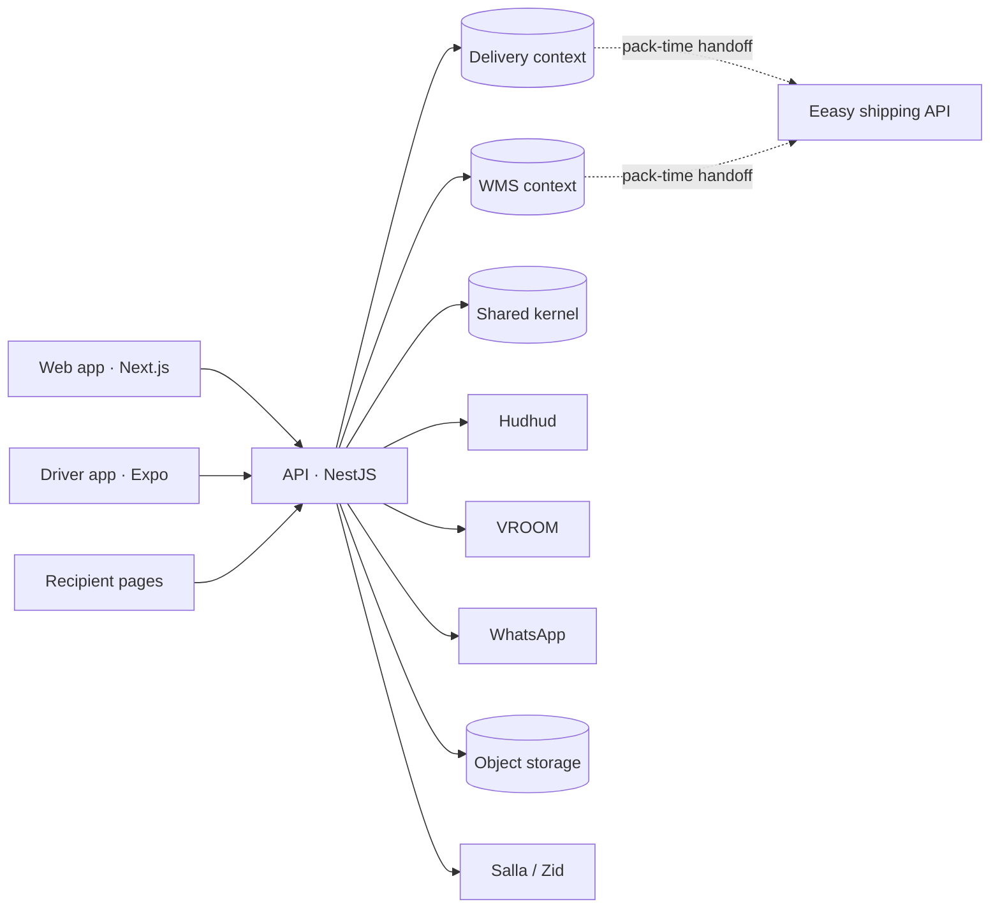

# Eeasy Logistics — foundation plan

Date: 2026-10-31. Status: brief for the architecture phase; owner-approved direction. Web version: the "Eeasy Logistics Foundation" page shared with the owner.

## 0. Decision record

Owner, 2026-10-31: last-mile work inside eeasynew is halted; nothing from wave A merges. A separate product, **eeasy-logistics**, is built instead: last-mile and WMS, standalone with its own accounts, one GitHub monorepo under Marllow-git holding the Next.js web app and the NestJS API, and a new driver app. Recorded as ADR-0001 to ADR-0004 and ADR-0023.

What carries over is the knowledge, not the code: the PRD, the GROUND-1 to GROUND-9 and LM-1 to LM-6 designs, the UAT-1 operator verdicts, the Logestechs, OTO, Shipox, Onfleet and Bolesa teardowns, the WMS architecture page, and the rulings in ADR-0005 to ADR-0017. The eeasynew Delivery module stays there as reference material.

Tracker state after the halt: the twelve `module:last-mile` issues in eeasynew are closed as not planned; PRs #1425 and #1426 stay open unmerged; the WMS issues #877 to #884 stay open until their plan moves here; X-1 (public API and webhooks, eeasynew #885) is the one piece of eeasynew work this product depends on.

## 1. Product shape

One tenant model, two operational modules, three surfaces.

- **Delivery module.** A merchant's own drivers deliver the merchant's orders: intake, zones, dispatch, the driver field loop with proof and COD, recipient tracking and messages, cash custody and settlement, slots and shifts, route sequencing and planning.
- **WMS module.** The merchant's stock: locations, catalog with lot and serial tracking, inbound, a double-entry stock ledger, picking and packing, dispatch handover, returns and counting, one-way channel stock sync.
- **Surfaces.** Web app for merchant operations and platform administration; a driver app (iOS and Android); public recipient pages for tracking, reschedule and address pin.

Users: merchant owner, dispatcher and branch staff, warehouse staff, driver, platform admin, recipient. First-customer profile (PRD): one to three sites, three to fifteen drivers, fifty to five hundred orders a day, COD on at least half, Riyadh and Jeddah, Arabic-first.

## 2. Rulings carried over

See `adr/README.md`, group "Rulings carried over from eeasynew" (ADR-0005 to ADR-0017).

## 3. Stack

| Layer | Choice | ADR |
|---|---|---|
| Monorepo | pnpm + Turborepo; `apps/web`, `apps/api`, `apps/driver`, `packages/contracts`, `packages/ui`, `packages/i18n`, `packages/config` | 0003, 0021 |
| Database | PostgreSQL 16 + PostGIS | 0019 |
| ORM and migrations | Drizzle + SQL migrations | 0020 |
| Jobs and outbox | BullMQ on Redis; outbox row in the same transaction as the business write | 0024 |
| Realtime | Server-sent events; polling at 10 to 15 s | 0009 |
| Identity | Own accounts; staff email + password (+ phone OTP), drivers phone OTP over WhatsApp with device-bound refresh tokens and PIN for cash; short access JWTs, rotating refresh tokens, scopes | 0023, identity document |
| Tenancy | `account_id` on every operational row, enforced structurally | 0025 |
| Geo | Hudhud geocode + matrix, VROOM solver, OSRM fallback, National Address short codes at intake | 0010 |
| Messaging | `MessageSender` port, WhatsApp adapter first | — |
| Storage | S3-compatible, signed upload and expiring read URLs | 0015 |
| Driver app | Expo + Expo Router in `apps/driver`; expo-location + task-manager, expo-sqlite outbox, expo-notifications, EAS | 0004, 0008, 0021 |
| Hosting | Containers on a Gulf-region host; Compose for development and CI | 0022 |
| Quality gates | typecheck, lint, unit, API integration on real PostgreSQL, census AR + EN, gitleaks; Arabic release notes | handbook |
| Observability | OpenTelemetry, Sentry, PostHog | platform document |

## 4. Domain model, first cut

Three bounded contexts in one database, separated by schema prefix and module folder; nothing crosses a context except through an explicit port.

**Shared kernel.** Accounts and users with roles (owner, dispatcher, branch staff, warehouse staff, driver, platform admin); limits and usage counters; one `sites` table (kind branch | warehouse | both) replacing the eeasynew branches-versus-warehouses split (ADR-0018); audit log, idempotency keys, outbox, feature flags and rollout mode, admin provisioning.

**Delivery context.** Ported from the 39 eeasynew module migrations: vehicles, drivers, driver sessions and devices (push tokens), driver locations; zones with boundary polygons, reason codes; orders with kind (delivery, return pickup, exchange, pickup request), items, events, per-account sequences, pins, transfers; assignments and offers, capacity counters that follow the current holder, slots and slot days, driver shifts; attempts, proofs, COD collections with custody and method, cash handovers, driver liability entries, cash deposits, cash reports; recipient tracking tokens per order.

**WMS context.** From the WMS architecture page: locations tree with totes, products with tracking mode, lots and serials, suppliers and purchase orders, inbound receipts, stock movements ledger with levels and summary projections, fulfilment orders with picking tasks, packages with pack-time shipment handoff, returns and adjustments, counting sessions, consumables, channel publications outbox.

## 5. Integrations

| Integration | Role | Needs |
|---|---|---|
| Eeasy shipping API | 3PL shipments at pack time, labels, tracking webhooks | eeasynew X-1 (#885): API keys, signed webhooks |
| Salla and Zid | Order intake, stock publish | New partner apps for this product |
| Hudhud | Geocoding, distance matrix | B2B key |
| VROOM | Route optimisation | Container beside the API |
| WhatsApp | Driver OTP, recipient messages | Provider account, approved AR/EN templates |
| Push | Driver offers and alerts | Expo push, new EAS project |
| Object storage | Proofs, labels, exports | Bucket before wave 1 |

## 6. Build sequence

| Wave | Delivers | Exit |
|---|---|---|
| 0 · Foundation | Scaffold, CI, Compose, PostgreSQL + PostGIS, auth and tenancy, accounts and sites, roles, platform admin with provisioning and rollout mode, design system and AR/EN i18n, audit, outbox, observability | Admin provisions a merchant; merchant signs in, creates a site and a staff user, both languages, CI green |
| 1 · Delivery core | Orders (manual, CSV), zones, drivers and vehicles, manual dispatch with offers, driver app field loop, offline outbox, recipient tracking and messages, driver push; intake rules: coverage before carrier, receive as pending, auto-override | UAT-2: the UAT-1 script on this product, all PASS including own-fleet coverage |
| 2 · Dispatch and money | Auto-dispatch, slots and shifts, cash custody handover deposits and reports, driver pay statements, routing rung 1, reschedule and address-pin pages (recipient pin over WhatsApp), diagnose console | A cash day closes with zero unexplained deficit; stops sequenced by VROOM |
| 3 · WMS core | W-1 locations, W-2 catalog, W-4 ledger, then W-3 inbound and counting, then W-5 picking and W-6 packing with pack-time handoff | Stock in, pick, pack, ship; nightly ledger assertion green |
| 4 · Network | Public API and webhooks (catalogue, samples, test, one-time token), Salla and Zid intake and publish, routing rungs 2 and 3, SLA and scorecards, returns and exchange, W-7, W-8 | A channel order flows to a delivered parcel without a human copying anything |

Rough sizing at the eeasynew cadence: wave 0 two to three weeks, wave 1 six to eight, wave 2 four, wave 3 six, wave 4 open-ended; waves 2 and 3 may overlap once wave 1 is in UAT.

## 7. Deliberately not ported

The Laravel module kit, Spatie permissions, Sanctum abilities, the `acc_*` ledger, the carrier pricing engine; the branches-versus-warehouses split; executor-fleet seams beyond a nullable column; the eeasy-app driver screens; Bluetooth POS and vehicle types.

## 8. Owner decisions

D1 database, D2 ORM, D3 driver-app home, D4 hosting: recorded as ADR-0019 to ADR-0022. D5 Eeasy sign-in link: wave 4 option (ADR-0023). D6 commercial model and billing: limits and counters from day one, pricing before wave 2. D7 pilot merchant and go-live target: open. D8 repo: `Marllow-git/eeasy-logistics`, created 2026-10-31; brand name for the merchant UI: open. D9 WMS issues #877 to #884: close in eeasynew once the WMS plan file exists here.

## 9. Reference products

| Reference | What we take | What we hold |
|---|---|---|
| Logestechs (admin-pro.logestechs.com, docs.logestechs.com) | Admin and dispatcher parity; public-API shape (one `X-API-Key` per customer account; create, cancel, return, track with history, AWB PDFs, address book, service types); we add webhooks and a sandbox | eeasynew `docs/delivery/01`, decompiled driver app, driver-cash gap-fill; missing: admin-pro census (needs a login) |
| Bolesa (app.bolesa.net, Bolesa 2) | Architecture precedent (Next.js on Vercel over an API on PostgreSQL, upload service, S3); patterns: coverage before carrier, N-consignee issuance with failures returned, diagnose console with one-click fixes, receive-as-pending and auto-override switches, store webhooks with catalogue and samples and test, return and replacement AWB from the row, recipient pin over WhatsApp; buy-not-build options: Shipday, Daftra, Ottu, Firebase push, Theneo docs | eeasynew `docs/research/bolesa-audit-2026-10`; re-audit Bolesa 2 after ~2026-11-03 |
| OTO (OTO Flex) | Dispatch and routing UX (simulate, optimise, create, assign), status vocabulary, carrier catalogue (433) | eeasynew `docs/delivery/03`, `docs/research/oto-platform-audit-2026-10`, `oto-carrier-audit-2026-10` |

Owed before wave 1 design: screen censuses of Logestechs admin and OTO Flex into `docs/references/`, plus the Bolesa 2 re-audit.

## Not checked

admin-pro.logestechs.com behind its login; current Expo, NestJS and Drizzle minor versions at scaffold time; Hudhud matrix pricing; whether Salla allows a second partner app under the same partner account.
