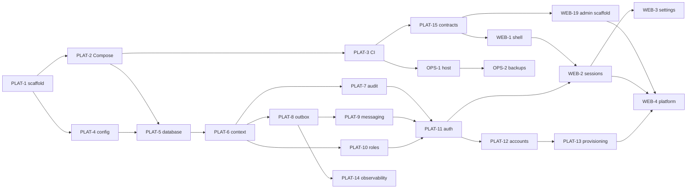
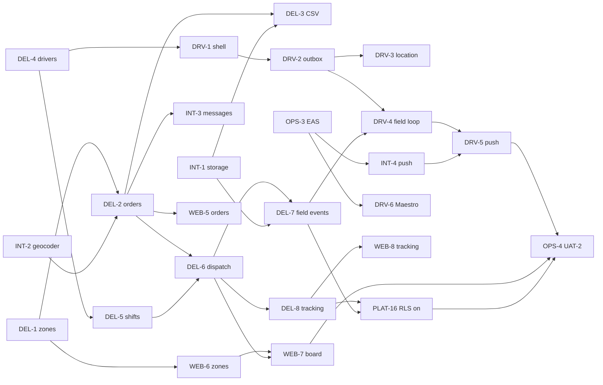
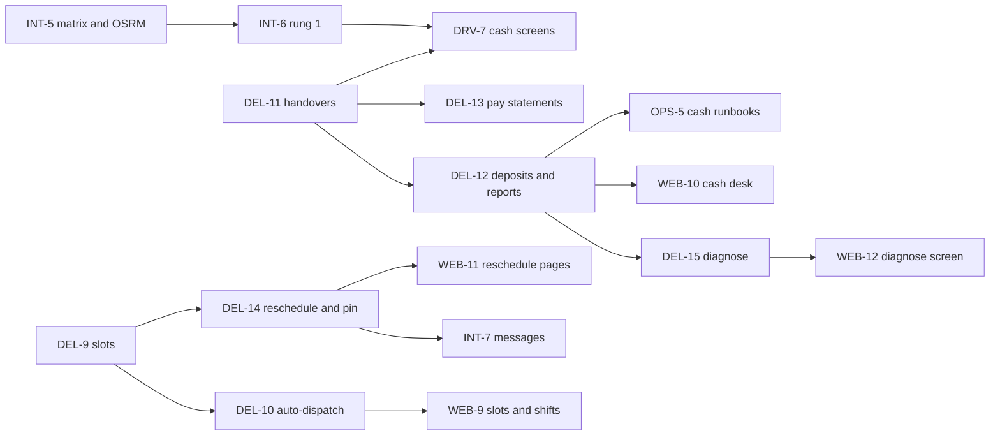
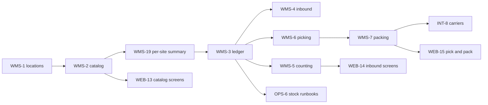
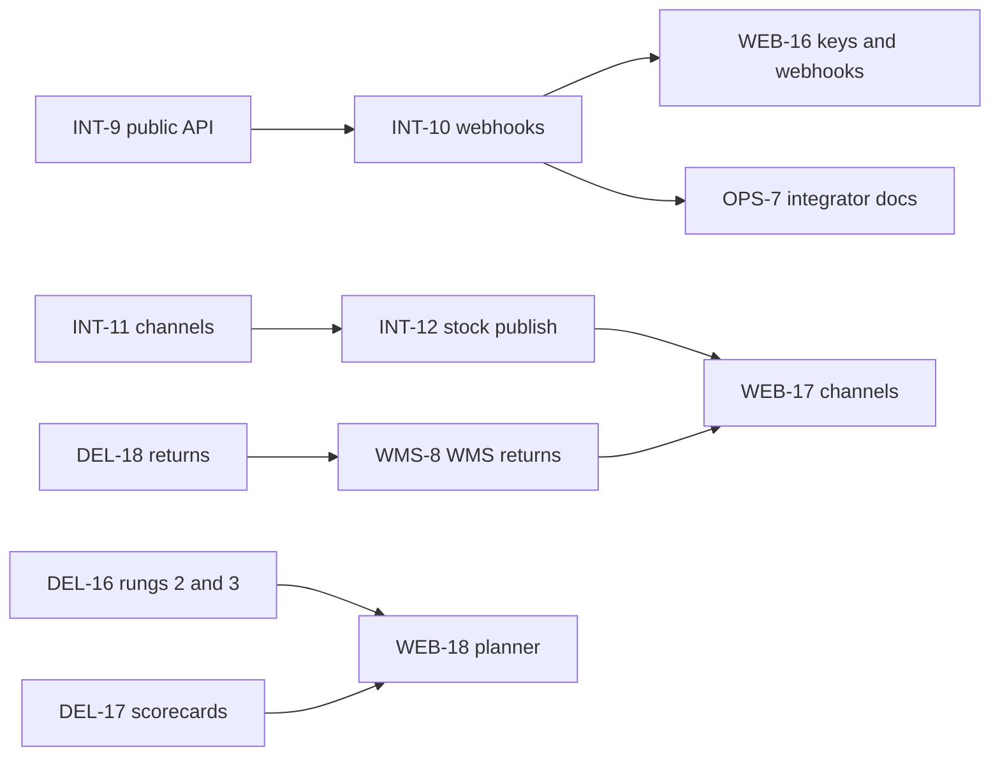

# Roadmap

Foundation document 12. Date: 2026-10-31. Status: for owner review. Derives from every other foundation document; governs the order of orders. Order: ARCH-1, decision 2.9. Amended 2026-11-03 (A-28): the feature book (`docs/research/feature-book/`, chapter 15 its comparison with this roadmap) is folded in; a row the book changes carries a **Book:** note, the text defects it found are fixed in place, its new rows are in §1.6 to §1.9 and its owner questions are Q-46 to Q-67.

The roadmap orders work; it decides no architecture. Waves, deliverables and exits are the foundation plan §6; every order below cites the ADRs and document sections that bind it. Where the documents leave something open, it is a row in the owner decision register (section 4), never a choice made here.

Documents cited by number: 2 domain model (`docs/architecture/domain-model.md`), 3 contracts (`docs/contracts/`), 4 identity and tenancy, 5 data (`data.md`), 6 platform, 7 web (`web.md`), 8 driver app (`driver-app.md`), 9 integrations (`integrations.md`). Order ids follow handbook 04 (`<MODULE>-<N>`, unique): `PLAT` platform and kernel, `DEL` delivery, `WMS`, `DRV` driver app, `WEB` web, `INT` integrations, `OPS` operations and runbooks; from the feature book also `BILL` billing, `SEC` security, `PDPL` data protection, `RES` research, `RPT` reports, `VEH` vehicles, `HUB` hubs, `CARR` carrier aggregation, and `ADR-A` to `ADR-G` for decisions owed (letters until the ADR gets its number). Each order gets its plan file and issue when it starts (handbook 01); numbers are not reused.

Columns: **Role** is the executor role (`backend`, `ux`, `driver`, `research`; `lead` for an ADR the lead drafts after a ruling). **Adv.** is the adversary trigger of handbook 01: `yes` when the order touches auth, tokens, authorization, visibility, cash or stock ledgers, or private data.

## 0. Progress

Updated by the lead at every order close (handbook 01 stage 9) and read with the ledger `docs/orders/README.md`, which holds the in-flight rows. A wave's exit criteria are in section 2.

| Order | State | PR | Date |
|---|---|---|---|
| ARCH-1, CHORE-1, CHORE-2 | merged | #4 to #14 (foundation) | 2026-10-31 |
| PLAT-1 CI skeleton, PLAT-2 local stack, PLAT-3 CI lanes, PLAT-4 config, PLAT-5 schema and harness, PLAT-6 request frame, PLAT-7 audit log, PLAT-8 outbox, PLAT-10 roles, PLAT-14 telemetry, PLAT-15 contracts seam | merged | #18 to #76 | 2026-10-31 to 2026-11-01 |
| WEB-19 admin scaffold, WEB-1 shell and design system | merged | #42, #61 | 2026-11-01 |
| PLAT-9 messaging port and OTP | merged | #75, fix #84 | 2026-11-01 |
| PLAT-11 staff and platform authentication | merged | #83 | 2026-11-02 |
| PLAT-12 accounts, members and sites | merged | #89 | 2026-11-02 |
| WEB-2 browser sessions and sign-in doors | merged | #91 | 2026-11-02 |
| INT-4 push sender | merged | #93 | 2026-11-02 |
| OPS-3 EAS and store accounts (research) | merged | #82 | 2026-11-01 |
| INT-2 geocoder and short codes | merged (migration `20261102115811_core_geocode_cache`) | #105 | 2026-11-02 |
| CHORE-3 timestamp migration names and parallel-order migrations | merged | #116 | 2026-11-02 |
| PLAT-13 provisioning, rollout and suspension | merged (two adversary runs, fixes in) | #104 | 2026-11-02 |
| WEB-3 merchant settings screens | merged | #109 | 2026-11-02 |
| DEL-4 drivers, devices and driver auth | merged (two adversary runs, three fix rounds; migration `20261102122929_del_drivers`; `driverVerifyOtp` gains `account_id`) | #114 | 2026-11-02 |
| OPS-1 host, registry and staging | waits on the owner's go (Q-10, Q-12); the wave 0 exit criteria need it | – | – |
| WEB-4 platform console screens | merged (one adversary run, fixes in; Linux baselines committed) | #129 | 2026-11-02 |
| DEL-1 zones and coverage | merged (migration `20261102125922_del_zones`; the `delivery` feature gate on the staff delivery doors) | #132 | 2026-11-02 |
| DEL-2 orders and intake rules | registered (#134); leg 1 building (the critical path's next step) | – | 2026-11-02 |
| DRV-1 driver app shell and sign-in | parked by owner ruling 2026-11-03 (driver app deferred, A-36); leg 1 pushed as draft PR #147, kept open | #147 (draft) | 2026-11-03 |
| DEL-5 shifts and location pings | registered (#137); leg 1 building | – | 2026-11-02 |

Wave 0 remaining for its exit (section 2): OPS-1 and the staging checks that need it (deploy on merge, the restore drill, an OTP delivered through the WhatsApp engine (ADR-0041; no Meta template approval), the ADR acceptances 0026, 0027, 0029, 0031, 0032, 0033, 0036, 0037).

Feature book (A-28): the decision rows of §1.6 (ADR-A to ADR-G, OPS-8, RES-1) are owed before the orders they gate, in the order of Q-46 onwards; Q-10 is reopened against the PDPL draft (Q-46) before OPS-1 deploys anything; the wave 1 amendments with a plan still to write (INT-3's messaging model, DEL-7's proof gating and COD confirmation, DEL-8's token purposes) are planned first because those orders build next.

## 1. Waves and orders

**Driver app deferred (owner ruling 2026-11-03, A-36).** Every `DRV` order (DRV-1 to DRV-12, in any wave) waits until the web and admin work is complete; the waves' web, admin and backend orders go first. The backend doors the app will call (DEL-4, DEL-5, DEL-7 and the rest) are still built in their waves, because the board, the cash desk and the console read them, and their contracts stay the app's seam. DRV-1's leg 1 (draft PR #147) is parked, not closed; its Expo patch-train exemption and plan are revisited on resume. The wave exit boxes that need the app move to the driver app phase (§2).

### 1.1 Wave 0 · Foundation

Delivers (foundation plan §6): scaffold, CI, Compose, PostgreSQL + PostGIS, auth and tenancy, accounts and sites, roles, platform admin with provisioning and rollout mode, design system and AR/EN i18n, audit, outbox, observability.

| Id | Title | Delivers | Bound by | Depends on | Role | Adv. |
|---|---|---|---|---|---|---|
| PLAT-1 | Monorepo scaffold | pnpm + Turborepo with `apps/web`, `apps/api`, `apps/driver` and `packages/contracts`, `ui`, `i18n`, `config`, `db`; shared TypeScript and lint config; module-boundary lint for the three contexts. | ADR-0003, ADR-0021, ADR-0026; plan §3; doc 5 §1.2 | – | backend | no |
| PLAT-2 | Compose profiles | `compose.yaml` with profiles `dev`, `ci`, `stack-a`, `stack-b`: PostgreSQL 16 + PostGIS, Redis 7, VROOM, MinIO, `whatsapp-stub`, Mailpit; clone-per-stack script (`elx_seed` template). | ADR-0019, ADR-0022; doc 6 §1, §2; doc 5 §11.7; handbook 03 | PLAT-1 | backend | no |
| PLAT-3 | CI lanes | The five required checks (`typecheck-lint`, `api-test`, `web-build-census`, `driver-test`, `gitleaks`) plus the RLS-enabled integration lane; gitleaks pre-commit; Turborepo cache; image build, scan and push on merge. | doc 6 §4; doc 5 §4.5; handbook 03 | PLAT-1, PLAT-2 | backend | no |
| PLAT-4 | Config module | `packages/config`: every setting read once and schema-validated; production startup refusals; stub adapters refused in production; credentials encryption (AES-256-GCM) with key id. | doc 6 §3; doc 9 §9, §11; doc 5 §10; AGENTS.md | PLAT-1 | backend | yes |
| PLAT-5 | Database, roles and migrations job | Drizzle conventions and `packages/db` helpers (incl. `xid8` type); the four database roles; `api --role migrate` one-shot job with advisory lock; `/health`, `/ready`; tenancy schema test; append-only trigger templates and their tests; RLS policies created with every table (RLS still disabled); deterministic seeds with two accounts. | ADR-0019, ADR-0020, ADR-0025, ADR-0031; doc 5 §1, §3.1, §4.1, §4.3, §4.4, §11; doc 6 §5; doc 4 §5 | PLAT-2, PLAT-4, Q-16 | backend | yes |
| PLAT-6 | Request context and tenancy guard | Guard resolving account, membership, device into `AsyncLocalStorage`; unit of work setting `elx.account_id`; repository predicate; `@CrossTenant()` on the `elx_platform` pool; idempotency keys (K-8); error model and request ids; rate-limit budgets. | ADR-0025, ADR-0031; doc 4 §5, §8; doc 5 §4.2, §5.1; doc 3 §3, §4, §7 | PLAT-5 | backend | yes |
| PLAT-7 | Audit log | Append-only, monthly-partitioned `core_audit_log`; synchronous writes for admin and ledger-adjacent actions; list (the export was deferred at merge). **Book:** an export door is owed as a follow-up (ch. 12). | doc 4 §7; doc 2 §2.5; doc 5 §2.1, §11.5 | PLAT-6 | backend | yes |
| PLAT-8 | Outbox, relay and worker queues | Outbox row in the business transaction; single-leader relay; one BullMQ queue per kind; consumer receipts; supersede; dead letters; platform outbox list and replay; pruning job. | ADR-0024, ADR-0027, ADR-0036; doc 2 §2.7, §6; doc 5 §5.2, §5.3; doc 9 §4 | PLAT-6 | backend | yes |
| PLAT-9 | Messaging port and OTP delivery | `MessageSender` with the WhatsApp adapter (eeasynew's provider, new number; A-22) and stub; `auth_otp` template submitted on the new number; OTP outbox rows encrypted and deleted 1 h after send; mail adapter for invitations and resets. | ADR-0037; doc 9 §2.4, §5.1, §5.2; doc 5 §10; doc 4 §3 | PLAT-8, Q-27 | backend | yes |
| PLAT-10 | Roles and permissions | System roles seeded; permission catalogue; `x-permission` enforcement; site scoping by `site_ids`; `403 separation_of_duties` hook. | doc 4 §2; doc 3 §1, §11 | PLAT-6 | backend | yes |
| PLAT-11 | Staff and platform authentication | Invitations, Argon2id passwords with breached check, phone OTP second factor, reset; 15-min access JWT and rotating refresh cookies with family revocation; platform TOTP; `X-EL-Client` and `Origin` check. | ADR-0023, ADR-0032; doc 4 §3.1, §3.3, §4, §9; doc 3 §1; doc 7 §3.3 | PLAT-7, PLAT-9, PLAT-10, Q-7, Q-23 | backend | yes |
| PLAT-12 | Accounts, members and sites | Account and settings, limits and usage counters, members (invite, update, revoke), sites of every kind. **Book:** the per-site stock summary and reservation scope are fixed in WMS-19 before WMS-3; a read-only trial state distinct from `suspended` comes with BILL-1 (ch. 08, 10, 12). | ADR-0018; doc 2 §2.1 to §2.3; doc 3 §10 wave 0 | PLAT-10, PLAT-11 | backend | yes |
| PLAT-13 | Provisioning, rollout and suspension | Platform account and site provisioning, owner invite, rollout modes and flags with the `FeatureGate`, suspension cascade, cross-tenant member and audit reads, platform staff management. | ADR-0006, ADR-0015; doc 4 §6; doc 2 §2.4; doc 3 §10 wave 0 | PLAT-7, PLAT-12 | backend | yes |
| PLAT-14 | Observability | OpenTelemetry traces, metrics and JSON logs; Sentry; PostHog (ids only); shared log redactor; alerts per doc 6 §7 with the per-kind thresholds of ADR-0036. **Book:** a status page and incident communication are SEC-1's (ch. 14). | doc 6 §7; doc 9 §4.5, §10, §11 | PLAT-1, PLAT-8 | backend | yes |
| PLAT-15 | Contracts generation | `packages/contracts`: `redocly lint` with the repository rules, bundles per surface, generated TypeScript types, clients and Zod schemas, contract-test harness against the API in Compose. | doc 3 §9; handbook 03 | PLAT-1, PLAT-3 | backend | no |
| WEB-1 | Web shell, design system and i18n | Route groups, Radix + Tailwind `packages/ui` with tokens, next-intl `ar` default and RTL, logical-CSS lint, shared formatting module, IBM Plex Sans Arabic, census harness `ar` and `en`. | ADR-0016, ADR-0033; doc 7 §1, §5, §6.1 to §6.3, §10, §11 | PLAT-1, PLAT-15, Q-21 | ux | no |
| WEB-2 | Browser sessions and sign-in doors | Edge routing of `/v1/*` on the web origin; middleware refresh; single-flight fetch wrapper; CSP and headers per group; sign-in, second factor, reset, invitation, platform sign-in and TOTP. | ADR-0032; doc 7 §3, §8 wave 0 | WEB-1, PLAT-11, Q-22 | ux | yes |
| WEB-3 | Merchant settings screens | Home with visible modules, account settings, members, sites, audit log; route manifest and `<Can>` gating. | doc 7 §4, §8 wave 0 | WEB-2, PLAT-12, PLAT-7 | ux | no |
| WEB-4 | Platform console screens | In `apps/admin` (ADR-0038): accounts and provisioning, rollout and flags, cross-tenant views with the support banner and `X-Support-Reason`, outbox, staff and audit. | ADR-0038; doc 7 §3.5, §8 wave 0; doc 4 §5, §6 | WEB-19, WEB-2, PLAT-13, PLAT-8 | ux | yes |
| WEB-19 | Admin console scaffold | `apps/admin`: Next.js app with `(auth)` and `(platform)` groups, `ar` default and RTL, standalone image and Dockerfile, `admin` service in the Compose profiles and the native stack, `admin-build-census` lane and `image (admin)` job, per-host edge routing documented for OPS-1, architecture rule limiting it to the `platform` contracts surface and `apps/web` to `staff` and `recipient`; the `(platform)` placeholder leaves `apps/web`. | ADR-0038; doc 7 §1, §1.2; doc 6 §2, §4, §8 | PLAT-3, PLAT-15 | ux | no |
| OPS-1 | Host, registry and staging | Provider quote and choice, registry, staging deployed on merge to `main`, secret store, Cloudflare in front, private network; `api --role migrate` on every deploy **and on a daily schedule** (it owns partition maintenance; the worker never holds `DATABASE_URL_OWNER`, A-21). **Book:** Q-10's Bahrain default is reread against the PDPL draft's in-Kingdom storage duty (Q-46) before any deploy (ch. 12, 14). | ADR-0022, ADR-0031; doc 6 §1, §4, §8, §10; doc 5 §13.4; PLAT-7 plan §9 M-3 | PLAT-3, Q-10, Q-12 | research, backend | yes |
| OPS-2 | Backups and wave 0 runbooks | Daily backups and WAL archiving, first restore drill; runbooks: provision an account, rotate token signing key, rotate credentials key, restore from backup, switch a rollout mode. **Book:** a breach runbook with the notification clock (with PDPL-1), a key-rotation drill, recovery time and point targets (ch. 14). | doc 6 §6, §9 | OPS-1 | backend | no |

### 1.2 Wave 1 · Delivery core

Delivers: orders (manual, CSV), zones, drivers and vehicles, manual dispatch with offers, driver app field loop, offline outbox, recipient tracking and messages, driver push; intake rules: coverage before carrier, receive as pending, auto-accept.

| Id | Title | Delivers | Bound by | Depends on | Role | Adv. |
|---|---|---|---|---|---|---|
| INT-1 | Object storage port | `ObjectStorage` adapter (MinIO, provider bucket), signed upload and expiring read URLs, versioning; buckets per environment before the first driver signs in. | ADR-0015; doc 9 §2.6; doc 6 §6 | PLAT-8, OPS-1 | backend | yes |
| INT-2 | Geocoder and short codes | Hudhud `Geocoder` adapter, National Address short-code lookup, cache, confidence, fixture stub. | ADR-0010; doc 9 §2.2, §6.1, §6.2 | PLAT-8, Q-28 | backend | no |
| INT-3 | Recipient messages, wave 1 | Templates `order_assigned`, `order_out_for_delivery`, `order_attempted`, `order_delivered`; opt-out list; per-order and per-phone caps; monthly budget counter. **Book:** the templates are product text sent through the engine (ADR-0041), not Meta-approved templates, and the plan, doc 9 §2.4 and §5 (A-29) and the exit boxes follow that; the 3,000-a-month budget default lasts two days at the §5.6 profile and needs a new default; opt-out quick replies do not exist on the engine and inbound callbacks need an owner; `order_out_for_delivery` promises no ETA window until INT-6; a recipient OTP template is added for DRV-8 (ch. 05). | ADR-0037, ADR-0041; doc 9 §5 | PLAT-9, DEL-2 | backend | yes |
| INT-4 | Push sender | `PushSender` with Expo push, EAS credentials, recorder stub; payloads carry ids only. | doc 9 §2.5; doc 8 §8.2 | PLAT-8, OPS-3 | backend | no |
| DEL-1 | Zones and coverage | Zones with boundary polygons, coverage per site, `checkCoverage`, reason codes; the coverage step of the provisioning door. | ADR-0015; doc 2 §3.4; doc 3 §10 wave 1 | PLAT-13 | backend | no |
| DEL-2 | Orders and intake rules | Order, items, events, per-account numbers; manual create, edit, cancel, transitions (§3.13) with `If-Match`; geocode at intake; coverage before carrier, receive as pending, auto-accept. **Book:** `awaiting_review` is set by nothing until ADR-C rules holds and approval (DEL-31 builds them); a parcel-count field; the own-fleet label door `getOrderLabel` is in the contract at wave 1 and is built by DEL-20 (ch. 01). | doc 2 §3.1 to §3.3, §3.13, §3.18; doc 3 §5; doc 9 §6.2; plan §6 | DEL-1, INT-2, Q-1, Q-3, Q-4, Q-6 | backend | yes |
| DEL-3 | CSV import | Import job (`202`), signed upload, progress stream, error list. | doc 3 §3, §6 | DEL-2, INT-1 | backend | no |
| DEL-4 | Drivers, devices and driver auth | Driver, Vehicle, DriverDevice; driver OTP with E.164 budgets, device binding, 90-day device-bound refresh, cash PIN set and reset, `driverVerifyCashPin`. **Book:** the `['dispatcher','driver']` role pair and `delivery.cash.read` conflict with the driver-role rule, a follow-up before DEL-11; the PIN window text is corrected in Q-15 (ch. 04, 06). | ADR-0034; doc 4 §3.2, §4; doc 2 §3.5; doc 8 §5.3, §7 | PLAT-11, PLAT-9, Q-8, Q-15 | backend | yes |
| DEL-5 | Shifts and location pings | DriverShift (§3.17); location ring and Redis fan-out; daily trails; latest positions; stale-tracking alert after 5 minutes without a point on an active shift. Builds `planShift` (DEL-5 plan 2.3); the contract's `x-wave: 2` retags to 1 (A-31) and DEL-10 and WEB-9 consume it. **Book:** site roles hold no location permission while the position doors are site-scoped, ruled in the DEL-5 review; the planned-end auto-close is in the adversary fix (ch. 04). | ADR-0009, ADR-0028, ADR-0039; doc 2 §3.6, §3.7, §7; doc 5 §6 | DEL-4, Q-5 | backend | yes |
| DEL-6 | Offers and manual dispatch | Assignment, Offer (§3.14), capacity counters; manual assign and unassign (`delivery.assignment.ended`); dispatch and driver SSE streams with replay buffer and polling twins. **Book:** an assignment gap setting; transfer as an assignment change; the un-assign arrow reserved (ch. 02; already in the DEL-6 plan). | ADR-0009, ADR-0029; doc 2 §3.8, §3.14; doc 3 §5, §6 | DEL-2, DEL-5 | backend | no |
| DEL-7 | Field events, proofs and COD | Replayable driver events endpoint (D-15, D-16, D-23); attempts (§3.15); proofs by signed upload; COD collections and custody entries (§3.16) with PIN verified at replay. **Book:** COD prefilled from the order with the driver's confirmation; a required-proof set per reason validated at the door; a `scan` proof kind; the cash block a PIN replay sets has no clearing door until DEL-11 (Q-61) (ch. 03, 06). | ADR-0007, ADR-0008, ADR-0034; doc 2 §3.10, §3.11, §3.15, §3.16; doc 3 §5, §12 | DEL-6, INT-1, Q-1, Q-15, Q-25 | backend | yes |
| DEL-8 | Recipient tracking | TrackingToken issue and revoke; public view (D-24); recipient tracking API and stream. **Book:** display modes and a queue-position notice after INT-6; never a lookup by phone; the 48-hour purpose tokens cannot cover a 7-day return window, so DEL-28 gets its own purpose (ch. 05, 07). | doc 4 §3.5; doc 2 §3.12; doc 3 §6 | DEL-6 | backend | yes |
| PDPL-1 | Data protection baseline (wave 1 exit) | Records of processing, data subject requests, retention schedule (Q-37, Q-38, A-35), breach runbook with the notification clock, cross-border transfer register. | book ch. 14 | OPS-1, Q-46 | research, backend | yes |
| PLAT-16 | Enable row-level security | One migration enabling RLS on every operational table at wave 1 exit; schema test asserts `relrowsecurity`. | ADR-0025, ADR-0031; doc 4 §5; doc 5 §4.3, §4.5 | DEL-1 to DEL-8 | backend | yes |
| DRV-1 | Driver app shell and sign-in | Expo Router groups, `ar` default and RTL, secure storage, OTP sign-in, device binding, single-flight refresh, PIN setup and device verifier. **Book:** driver-app §5.3, §7.1 and §12.4 are stale against the contract (A-30) (ch. 03). | ADR-0004, ADR-0021, ADR-0034; doc 8 §5.2, §5.3, §7, §10 | PLAT-15, DEL-4 | driver | yes |
| DRV-2 | Offline outbox and sync screen | SQLite outbox with lanes and replay rules, local read model, sync screen, support bundle, local log ring. | ADR-0008; doc 8 §3, §4.5, §11 | DRV-1 | driver | yes |
| DRV-3 | Shift and background location | Permission setup screens, shift actions, background position task with the `moving` and `parked` profiles, parked geofence, speed bands, fix filter, watchdog and battery measurement, buffer. **Book:** RES-1 (Wasl and CST applicability) is answered before it ships (ch. 04). | ADR-0009, ADR-0028, ADR-0039; doc 8 §6 | DRV-2, DEL-5, Q-26, RES-1 | driver | yes |
| DRV-4 | Field loop screens | Run list, offer sheet, order detail, pickup by scan, start stop, deliver with proof queue and COD, attempt, wave 1 cash tab. **Book:** navigation hand-off; proof capture for recipient OTP, ID check and scan is DRV-8's (Q-57); the geofenced drop warning is DEL-26's (ch. 03). | ADR-0007, ADR-0008; doc 8 §4, §5, §9 | DRV-2, DEL-6, DEL-7 | driver | yes |
| DRV-5 | Live updates and push | Driver stream, push notifications, offer acceptance race (D-13). | ADR-0009, ADR-0029; doc 8 §8 | DRV-4, INT-4 | driver | no |
| DRV-6 | Maestro lane and EAS channels | Maestro flows in `ar` and `en` with Toxiproxy; EAS profiles; OTA policy; minimum-version handling if ruled. | ADR-0035; doc 8 §12 | DRV-1, OPS-3, Q-24 | driver | no |
| WEB-5 | Orders screens | Orders list, manual create, detail (events, attempts, proofs, COD panel, tracking links), CSV import. **Book:** bulk actions with per-row results; labels with DEL-20 (ch. 01). | doc 7 §7, §8 wave 1 | WEB-3, DEL-2, DEL-3 | ux | no |
| WEB-6 | Zones, drivers and vehicles | `MapProvider` with zone editor and coverage; drivers, devices, trail; vehicles. | ADR-0033; doc 7 §6.4, §8 wave 1 | WEB-3, DEL-1, DEL-4, DEL-5, Q-19 | ux | no |
| WEB-7 | Dispatch board | Board and map, `useEventStream`, polling fallback, `409` conflict handling, keyboard assign path. **Book:** the exception list (DEL-33) and the alert surface (DEL-21) land on the board when those orders merge (ch. 02, 14). | ADR-0009, ADR-0029; doc 7 §6.3, §7, §8 wave 1 | WEB-6, DEL-6 | ux | no |
| WEB-8 | Recipient tracking page | `/track/[token]` and `/embed/track/[token]` (fails closed until embedding is ruled); budgets. **Book:** the merchant's logo here or branded tracking in WEB-20 (Q-62) (ch. 05). | doc 7 §9, §10.2; doc 4 §3.5 | WEB-1, DEL-8, Q-20 | ux | yes |
| OPS-3 | EAS project and store accounts | New EAS project; App Store and Play listings; background-location justification and declaration. | ADR-0004, ADR-0021; doc 8 §6.3, §12.3 | – | research | no |
| OPS-4 | UAT-2 script and run | The UAT-1 operator script ported to this product as `docs/orders/OPS-4/uat-2.md`, staging seed, run with the owner and pilot drivers. | plan §0, §6 | OPS-1, Q-31 | research | no |

### 1.3 Wave 2 · Dispatch and money

Delivers: auto-dispatch, slots and shifts, cash custody handover deposits and reports, driver pay statements, routing rung 1, reschedule and address-pin pages, diagnose console.

| Id | Title | Delivers | Bound by | Depends on | Role | Adv. |
|---|---|---|---|---|---|---|
| DEL-9 | Slots and slot days | Slot and SlotDay with capacity; slot on order. **Book:** service levels with cutoffs and service days sit beside it (DEL-32). | doc 2 §3.9; doc 3 §10 wave 2 | DEL-6 | backend | no |
| DEL-10 | Shift planning and auto-dispatch | Offers created by rule within D-12 and D-13 over the shifts DEL-5 plans. **Book:** preview then confirm (pulled from DEL-16, Q-63), the assignment gap, a bounded wave rule (ch. 02). | doc 2 §3.8, §3.17; doc 3 §10 wave 2 | DEL-6, DEL-9 | backend | no |
| DEL-11 | Cash handovers and custody | CashHandover with PIN (D-19, D-20), liability entries, cash block and its clearing (D-11). **Book:** the clearing door may move into wave 1 (Q-61); liability for goods needs a reason enum (Q-64) (ch. 06, 07). | ADR-0007; doc 2 §3.11, §3.16; doc 4 §2, §3.2; doc 5 §3 | DEL-7 | backend | yes |
| DEL-12 | Deposits and cash reports | Deposits with slip upload; cash report close per site and business date; nightly cash assertions. **Book:** the contract's deposit-reversal path moves custody backward and breaks a CHECK: the contract is fixed (A-32), not the ledger; `DepositRequest` requires a slip link on every deposit, confirmed or relaxed in the plan (ch. 06). | ADR-0007; doc 2 §3.11, §5.2; doc 5 §3.4; handbook 03 | DEL-11, INT-1 | backend | yes |
| DEL-13 | Driver pay statements | Statement per driver and period, scoped by the register ruling. **Book:** no incentive or hours rule exists; labour-law touchpoints are owner questions (ch. 04). | plan §6 wave 2 | DEL-7, DEL-11, Q-32 | backend | yes |
| DEL-14 | Reschedule and address pin | Staff and recipient reschedule and pin operations; 48-hour purpose tokens; void attempt. **Book:** delivery instructions (DEL-19) and the return request (DEL-28) reuse its token machinery (ch. 01, 07). | doc 4 §3.5; doc 2 §3.12; doc 3 §10 wave 2 | DEL-8, DEL-9 | backend | yes |
| DEL-15 | Diagnose console | Platform diagnose with whitelisted fixes; cross-tenant order and driver views; ledger assertion queries. | doc 4 §2; doc 5 §3.4; doc 3 §10 wave 2 | PLAT-13, DEL-12 | backend | yes |
| INT-5 | Distance matrix and OSRM | Deferred to the end of its wave (owner ruling 2026-11-01, A-24). Hudhud matrix adapter with per-day cache; `osrm` container; straight-line fallback. | ADR-0010; doc 9 §2.1, §6.3, §6.5; doc 5 §8 | INT-2, Q-28 | backend | no |
| INT-6 | Route optimiser, rung 1 | Deferred to the end of its wave (owner ruling 2026-11-01, A-24). VROOM driver stop sequence and per-stop ETA; nearest-neighbour fallback. **Book:** time windows and the delay alert follow in DEL-25. | ADR-0010; doc 9 §2.3, §6.4 | INT-5, DEL-6, Q-18 | backend | no |
| INT-7 | Recipient messages, wave 2 | `reschedule_request`, `address_pin_request`, `order_rescheduled`; quiet hours (window per Q-60). The `cash_block_notice` goes to dispatchers, not recipients, and moved to DEL-21 (A-28). | ADR-0037; doc 9 §5.1, §5.4 | INT-3, DEL-14 | backend | yes |
| DRV-7 | Cash and handover, wave 2 screens | Wave 2 cash tab, handover request, pin address at the door, run list in server sequence. | doc 8 §5.4 to §5.6, §9 | DRV-4, DEL-11, DEL-14, INT-6 | driver | yes |
| WEB-9 | Slots and shift planning | Slots and shift planning screens. | doc 7 §8 wave 2 | DEL-9, DEL-10 | ux | no |
| WEB-10 | Cash desk | Handovers, deposits, reports, driver cash and liability. **Book:** the merchant cash view lands with DEL-23. | doc 7 §4, §8 wave 2 | DEL-11, DEL-12, DEL-13 | ux | yes |
| WEB-11 | Reschedule and pin pages | Staff dialogs; recipient `/reschedule/[token]` and `/pin/[token]`. | doc 7 §8, §9 | DEL-14, WEB-8 | ux | yes |
| WEB-12 | Diagnose console screen | `/platform/accounts/[accountId]/diagnose`. | doc 7 §8 wave 2 | DEL-15, WEB-4 | ux | yes |
| OPS-5 | Cash-day runbooks and wave 2 script | Runbooks: close a cash day, clear a cash block, revoke a driver device; the wave 2 exit script. | doc 6 §9; ADR-0007 | DEL-12 | research | no |

### 1.4 Wave 3 · WMS core

Delivers, in the plan's order: W-1 locations, W-2 catalog, W-4 ledger, then W-3 inbound and counting, then W-5 picking and W-6 packing with pack-time handoff. Here W-n are the WMS work items of foundation plan §6 (carried from eeasynew #877 to #884, D9), not the WMS invariants of document 2 §4.16.

| Id | Title | Delivers | Bound by | Depends on | Role | Adv. |
|---|---|---|---|---|---|---|
| WMS-1 | Locations and totes (W-1) | Location tree, system locations, totes. **Book:** location and tote labels; inter-site transfers are WMS-15 (ch. 08). | ADR-0012, ADR-0018; doc 2 §4.1 | PLAT-13 | backend | no |
| WMS-2 | Catalog (W-2) | Products with tracking mode, lots, serials. **Book:** variants (WMS-9) before WEB-13; expired lots excluded from available; GS1 and SASO fields by ruling (ch. 08, 09). | ADR-0012; doc 2 §4.2 | WMS-1 | backend | no |
| WMS-19 | Per-site stock summary and reservations (design fix) | Before WMS-3: the summary keyed by account, site and product; `on_hand` excludes totes, docks and transit so available does not rise after a pick (doc 2 §4.10); the reservation guard per site; pick lines carry the fulfilment-line id. A doc 2, doc 5 and contract amendment with the schema. | doc 2 §4.5, §4.10; book ch. 08, 10 | WMS-2 | backend | yes |
| WMS-3 | Stock ledger and projections (W-4) | Append-only movements with validation trigger; StockLevel in-transaction; StockSummary projector on the `(tx_id, ledger_seq)` cursor; rebuild; nightly stock assertions. **Book:** builds on WMS-19's per-site summary and reservation scope; ADR-0031 is accepted first (ch. 08, 10). | ADR-0011, ADR-0031; doc 2 §4.4, §4.5; doc 5 §3 | WMS-19, PLAT-5, Q-2 | backend | yes |
| WMS-4 | Inbound (W-3) | Suppliers, purchase orders, receipts (§4.11), over-receipt approval, put-away. **Book:** quality hold as a quarantine movement, a locked put-away list, the over-receipt tolerance stored (W-15), receipt timestamps for dock-to-stock, SFDA and SASO fields, supplier returns (ch. 09). | doc 2 §4.3, §4.11 | WMS-3 | backend | yes |
| WMS-5 | Adjustments and counting (W-3) | Adjustments with the separation-of-duties threshold; count sessions (§4.15). **Book:** count types with recount-until-agree; per-SKU schedules are WMS-14 (ch. 08). | doc 2 §4.8, §4.15; doc 4 §2 | WMS-3, Q-17 | backend | yes |
| WMS-6 | Fulfilment and picking (W-5) | Fulfilment orders (§4.12), reservations, pick tasks (§4.13), short picks. **Book:** ordered allocation rules with a default, partial fulfilment with backorder lines, tote per order (one tote per task today), short-pick and quarantine reasons; pick strategies and FEFO are WMS-10 (ch. 10). | doc 2 §4.6, §4.10, §4.12, §4.13 | WMS-3 | backend | yes |
| WMS-7 | Packing and pack-time handoff (W-6) | Packages (§4.14); fulfilment options; own-fleet card creating a Delivery order through the port; labels. **Book:** COD on the package, not the fulfilment order; the own-fleet label defined; a handoff scan; packing aids are WMS-11 and pack-time carrier rules INT-16 (ch. 10). | ADR-0014; doc 2 §4.7, §4.14, §5.1 | WMS-6, DEL-2 | backend | yes |
| INT-8 | Eeasy shipping carriers | `CarrierShipments` adapter, tracking webhook mapping, labels, per-account key; carrier cards behind an `allowlist` flag until the go or no-go. **Book:** a carrier-event harmonisation table with AWB sync back; carrier choice by rules over `quote` (INT-16); carrier COD settlement is INT-17 (ch. 13, 06). | ADR-0014, ADR-0006; doc 9 §2.7, §3, §7 | WMS-7, Q-29 | backend | yes |
| WEB-13 | Locations and catalog screens | Locations tree and totes; products, lots, serials. | doc 7 §8 wave 3 | WMS-1, WMS-2 | ux | no |
| WEB-14 | Inbound, stock and counts screens | Purchase orders, receipts, stock and movements, adjustments, counts. | doc 7 §8 wave 3 | WMS-4, WMS-5 | ux | no |
| WEB-15 | Fulfilment, pick and pack bench | Scanner-first pick and pack screens. **Book:** web-only while the market runs the floor on handhelds; ADR-F decides whether WMS-18 replaces or joins it (ch. 08, 10). | doc 7 §8 wave 3 | WMS-6, WMS-7 | ux | no |
| OPS-6 | Stock runbooks and WMS pilot script | Runbooks: stock assertion drift, projection rebuild; the wave 3 exit script. | doc 5 §3.4, §3.5; doc 6 §9 | WMS-3 | research | no |

### 1.5 Wave 4 · Network

Delivers: public API and webhooks (catalogue, samples, test, one-time token), Salla and Zid intake and publish, routing rungs 2 and 3, SLA and scorecards, returns and exchange, W-7, W-8.

| Id | Title | Delivers | Bound by | Depends on | Role | Adv. |
|---|---|---|---|---|---|---|
| INT-9 | Public API and API keys | Public surface (orders, tracking); key create, rotate, revoke; per-key usage; sandbox keys. **Book:** resources split into orders, shipments and warehouses; a key-issue screen; a read surface for routes and stops; the SEC-1 pen test is its gate (ch. 13, 14). | doc 4 §3.4; doc 3 §1, §10 wave 4 | DEL-2, DEL-8, SEC-1, Q-13, Q-14 | backend | yes |
| INT-10 | Merchant webhooks | Subscriptions with verification token, Standard Webhooks signing (conformance test against the official libraries), retries with `410` and `Retry-After`, catalogue, samples, test, deliveries and redeliver; SSRF guard. **Book:** health states, no silent discard, an updated-since read; the no-PII payload test (INT-18) (ch. 13). | ADR-0027, ADR-0040; `webhooks.md`; doc 9 §2.10, §11 | INT-9, PLAT-8, Q-35 | backend | yes |
| INT-11 | Salla and Zid connections and intake | Partner apps, install and OAuth, claim, serialised token refresh, order intake, reconcile. **Book:** a mapping gate before the first sync and a failed-log view; never a merchant password; Zid's secret in Basic Auth and Salla's unsigned-timestamp signature shape the replay defence (ch. 13). | ADR-0013; doc 9 §8 | DEL-2, Q-30, Q-34 | backend | yes |
| INT-12 | Channel stock publish (W-8) | Channel publications, product mapping, drift reconcile. **Book:** a per-channel buffer; tracking push-back; allocation and replenishment later (INT-13). | ADR-0013; doc 2 §4.9, §5.3; doc 9 §8.4 | INT-11, WMS-3, Q-36 | backend | yes |
| DEL-16 | Routing rungs 2 and 3 | Dispatcher planner (simulate, commit through offers) and re-solve automation. **Book:** preview-then-confirm and re-solve may move earlier (Q-63). | ADR-0010; doc 9 §6.4 | INT-6, DEL-10 | backend | no |
| DEL-17 | SLA and scorecards | Reports over the reporting views. **Book:** cuts by carrier, zone, city and driver; missed-SLA counts; scheduled exports (RPT-1). | plan §6 wave 4; doc 5 §9 | DEL-7, Q-32 | backend | no |
| DEL-18 | Returns and exchange (Delivery) | `return_pickup` and `exchange` flows end to end. **Book:** the check-in capture of count and condition; exchange money fields are DEL-34, the recipient return request DEL-28, COD reversal ADR-D, claims DEL-27 (ch. 07). | doc 2 §3.1, §3.13 | DEL-7, Q-4 | backend | yes |
| WMS-8 | WMS returns (W-7) | Returns and dispositions into stock. **Book:** `delivery_return` is added to the `createReturn` source enum (A-33) (ch. 07). | doc 2 §4.8, invariant W-17; doc 3 §10 wave 4 | WMS-3, DEL-18, Q-36 | backend | yes |
| WEB-16 | API keys and webhook screens | API keys (shown once), subscriptions, samples, deliveries. | doc 7 §8 wave 4 | INT-9, INT-10 | ux | yes |
| WEB-17 | Channels and WMS returns screens | Connection page; channel publications; WMS returns. | doc 7 §8 wave 4; doc 9 §8.7 | INT-11, INT-12, WMS-8 | ux | no |
| WEB-18 | Planner and scorecards screens | Rung 2 simulate and commit; scorecards. | doc 7 §8; doc 9 §6.4 | DEL-16, DEL-17 | ux | no |
| OPS-7 | Integrator docs and sandbox | Published API reference from the bundles; sandbox accounts on staging; onboarding runbook; channel runbooks of doc 9 §10. **Book:** the sandbox model is an open question (ch. 13). | doc 3 §9; doc 9 §9, §10 | INT-9, INT-10 | research | no |

### 1.6 Decisions owed now (feature book)

Each blocks the rows named in its "Depends on" column elsewhere; the lead drafts each ADR after the owner rules its question.

| Id | Title | Delivers | Bound by | Depends on | Role | Adv. |
|---|---|---|---|---|---|---|
| ADR-A | Country, currency and timezone | Country, currency (three-decimal GCC currencies included) and timezone per account and site; before the next money migration. | book ch. 06, 12 | Q-47 | lead | no |
| ADR-B | Driver app languages | Supersedes ADR-0016 for the driver app only (Urdu, Hindi, Bengali, Tagalog candidates). | ADR-0016; book ch. 03 | Q-48 | lead | no |
| ADR-C | Order holds and approval states | Changes doc 2 §3.13: holds as audited flags that block offers and allocation; what sets `awaiting_review`. By wave 1 exit. | doc 2 §3.13; book ch. 01, 10 | Q-50 | lead | no |
| ADR-D | Custody reversal | Supersedes ADR-0007's forward-only rule in part: a reversing entry for COD on return or cancellation after collection. | ADR-0007; book ch. 06, 07 | Q-51 | lead | no |
| ADR-E | Hub as a site kind | Supersedes ADR-0018's three kinds, after the scope ruling. | ADR-0018; book ch. 11 | Q-52 | lead | no |
| ADR-F | Warehouse handheld app | A native offline app on the DRV-2 pattern beside ADR-0021, or the scanner-first web bench of WEB-15. | ADR-0021; book ch. 08 to 10 | Q-53 | lead | no |
| ADR-G | Merchant billing and payments | Plans, a read-only trial distinct from suspension, metering, VAT invoices, a gateway; beside ADR-0017 (digital COD only). | ADR-0017; book ch. 12 | Q-49, OPS-8 | lead | no |
| OPS-8 | ZATCA scope research | Eeasy's VAT and e-invoicing position; wave 25 (SAR 187,500 threshold, integrate by 2027-02-01) confirmed on the official page; what BILL-2 must emit. | book ch. 12 | – | research | no |
| RES-1 | Wasl and CST applicability | Whether Wasl registration and CST rules bind own-fleet couriers, and what DRV-3 and DEL-22 must collect. | book ch. 04 | – | research | no |

### 1.7 Wave 2b · Operations breadth (feature book)

Runs after wave 2's core rows it depends on; whether it stays a sub-wave or is cut is Q-66.

| Id | Title | Delivers | Bound by | Depends on | Role | Adv. |
|---|---|---|---|---|---|---|
| DEL-19 | Intake hardening | COD rules at intake, address prompts, delivery instructions on DEL-14's tokens. | book ch. 01 | DEL-2, DEL-14 | backend | yes |
| DEL-20 | Own-fleet labels and bulk actions | `getOrderLabel`, the label layout with a scannable parcel id, bulk actions with per-row results. | doc 3 `getOrderLabel`; book ch. 01, 11 | DEL-2 | backend | no |
| DEL-21 | Notification centre and dispatcher alerts | Staff notification centre, dispatcher alerts with escalation, the `cash_block_notice` (from INT-7). | book ch. 04, 14 | DEL-6, DEL-11, Q-58 | backend | no |
| DEL-22 | Compliance documents | Driver and vehicle documents with expiry; gating of shift start. | book ch. 04 | DEL-4, INT-1, RES-1, Q-59 | backend | yes |
| DEL-23 | Merchant cash view | COD reversal, merchant statement, reconciliation, exports. | ADR-0007, ADR-D; book ch. 06 | DEL-12, ADR-D | backend | yes |
| DEL-24 | Batching and ability matching | Grouping stops into runs; driver and vehicle abilities matched in dispatch. | book ch. 02 | DEL-10 | backend | no |
| DEL-25 | Time windows and delay alert | Time windows in the plan, the delay alert, re-solve pull-forward. | book ch. 02 | INT-6, DEL-21 | backend | no |
| DEL-26 | Geofenced arrival and drop warning | Arrival detection and a warning on a drop far from the pin. | book ch. 03 | DEL-7, DRV-4 | backend, driver | no |
| DEL-31 | Order holds and tags | Holds blocking offers and allocation, tags, the approval state. | ADR-C; book ch. 01 | DEL-2, ADR-C | backend | no |
| DEL-32 | Service levels and route templates | Cutoffs, service days (weekend, Ramadan), route templates. | book ch. 01, 02 | DEL-9, Q-60 | backend | no |
| DRV-8 | Proof capture | Recipient OTP, ID check and scan proofs; gating per reason. | book ch. 03 | DRV-4, DEL-7, Q-57 | driver | yes |
| DRV-9 | Pre-shift check and onboarding | Vehicle check before a shift; onboarding checklist. | book ch. 03 | DRV-3 | driver | no |
| DRV-11 | Driver app languages | The languages ADR-B rules. | ADR-B | DRV-1, ADR-B | driver | no |
| DRV-12 | Driver SOS | SOS with position to dispatch. | book ch. 03 | DRV-3, DEL-21 | driver | yes |
| BILL-1 | Plans and metering | Plans and trial over the PLAT-12 counters. | ADR-G; book ch. 12 | ADR-G, PLAT-12 | backend | yes |
| BILL-2 | ZATCA invoices | VAT invoices per OPS-8. | ADR-G; book ch. 12 | BILL-1, OPS-8 | backend | yes |
| BILL-3 | Payment gateway | Merchant subscription payments. | ADR-G; book ch. 12 | BILL-1 | backend | yes |
| RPT-1 | Exports and dashboard tiles | Exports and tiles; scheduled reports with DEL-17. | book ch. 14 | DEL-7 | backend | yes |
| VEH-1 | Vehicle service tasks | Service schedule per vehicle (owner's choice to keep). | book ch. 04 | DEL-4 | backend | no |

### 1.8 Wave 3b · WMS breadth (feature book)

WMS-19, on the WMS critical path, sits in wave 3 itself (§1.4).

| Id | Title | Delivers | Bound by | Depends on | Role | Adv. |
|---|---|---|---|---|---|---|
| WMS-9 | Variants | Product variants; before WEB-13. | book ch. 08 | WMS-2 | backend | no |
| WMS-10 | Pick strategies and FEFO | Wave, batch and zone picking; first-expiry-first-out. | book ch. 08, 10 | WMS-6 | backend | yes |
| WMS-11 | Packing aids | Item verification scan, box catalogue, packing slip. | book ch. 10 | WMS-7 | backend | no |
| WMS-12 | Receiving holds and put-away rules | Quality hold as a quarantine movement, put-away rules. | book ch. 09 | WMS-4 | backend | yes |
| WMS-13 | Low-stock alerts | Thresholds per product and site, through DEL-21. | book ch. 08 | WMS-3, DEL-21 | backend | no |
| WMS-14 | Count schedules | Per-SKU cycle-count schedules. | book ch. 08 | WMS-5 | backend | yes |
| WMS-15 | Inter-site stock transfers | Transfers between the account's sites with transit stock. | book ch. 08, 11 | WMS-3 | backend | yes |
| WMS-18 | Warehouse handheld app | The app ADR-F rules. | ADR-F | ADR-F, WMS-6 | driver | yes |
| DEL-27 | Claims and disputes | Damage and loss claims, disputes, liability link. | book ch. 07 | DEL-11 | backend | yes |
| DEL-29 | Ratings and feedback | Recipient rating by tracking token. | book ch. 05 | DEL-8 | backend | yes |
| INT-16 | Pack-time carrier and label rules | Carrier choice by rules at pack time. | book ch. 10, 13 | WMS-7, INT-8 | backend | no |
| SEC-1 | Security programme | NCA CCC gap assessment, pen test (gate before INT-9), status page and incident communication. | book ch. 14 | OPS-1 | research | no |

### 1.9 Wave 4 additions and rows waiting on a scope ruling (feature book)

| Id | Title | Delivers | Bound by | Depends on | Role | Adv. |
|---|---|---|---|---|---|---|
| DEL-28 | Recipient return request | Return request by its own token purpose with a 7-day window (wave 2 or 4 by Q-66). | book ch. 05, 07 | DEL-14, DEL-18 | backend | yes |
| DEL-30 | Partial delivery | Needs an ADR. | book ch. 03 | DEL-7, Q-56 | backend | yes |
| DEL-33 | Exception and NDR rules | Rules on failed attempts and exceptions (wave 2 or 4 by Q-66). | book ch. 02 | DEL-21 | backend | no |
| DEL-34 | Exchange money fields | Two money fields; the exchange allocation gate. | Q-4; book ch. 07 | DEL-18, Q-56 | backend | yes |
| WMS-16 | B2B fulfilment | Bulk and B2B orders. | book ch. 10 | WMS-7, Q-54 | backend | yes |
| WMS-17 | ASN and cross-dock | Advance shipping notices, cross-dock. | book ch. 09 | WMS-4 | backend | yes |
| HUB-1 | Order transfers and arrival scans | | ADR-E; book ch. 11 | ADR-E, Q-52 | backend | yes |
| HUB-2 | Manifests and trips | | book ch. 11 | HUB-1 | backend | no |
| HUB-3 | Hub capacity and sorting | | book ch. 11 | HUB-2 | backend | no |
| INT-13 | Channel allocation and replenishment | After wave 4. | book ch. 08 | INT-12 | backend | no |
| INT-14 | Shopify and WooCommerce connectors | | book ch. 13 | INT-11 | backend | yes |
| INT-15 | noon and Amazon.sa connectors | | book ch. 13 | INT-11 | backend | yes |
| INT-17 | Carrier COD settlement | Reconciliation of carrier-collected COD. | book ch. 06 | INT-8, DEL-12 | backend | yes |
| INT-18 | Integration health | Webhook health, reconciliation read, connector mapping gate, channel buffers, the no-PII payload test; with INT-10 to INT-12. | book ch. 13 | INT-10, INT-11, INT-12 | backend | yes |
| WEB-20 | Branded tracking | | book ch. 05 | WEB-8, Q-62 | ux | no |
| CARR-1 | Carrier aggregation | After the scope ruling; distinct from the executor-fleet seam (ADR-0005), on which nothing is built. | book ch. 13 | INT-8, Q-55 | backend | yes |
| DRV-10 | Masked calls and chat | Through a provider. | book ch. 03 | DRV-5 | driver | yes |

## 2. Exit criteria

Each criterion is checked on staging by the owner unless it says CI. A wave exits when every box is ticked.

**Wave 0.**
- [ ] A platform admin signs in with TOTP, provisions an account with a site, and invites its owner; each step has an audit row.
- [ ] The owner accepts the invitation, signs in, creates a site and invites a staff user who signs in; done once in `ar` and once in `en`.
- [ ] Every wave 0 screen of doc 7 §8 has a census spec green in both locales (CI).
- [ ] A user of the second seeded account cannot read the first account's sites, members or audit (`404`), in the normal lane and the RLS-enabled lane (CI).
- [ ] A module in `allowlist` mode is invisible to an account until its flag is enabled by a platform user (ADR-0006).
- [ ] The tenancy schema test, the trigger tests and the five required checks are green on `main`; the image deploys to staging on merge.
- [ ] An outbox row is relayed; a forced dead row appears in `/platform/outbox`, raises its alert, and replays.
- [ ] A second-factor OTP arrives by WhatsApp through the engine on staging (ADR-0041; no Meta approval).
- [ ] One restore drill is recorded in the ops log.
- [ ] ADR-0026, 0027, 0029, 0031, 0032, 0033, 0036 and 0037 are accepted or replaced.

**Wave 1.**
- [ ] UAT-2: the UAT-1 operator script run on this product (`docs/orders/OPS-4/uat-2.md`), every step PASS, including own-fleet coverage (field steps in the driver app phase, A-36).
- [ ] (driver app phase, A-36) A delivery with split COD recorded with the phone offline replays after reconnection with one collection on the ledger and no duplicate event (D-15).
- [ ] RLS is enabled on every operational table (PLAT-16) and the full suite is green.
- [ ] (driver app phase, A-36) Maestro flows green in `ar` and `en` on Android in CI and on iOS nightly; a `preview` build is with the pilot drivers.
- [ ] The tracking page meets the doc 7 §10.2 budget; the recipient sees the driver move while `out_for_delivery`.
- [ ] The wave 1 templates are in the product's template catalogue in both languages and send through the engine (ADR-0041).
- [ ] PDPL-1: records of processing, retention schedule and the breach runbook are in place.

**Wave 2.**
- [ ] A cash day run through the OPS-5 script closes at every site with zero unexplained deficit, and the nightly cash assertions are green.
- [ ] A driver's run is sequenced by VROOM (rung 1) and the app follows it; with VROOM and Hudhud stubbed down, the fallbacks are taken and labelled.
- [ ] A recipient reschedules and pins an address from WhatsApp links in both languages.

**Wave 3.**
- [ ] On staging: receive stock with a lot and a serial product, put away, pick, pack and hand over to the own-fleet card, which creates a Delivery order that is delivered.
- [ ] The nightly stock assertion has been green every night since WMS-3 merged, with no open drift alert.
- [ ] The #885 go or no-go (Q-29) is recorded; carrier cards are either live for a pilot account or behind an empty allowlist.

**Wave 4.**
- [ ] A Salla (or Zid) order arrives, is dispatched and delivered, and the merchant's subscribed webhook receives each event signed, with no human copying anything.
- [ ] An integrator creates and tracks an order with a sandbox key using only the published docs.

## 3. Sizing

At the eeasynew cadence (foundation plan §6): wave 0 two to three weeks, wave 1 six to eight, wave 2 four, wave 3 six, wave 4 open-ended. Waves 2 and 3 may overlap once wave 1 is in UAT.

| Wave | Weeks | Orders | Cumulative, no overlap | With the 2 and 3 overlap |
|---|---|---|---|---|
| 0 | 2 to 3 | 21 | 3 | 3 |
| 1 | 6 to 8 | 25 | 11 | 11 |
| 2 | 4 | 16 | 15 | 15 |
| 2b | after Q-66 | 19 | – | – |
| 3 | 6 | 13 (with WMS-19) | 21 | about 17 (starts at week 10, when wave 1 enters UAT) |
| 3b | after Q-66 | 12 | – | – |
| 4 | open | 12 + 17 (§1.9) | – | – |
| decisions | now | 9 (§1.6) | – | – |

Wave 1 is 26 with PDPL-1. The feature book adds 58 rows; waves 2 and 3 as sized cannot hold them, so they sit in 2b and 3b until the owner keeps or cuts them (Q-66); each "no" on Q-52 to Q-56 or Q-65 removes whole groups.

**Critical path.** PLAT-1 → PLAT-2 → PLAT-5 → PLAT-6 → PLAT-11 (waits on PLAT-9 and the WhatsApp provider, Q-27) → PLAT-12 → PLAT-13 → WEB-4 → wave 0 exit → DEL-1 → DEL-2 → DEL-6 → DEL-7 → WEB-7 → OPS-4 (UAT-2, staff and recipient steps) → DEL-11 → DEL-12 → wave 2 exit; with the driver app deferred (A-36), DRV-4 → DRV-5 → the UAT-2 field steps run on resume. The WMS path is WMS-1 → WMS-2 → WMS-19 → WMS-3 → WMS-6 → WMS-7. No other feature book row sits on either path.

**What can overlap.**
- Wave 0: PLAT-4, PLAT-15 and WEB-1 run beside the database chain; OPS-1 runs from day one once the provider is chosen.
- Wave 1: the DRV orders are deferred (A-36); WEB-5 to WEB-8 follow their backend orders by one order; OPS-3 starts in wave 0 because store review and the background-location declaration take weeks.
- Wave 2 and 3: two backend executors; WMS-1 to WMS-3 have no dependency on wave 2.
- Integrations whose external answer is pending (INT-2, INT-5, INT-8, INT-11) build against stubs and fixtures (doc 9 §9) and switch on when the contract is signed.

## 4. Owner decision register

Every open question still unanswered across the foundation documents, merged where they repeat. Doc 3 §12 items 3 (`delivery.assignment.ended`) and 5 (D-24 wording) are already applied in doc 2 (PR #5) and are not listed; item 1 is Q-13 and Q-14, item 2 and 6 are Q-15 and Q-24, item 4 is Q-18. "By" is the wave by which it must be ruled; the order that needs it is in its "Depends on" column.

Owner delegation 2026-10-31: every proposed default stands provisionally and is built on until the owner rules otherwise; a ruling that changes a default is recorded here and triggers the amendment in §5.

| Id | Source | Question | Proposed default | By | Ruling |
|---|---|---|---|---|---|
| Q-1 | doc 2 §9.1 | Offline delivery versus a dispatcher reassignment (D-23): who wins? | field fact wins; dispatcher alerted | 1 | default (provisional) |
| Q-2 | doc 2 §9.2 | When stock leaves the books (W-14) | per-site `transit` at pickup, CUSTOMER on delivery | 3 | default (provisional) |
| Q-3 | doc 2 §9.3 | Maximum attempts (D-14) and per-order override | three, account setting; override question open | 1 | default (provisional) |
| Q-4 | doc 2 §9.4 | Exchange as one order or two linked orders | one order of kind `exchange` | 1 | default (provisional) |
| Q-5 | doc 2 §9.5 | Daily location trail retention | 90 days | 1 | default (provisional) |
| Q-6 | doc 2 §9.6 | Cancel after pickup; does refusal at the door count as an attempt? | cancel becomes `failed` then `returned` | 1 | default (provisional) |
| Q-7 | doc 4 §10.1 | Mandatory second factor for merchant owners | optional per account, enforceable by the owner (doc 4 §3.1) | 0 | default (provisional) |
| Q-8 | doc 4 §10.2 | Active driver devices per driver | two | 1 | default (provisional) |
| Q-9 | doc 4 §10.3 | Read-only support impersonation | yes, read-only, one hour, banner | 0 | default (provisional) |
| Q-10 | doc 6 §10.1; doc 5 §13.4; doc 9 §6.5 | Hosting provider, with the database conditions (four roles, PostGIS, `citext`, triggers and policies without superuser) and OSRM memory | Saudi or Bahraini region with managed PostgreSQL meeting the conditions | 0 | reopened 2026-11-03 by Q-46 (PDPL draft) |
| Q-11 | doc 6 §10.2 | Web on the same host or an edge platform | same host; revisit after wave 4 | 4 | default (provisional) |
| Q-12 | doc 6 §10.3 | Container registry | GitHub Container Registry | 0 | default (provisional) |
| Q-13 | ARCH-1 plan §7.1; doc 3 §12.1 | Public API credential shape | static `X-API-Key` | 4 | default (provisional) |
| Q-14 | ARCH-1 plan §7.2; doc 3 §12.1 | Public WMS paths in `/v1` | Delivery only; WMS `x-availability: after-wms-pilot` | 4 | default (provisional) |
| Q-15 | doc 3 §12.2, §12.6; doc 8 §13.1 | Cash PIN: when a wrong PIN is refused rather than recorded; the device verifier of ADR-0034 with `driverVerifyCashPin`; six digits only? | refused when live at the door by the contract's H1 signal (no other authenticated call after `client_ts`), never by a time window; a replayed wrong PIN sets `cash_blocked`, cleared in DEL-11; device verifier plus server re-check; length stays four to six (corrected 2026-11-03, A-28: the earlier text cited a 120-second window and DEL-8) | 1 | default (provisional) |
| Q-16 | doc 4 §5; doc 5 §4.5 | Confirm RLS policies from wave 0 with RLS switched on at wave 1 exit | as doc 5 §4.5 | 0 | default (provisional) |
| Q-17 | doc 4 §2 | Separation-of-duties threshold for stock adjustments | per-account setting, set in WMS-5 | 3 | default (provisional) |
| Q-18 | doc 3 §12.4; doc 8 §9; doc 9 §6.4 | Where the stop sequence and ETA live | decided in INT-6 as an additive doc 2 and contract change | 2 | default (provisional) |
| Q-19 | doc 7 §12.3 | Map tiles: Hudhud, self-hosted Protomaps, or licensed | Hudhud if included, else Protomaps after a boundary check | 1 | default (provisional) |
| Q-20 | doc 7 §12.4 | Recipient page embedding | off by default; `embed_origins`; tracking only | 1 | default (provisional) |
| Q-21 | plan §8 D8; doc 7 §12.1 | Brand name for the merchant UI | "Eeasy Logistics" plus a working Arabic name, one key | 0 | default (provisional) |
| Q-22 | doc 7 §12.2 | Platform area on its own hostname | a separate application `apps/admin` on `admin.<domain>` (ADR-0038) | 0 | ruled 2026-11-01 |
| Q-23 | doc 7 §12.5; doc 8 §13.2 | Refresh-token reuse grace | 30 seconds, same family, same pair returned | 0 | default (provisional) |
| Q-24 | doc 8 §13.5; doc 3 §12.6 | Minimum app version signal | `min_app_version` on `driverGetMe` and `426 app_update_required` (already in `driver.yaml` as proposed) | 1 | default (provisional) |
| Q-25 | doc 8 §13.3 | Keep rejected driver events with cash and show them to dispatch and cashiers | yes | 1 | default (provisional) |
| Q-26 | doc 8 §13.4 | Shift start without background location | allowed with a warning to dispatch | 1 | default (provisional) |
| Q-27 | doc 9 §12.1 | WhatsApp provider | reuse eeasynew's WhatsApp: its verified Meta business and its provider, with a **new phone number**, our own display name, templates and credentials (doc 9 §2.4, §5.2); which provider is still to confirm with eeasynew | 0 | ruled 2026-11-01 (provider to confirm) |
| Q-28 | doc 9 §12.2 | Hudhud agreement: signer, quota, price, short-code lookup | – (commercial) | 1 | default (provisional) |
| Q-29 | doc 9 §12.3, §7.7 | #885 go or no-go for carriers, and ADR-0040 (Standard Webhooks) signing asked of Eeasy shipping | 2027-01-15; yes | 2 | default (provisional) |
| Q-30 | doc 9 §12.4 | New Salla and Zid partner apps for this product | new apps | 3 | default (provisional) |
| Q-31 | plan §8 D7 | Pilot merchant and go-live target | – (owner names one before UAT-2) | 1 | default (provisional) |
| Q-32 | plan §6 waves 2 and 4 | Driver pay statements and SLA scorecards have no aggregate in doc 2 | read-only reports over existing ledgers and events; no new ledger | 2 | default (provisional) |
| Q-33 | plan §8 D6 | Commercial model and pricing | limits and counters from day one; pricing before wave 2 | 2 | default (provisional) |
| Q-34 | doc 9 §12.5 | Order status written back to the channel | read-only for orders; a write-back needs a new ADR | 4 | default (provisional) |
| Q-35 | doc 5 §13.3 | Merchant webhook log visibility | 30 days | 4 | default (provisional) |
| Q-36 | plan §6 wave 4 | Content of work items WMS-W7 and WMS-W8 (renamed, A-12) | WMS-W7 WMS returns, WMS-W8 channel stock publication (doc 3 §10 wave 4) | 3 | default (provisional) |
| Q-37 | doc 5 §13.1 | Recipient data on orders | kept for the life of the account | 1 | default (provisional) |
| Q-38 | doc 5 §13.2 | Closed-account retention and immediate deletion | 90 days with export, then deletion | 1 | default (provisional) |
| Q-39 | ADR-0039 | Battery budget for background location | at most 4 % per hour on an active shift, reference Android device | 1 | ruled 2026-11-01 |
| Q-40 | ADR-0039; doc 8 §3.2 | Encrypt the driver app's SQLite database | yes, SQLCipher with a secure-store key | 1 | ruled 2026-11-01 |
| Q-41 | `docs/research/play-location-policy-2026-11.md`; `docs/research/background-location-teardown-2026-11.md` §3 | Google Play date for removing geofencing as a foreground-service use | 2027-01-27 (Google's policy timeline); it removes geofencing as an FGS use case only. We geofence through the Geofencing API and run an FGS of type `location` from the driver's shift start to its end, so we are unaffected. DRV-3 owes the background-location declaration with video and the prominent disclosure (doc 8 §6.3); DRV-1 confirms targetSdk ≥ 36 (required since 2026-08-31) | 1 | answered 2026-11-01 |
| Q-42 | `docs/research/backend-library-census-2026-11.md` §2; ADR-0024, ADR-0036 | Worker queue: BullMQ on Valkey, or a PostgreSQL queue (pg-boss, Graphile Worker) that removes Valkey from the queue path | BullMQ on Valkey (ADR-0036): the Node standard (about 13.2M npm downloads a week against 4.2M for pg-boss, 2026-11-01) with the official `@nestjs/bullmq` supporting Nest 12; the outbox already makes enqueue atomic | 0 | ruled 2026-11-01 |
| Q-43 | `docs/research/webhook-signing-standards-2026-11.md`; ADR-0030 | Merchant webhook signing: keep ADR-0030's format or adopt the Standard Webhooks spec | Standard Webhooks v1 (HMAC-SHA256, `webhook-id`/`-timestamp`/`-signature`, `whsec_` secrets), keeping our verification token, ordering, retries and SSRF rules, plus `410` disables and `Retry-After`; ADR-0040 supersedes ADR-0030 | 4 | ruled 2026-11-01 |
| Q-44 | `docs/research/client-library-census-2026-11.md`; ADR-0034 | Secure-store accessibility value (Expo SDK 58 marks `AFTER_FIRST_UNLOCK_THIS_DEVICE_ONLY` deprecated) and the React Native Argon2 library (none has a clear New Architecture record) | spike in DRV-1 before ADR-0034 is accepted | 1 | open |
| Q-45 | `docs/research/geo-logistics-oss-census-2026-11.md` §2; ADR-0010 | Routing engine for VROOM matrices: OSRM, or Valhalla (documents time-of-day matrices) | OSRM (ADR-0010) until ruled; benchmark Valhalla on Riyadh data before route optimisation | 2 | open |
| Q-46 | book index §4.1; ch. 12, 14 | Controller or processor for recipient data; the hosting region against the PDPL draft's in-Kingdom storage duty (reopens Q-10) | – (counsel reads the SDAIA text) | 0 | open |
| Q-47 | book §4.2; ch. 06, 12 | GCC expansion timing (ADR-A) | – | 2 | open |
| Q-48 | book §4.3; ch. 03 | Driver app languages (ADR-B) | – | 2 | open |
| Q-49 | book §4.4; ch. 12 | Eeasy's VAT position, ZATCA wave, gateway; invoices to merchants' customers in scope (ADR-G) | – (OPS-8 first) | 2 | open |
| Q-50 | book §4.5; ch. 01, 10 | Holds and approval: who sets them, what they block (ADR-C) | – | 1 | open |
| Q-51 | book §4.6; ch. 06, 07 | Custody reversal shape, who records refunds, VAT on COD amounts (ADR-D) | – | 2 | open |
| Q-52 | book §4.7; ch. 11 | Own hub network in scope, and when (ADR-E, HUB-1 to HUB-3) | – | 4 | open |
| Q-53 | book §4.8; ch. 08 to 10 | Handheld app or web scanner bench (ADR-F); pilot site count | – | 3 | open |
| Q-54 | book §4.9; ch. 08, 12 | Multi-client 3PL and B2B fulfilment in scope | – | 3 | open |
| Q-55 | book §4.10; ch. 13 | Carrier aggregation and hybrid fleets (CARR-1) | – | 4 | open |
| Q-56 | book §4.11; ch. 03, 07 | Partial delivery; the exchange money fields (with Q-4) | – | 4 | open |
| Q-57 | book §4.12; ch. 03 | Proof kinds required per merchant; recipient OTP in wave 1 or 2 (DRV-8) | – | 1 | open |
| Q-58 | book §4.13; ch. 14 | Alert recipients, channels and escalation timing; the staff WhatsApp number (DEL-21) | – | 2 | open |
| Q-59 | book §4.14; ch. 04 | Driver document gating; retention basis for identity scans (DEL-22) | – | 2 | open |
| Q-60 | book §4.15; ch. 01, 02, 05 | Cutoffs, weekend and Ramadan service days; the quiet-hours window and the 24-hour stop | – (counsel for quiet hours) | 2 | open |
| Q-61 | book ch. 06 | Move DEL-11's cash-block clearing door into wave 1, before UAT-2? | yes, before UAT-2 (a PIN replay otherwise blocks a driver with no way out) | 1 | default (provisional) |
| Q-62 | book ch. 05 | Merchant logo on the wave 1 tracking page, or branded tracking later (WEB-20) | logo only in WEB-8; WEB-20 later | 1 | default (provisional) |
| Q-63 | book ch. 02 | Pull preview-then-confirm into DEL-10 and re-solve earlier than DEL-16 | preview-then-confirm in DEL-10; re-solve stays in DEL-16 | 2 | default (provisional) |
| Q-64 | book ch. 06, 07 | Reason enum for driver liability for goods (DEL-11) | – | 2 | open |
| Q-65 | book index §1.10; ch. 01 | Dangerous goods and cold chain in scope | no | 3 | default (provisional) |
| Q-66 | book ch. 15 §2 | Keep the feature book rows as waves 2b and 3b, or cut by ruling | keep as 2b and 3b, sized after the rulings above | 2 | default (provisional) |
| Q-67 | book index §2; ch. 09, 12 | Retention conflicts with Q-38: SFDA GSDP records (shelf life plus one year) and tax records survive closed-account deletion | keep regulated records for their legal term; delete the rest at 90 days (A-35) | 1 | default (provisional) |

Proposed ADRs and the wave by which each must be accepted (or replaced):

| ADR | Title (short) | Source | Accept by |
|---|---|---|---|
| 0026 | Bounded contexts and module boundaries | doc 2 | 0 (PLAT-1) |
| 0027 | Domain event envelope and versioning | doc 2 | 0 (PLAT-8) |
| 0028 | Driver location pings bypass the outbox | doc 2 | 1 (DEL-5) |
| 0029 | Cursor pagination and SSE event names | doc 3 | 0 (first lists in PLAT-12) |
| 0030 | Merchant webhook signing and delivery | doc 3 | 2 (cited in the #885 request, Q-29); built in 4 |
| 0031 | Database roles and the ledger single writer | doc 5 | 0 (PLAT-5) |
| 0032 | Browser reaches the API on the web origin | doc 7 | 0 (WEB-2, PLAT-11) |
| 0033 | Radix and Tailwind design system, MapLibre | doc 7 | 0 (WEB-1) |
| 0034 | Offline cash PIN device verifier | doc 8 | 1 (DEL-4, DRV-1) |
| 0035 | Driver app end-to-end with Maestro | doc 8 | 1 (DRV-6) |
| 0036 | Outbox kinds and worker queues | doc 9 | 0 (PLAT-8) |
| 0037 | Templates only, no SMS before wave 3 | doc 9 | 0 (PLAT-9) |
| ADR-A to ADR-G | Feature book decisions (§1.6) | book | per §1.6 |

ADR-0031 and ADR-0033 still read "proposed" while merged orders are bound by them; accepting them is part of the wave 0 exit.

## 5. Foundation amendments owed

Small changes other documents need; none is made by this roadmap. The ones that need no ruling were applied on 2026-10-31 (Status column); the rest wait on the ruling or ADR named. Already done and so not listed: the contract additions from docs 7, 8 and 9 (`X-EL-Client`, `embed_origins`, `driverVerifyCashPin`, `min_app_version`, inbound-webhook and channel-connection operations; contracts PR #12) and the doc 2 events for an assignment ending, a channel-side order change and a carrier request going dead (PR #5).

| # | Document | Change | Carried by | Status |
|---|---|---|---|---|
| A-1 | doc 6 §2 | Add an `osrm` container from wave 2 (doc 9 §6.5). | INT-5 PR | done 2026-10-31 |
| A-2 | doc 6 §7 | Replace "any dead-lettered job" with the per-kind thresholds and rate alerts of ADR-0036 (doc 9 §4.5). | PLAT-14 PR, after ADR-0036 is accepted | waits on ADR-0036 |
| A-3 | doc 4 §4 | One sentence on the refresh reuse grace, once Q-23 is ruled. | PLAT-11 PR | done 2026-11-02 |
| A-4 | doc 4 §3.2 | The PIN is required for a COD collection only when the delivery has a cash line (doc 3, doc 8 §12.1), and for a handover request. | DEL-4 PR | done 2026-10-31 |
| A-5 | doc 9 §4 and §5 | Adopt doc 5 §10 and §5.2: an OTP `message` outbox row carries the code encrypted with the credentials key and is deleted 1 hour after sending, not after 7 days. | PLAT-9 PR | done 2026-10-31 |
| A-6 | doc 6 §4 | Add the RLS-enabled integration lane (doc 5 §4.5) to the required checks. | PLAT-3 PR | done 2026-10-31 |
| A-7 | plan §3, AGENTS.md | List `packages/db` (doc 5 §1.2) among the shared packages. | PLAT-1 PR | done 2026-10-31 |
| A-8 | doc 6 §9 | Add the integration runbooks of doc 9 §10. | OPS-7 PR (channel ones), INT PRs otherwise | done 2026-10-31 |
| A-9 | doc 3 `platform.yaml` | `platformProvisionZone` and `platformProvisionCoverage` carry `x-wave: 0`, but zones are built in DEL-1 (wave 1); retag to 1. | DEL-1 PR | done 2026-10-31 |
| A-10 | doc 2 §2.7 | The outbox `kind` list lacks `storage_lifecycle` (ADR-0036, doc 9 §4.1), already in `components.yaml`. | PLAT-8 PR | done 2026-10-31 |
| A-11 | doc 4 §5 | Record doc 5 §4.5: policies from wave 0, RLS enabled at wave 1 exit, once Q-16 is ruled. | PLAT-5 PR | waits on Q-16 |
| A-12 | plan §6 | W-1 to W-8 work items collide with doc 2's W-n invariants; name the work items distinctly. | the WMS-1 plan file | done 2026-10-31 |
| A-13 | plan §8 | Record D8 brand (Q-21) and D7 pilot (Q-31) once ruled. | the PR that follows each ruling | waits on Q-21 / Q-31 |
| A-14 | PLAT-1 plan §8, platform §2 | Move the runtime from Node 22 LTS to Node 24 LTS (Vercel knowledge update 2026-09-18: Node 24 is the current default; Node 20 deprecated 2026-10-01). Self-hosted containers are unaffected until then; do it before wave 1 exit. | PLAT-3 PR (CI matrix on 24) then a chore PR | done 2026-11-01 (CHORE-1) |
| A-15 | ADR-0015, platform §2, integrations §9 | Upstream MinIO is archived and its images are gone (2026-10-31); local and CI use the maintained fork `pgsty/silo` with `pgsty/mc`, pinned by digest in `compose.yaml`; production stays on the provider bucket. Wording in the three documents: "an S3-compatible store (the Silo fork of MinIO in Compose)". | PLAT-2 PR #25 (compose); wording PR | done 2026-10-31 |
| A-16 | ADR-0032, ADR-0038, doc 7 §1, §1.2, §12.2, doc 6 §2, §4, §8, AGENTS.md | Owner ruling 2026-11-01: the platform console is its own application `apps/admin` on its own hostname; per-host edge routing of the platform surface; new order WEB-19; Q-22 ruled. | docs PR (this amendment); WEB-19 for the code | done 2026-11-01 (docs) |
| A-17 | doc 3 §9, PLAT-6 and PLAT-15 plans | Owner ruling 2026-11-01: every app, the API included, takes its request and response types from `@eeasy-logistics/contracts`; no hand-written DTOs. PLAT-15's Orval config emits strict Zod schemas for param, query, header and body, with query and path coercion (if its build predates this row, PLAT-6 extends the config). PLAT-6 adds the kernel `ContractPipe` and the `apps/api` dependency-cruiser rules of doc 3 §9. Test data rule in handbook 03: PLAT-15 adds a test-only `mocks` entry point per surface, the driver surface included (MSW handlers and mock factories, kept out of app bundles); PLAT-6 adds the violation fixtures for the new rules. | docs PR (this amendment); PLAT-15 and PLAT-6 for the code | done 2026-11-01 (docs); code owed |
| A-18 | doc 8 §3.2, §6.2, §6.3; `driver.yaml`; DRV-1, DRV-3, DEL-5 rows | ADR-0039 (owner ruling 2026-11-01): own adaptive tracker (`moving`/`parked` profiles, parked geofence, speed bands, fix filter, watchdogs), iOS activity type `OtherNavigation`, battery budget 4 % per hour, SQLCipher for the driver database. `DriverLocationPoint` gains `is_charging` and `power_saver` (DEL-5 edits `driver.yaml`); DRV-1 sets up SQLCipher and its secure-store key. | docs PR (this amendment); DRV-1, DRV-3, DEL-5 for the code | done 2026-11-01 (docs); code owed |
| A-19 | web §10.2; WEB-1 plan 2.10 and §8.2 #28 | Lead ruling 2026-11-01: the first-load budgets of web §10.2 are route JavaScript above the shared framework chunk (React, React DOM, Next runtime), which has its own cap of 135 KB gzip, because the chunk alone (128.2 KB with Next 16.4 and React 19.3) exceeds the recipient budget of 90 KB. The same measure for all classes (recipient 90, merchant and platform 180); `check:budget` (`apps/web/scripts/check-budget.ts`) reads Next's route bundle stats and prints both numbers per route. | WEB-1 (docs and script) | done 2026-11-01 (docs and script) |
| A-20 | doc 3 `webhooks.md` §2, §3; `public.yaml` webhook header parameters; doc 3 README; doc 5 §2; doc 9 §3, §8, §12; INT-10 row | ADR-0040 (owner ruling 2026-11-01, Q-43): Standard Webhooks v1 signing replaces ADR-0030's headers; `410` disables a subscription, `Retry-After` honoured; references to ADR-0030 now name ADR-0040. | docs PR (this amendment); INT-10 for the code | done 2026-11-01 (docs); code owed |
| A-21 | OPS-1 row; doc 6 (jobs and schedules); doc 5 (partitions) | PLAT-7 review M-3 (2026-11-01): partition creation and retention drops run in `api --role migrate` as `elx_owner`, never in the worker (ADR-0031). So OPS-1 schedules `--role migrate` daily as well as on each deploy, and alerts when a daily run fails. `--role migrate` loads only `packages/config` and `packages/db` (a dependency-cruiser rule enforces it), and the CI lane builds `packages/contracts` before migrating. | docs PR (this amendment); OPS-1 for the schedule | done 2026-11-01 (docs); schedule owed |
| A-22 | doc 9 §2.4, §3.2, §5.2, §12.1; PLAT-9 row | Owner ruling 2026-11-01 (Q-27): messaging reuses eeasynew's verified WhatsApp business and provider on a new number with our own templates and credentials. PLAT-9 builds the `MessageSender` port, stub and mail adapter without waiting; its WhatsApp adapter needs the provider name, so it waits on that one fact. The `auth_otp` template is submitted on the new number. Also fixes doc 9 §3.2's Eeasy shipping row to the ADR-0040 headers. | docs PR (this amendment); PLAT-9 for the code | done 2026-11-01 (docs); provider name owed by the owner |
| A-23 | doc 5 §5.2; PLAT-8 relay | Lead ruling 2026-11-01 (PLAT-8 leg 2 review): the relay's suspended-account hold applies to every kind except `internal_event`, because the suspension event itself drives the internal effects (ending shifts, pausing effects) and internal consumers make no external call. Data §5.2 now says so. | PLAT-8 PR (#63) | done 2026-11-01 |
| A-24 | PLAT-8 plan 2.10; INT-5, INT-6 rows; Q-19, Q-42, Q-45; PLAT-2 Compose | Owner ruling 2026-11-01: VROOM, Valkey and the other routing and map infrastructure (OSRM or Valhalla matrices, map tiles) are set up last. Wave 0: PLAT-8 decision 2.10 (Valkey in Compose and the native stack) is withdrawn; Redis stays locally and in CI, production Valkey remains OPS-1's choice under Q-42. INT-5 and INT-6 move to the end of their waves; Q-19 and Q-45 are ruled last. The VROOM services of PLAT-2's Compose stay but nothing builds on them until then. A-23 is reserved by PLAT-8 (data §5.2 wording, on its branch). | docs PR (this amendment) | done 2026-11-01 (docs) |
| A-25 | ADR-0041; ADR-0037; doc 9 §2.4, §5.2, §5.5; data §10; PLAT-9 plan; OPS-1 row | Owner ruling 2026-11-01: WhatsApp messages go through eeasynew's `whatsapp-engine` (Baileys), one deployment for this product; admin-linked platform number for OTP, merchant-linked numbers for merchant messages (a new order, after PLAT-13); templates stay a product rule without Meta approval; policy stays in the kernel; OTP purge option requested from eeasynew. Four provisional defaults in ADR-0041 await the owner. PLAT-9 leg 2 builds the engine adapter and callback door. | docs PR (this amendment); PLAT-9 leg 2; OPS-1 for the deployment | done 2026-11-01 (docs); code owed; doc 9 §2.4 and §5 text fixed by A-29 |
| A-26 | doc 3 §2.1, §2.4; PLAT-11 plan 2.1 | Lead ruling 2026-11-01 (PLAT-11 plan): one users-class table `core_auth_challenges` (`kind` second_factor, totp, selection, enrolment, enrolment_link; `secret_hash`, `amr`, `membership_ids`, `attempts`, `expires_at`, `consumed_at`, `ip`) holds every intermediate sign-in state the contracts call `challenge_id`, `selection_token` and `enrolment_token`, so attempts and expiry are counted in one place and no signed stateless token is minted before a session exists; `core_invitations` gains `kind` (staff, platform) with a nullable `account_id` for platform invitations; `core_refresh_tokens` gains `surface`, `token_version`, `user_agent_hash` and `successor_ciphertext` for the Q-23 grace. The data catalogue row is written in the PLAT-11 PR. | PLAT-11 PR | open |
| A-27 | doc 5 §11 (new §11.9) | Timestamp-named migrations; the runner applies every unapplied journal entry in journal order; the forked-snapshot and journal-merge procedures for parallel orders (owner ruling 2026-11-02). | CHORE-3, PR #116 | done 2026-11-02 |
| A-28 | roadmap; book ch. 15 | The feature book folded into the roadmap: Book notes on the rows it changes, §1.6 to §1.9, Q-46 to Q-67, sizing; text defects fixed (DEL-2 auto-accept, INT-7 `cash_block_notice` to DEL-21, WMS-8 W-17, Q-15 H1 signal, exit boxes without Meta approval). | docs PR (this amendment) | done 2026-11-03 |
| A-29 | doc 9 §2.4, §5 | Describe the engine model of ADR-0041 (product templates, no Meta approval) instead of the Meta model. | docs PR (this amendment) | done 2026-11-03 |
| A-30 | doc 8 §5.3, §7.1, §12.4 | Bring up to date with the account picker and the live-refusal path of the contract. | DRV-2 PR | open |
| A-31 | doc 3 `staff-delivery.yaml` `planShift` | `x-wave: 2` → 1; DEL-5 builds it. | docs PR (this amendment) | done 2026-11-03 |
| A-32 | doc 3 deposit reversal | The deposit-reversal path moves custody backward and breaks a CHECK; fix the contract, not the ledger. | DEL-12 plan, after ADR-D | open |
| A-33 | doc 3 `staff-wms.yaml` `createReturn` | Add `delivery_return` to the source enum. | docs PR (this amendment) | done 2026-11-03 |
| A-34 | ADR-0007, ADR-0011 | Verify the Logestechs COD chain citation and the "no WMS" statement against current public pages. | researcher | open |
| A-35 | doc 5 §13.2; Q-38 | Regulated and tax records outlive the 90-day deletion (Q-67). | PDPL-1 | open |
| A-36 | roadmap §0, §1, §2, §3, §6 | Owner ruling 2026-11-03: the driver app (every DRV order) is deferred until web and admin are complete; DRV-1 parked on draft PR #147; app-dependent exit boxes move to the driver app phase; the critical path runs through the web and admin orders. | docs PR (this amendment) | done 2026-11-03 |

## 6. Deferred and out of scope

- **Login-gated censuses** (Logestechs admin, OTO Flex, Bolesa 2 re-audit): skipped by owner ruling 2026-10-31 (ARCH-1 plan §6); they stay owed in the reference index and need a login before any order can run them.
- **Driver app** (owner ruling 2026-11-03, A-36): DRV-1 to DRV-12 resume after the web and admin work is complete; UAT-2 runs its staff and recipient steps first and its field steps on resume.
- **Executor-fleet seam**: nothing is built on it (ADR-0005, AGENTS.md).
- **Digital COD**: `PaymentPort` stays unimplemented until the owner unlocks ADR-0017 (doc 9 §2.9).
- **SMS**: no fallback before wave 3 (ADR-0037); scheduled later only on evidence of undelivered rates (doc 9 §5.3).
- **Public WMS API**: paths stay `x-availability: after-wms-pilot` until the WMS pilot ends (doc 3 §9, Q-14).
- **Scope rulings pending** (Q-52 to Q-56, Q-65): hubs, 3PL and B2B, carrier aggregation, partial delivery, dangerous goods and cold chain; the §1.9 rows wait on them.
- Also not scheduled: custom account roles (doc 4 §2), dark mode (doc 7 §6.2), Eeasy sign-in link (ADR-0023, D5), web on an edge platform (Q-11).

## 7. Risks

| # | Risk | Owner | Mitigation |
|---|---|---|---|
| R-1 | eeasynew #885 is late, so carriers miss wave 3. | owner | Go or no-go on 2027-01-15 (Q-29); INT-8 builds on fixtures; carrier cards stay behind an empty allowlist. |
| R-2 | The Hudhud contract is unsigned when intake needs geocoding. | owner | Intake continues without a point (doc 9 §6.2); straight-line and OSRM fallbacks; Protomaps for tiles (Q-19). |
| R-3 | The WhatsApp engine or its linked numbers are unavailable or banned, delaying OTP and messages. | owner, architecture lead | ADR-0041: no Meta approval is needed; mail fallback for staff, per-number caps, the engine's health alert. |
| R-4 | Android OEM battery managers stop background location. | driver executor | Foreground service, per-maker exemption guide, foreground-only fallback (Q-26), Maestro on real devices before UAT-2. |
| R-5 | Store review rejects the background-location declaration. | research executor | OPS-3 in wave 0; prominent disclosure per doc 8 §6.3. |
| R-6 | No pilot merchant (D7), so UAT-2 has no real operator. | owner | Rule Q-31 before wave 1 mid-point; UAT-2 runs with staff operators meanwhile. |
| R-7 | Hosting provider undecided or lacks the database conditions. | owner | Rule Q-10 in wave 0 week one; Compose keeps all work local until then. |
| R-8 | Salla needs a second partner account. | owner | Ask in wave 3 (Q-30); Zid first if Salla is slower. |
| R-9 | RLS enabled late breaks silent paths. | backend executor | Policies from wave 0 and the RLS lane in CI (doc 5 §4.5). |
| R-10 | The PDPL draft's in-Kingdom storage duty excludes the chosen host. | owner | Q-46 before OPS-1 deploys; counsel reads the SDAIA text. |
| R-11 | The feature book's 58 rows swamp waves 2 and 3. | owner, architecture lead | Waves 2b and 3b; scope rulings cut whole groups (Q-66). |
